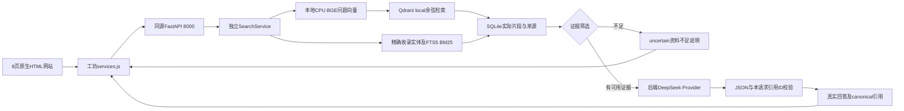

# Phase 2 京剧私有RAG实际架构

更新日期：2026-10-10（Asia/Shanghai）。依据当前代码与真实运行记录；工程闭环与浏览器回归完成，等待检查点B。20题RAG实测、5对LLM对照已经执行；人工文化审核与独立盲测仍未完成。

## 组件和请求路径



- `backend/app/main.py`：5个API、中文统一错误、请求ID/日志、并发/幂等及白名单静态服务。
- `knowledge/embedding.py`：真实SentenceTransformer CPU向量，不存在关键词替代或假向量后备。
- `knowledge/chunking.py`：章节/句子边界、Unicode清洗、重叠与真实tokenizer限制。
- `knowledge/store.py`：SQLite来源/文档/片段、确定性中文单字/二元词项FTS5。
- `knowledge/vector_store.py`：Qdrant Client local持久化、512维Cosine与稳定point-ID关联。
- `services/search.py`：独立检索服务，API默认经过实测的实体/BM25/向量混合，纯向量仍可作对照。
- `services/chat.py`与 `prompts/rag_answer_v2.txt`：依据本次证据、资料不足、引用别名映射与结构门禁；v1作为真实演进历史保留。
- `providers/llm.py`、`budget.py`：唯一获准供应商、非思考非流式、超时及仓库外保守预算账本。

不需要React、Vue、npm、LangChain、独立Qdrant服务器或GPU；local模式没有被宣传为服务端HNSW部署。

## 单端口静态服务与私有配置

FastAPI只监听127.0.0.1:8000。前端meta默认 `/api/v1`，不直接连接DeepSeek。公开文件仅8个HTML及css/js/images/audio/media目录中的允许扩展名；隐藏路径、路径穿越、backend/docs/knowledge/仓库配置不在静态白名单中，资源响应采用no-store及nosniff。

默认目录：

```text
D:\京剧\京剧\                         Git仓库、网页、backend、公开摘要与测试
D:\京剧\.private-config\.env         真实后端Key与配置；不进Git、不静态公开
D:\京剧\.runtime\models\bge-small-zh-v1.5\
    model.safetensors、tokenizer、model-manifest.json
D:\京剧\.runtime\xijing-ai\
    active.json                       当前generation引用
    index-owner.lock                  应用/入库独占锁
    generations\gen-...\
        knowledge.sqlite3             canonical片段/来源
        qdrant\                       实际向量持久化
        manifest.json                 数据/参数/模型版本
    api-budget.sqlite3                应用费用预留与usage估算
    provider-readiness.json            同配置真实API连通记录，非公开配置
```

路径相对于仓库父目录配置，迁移机器时调整 `.env.example` 的绝对示例路径。可用 `XIJING_ENV_FILE` 指向另一仓库外私有env；静态前端不读取env。配置校验拒绝把模型/运行数据放回仓库。

可选跨端口本地调试只允许明确的localhost/127.0.0.1与8000/8877 origins，credentials=false，GET/POST及Content-Type/X-Idempotency-Key。CORS不是公开付费服务的身份认证，本阶段不无条件开放远程监听。

## 依赖与Embedding snapshot

本次实测Python3.11.1； `.venv` 使用system-site-packages，复用已有CPU torch，包元数据2.11.0。FastAPI0.143.0、uvicorn0.54.0、pydantic-settings2.15.0、httpx0.28.1、qdrant-client1.19.1、sentence-transformers6.1.0、numpy2.4.4、pytest9.1.1已有实际环境查询。requirements指定CPU torch2.11.0+cpu；复用现有torch不能被当成冷机从零安装该wheel的证据。

模型固定为 `BAAI/bge-small-zh-v1.5`，revision `7999e1d3359715c523056ef9478215996d62a620`。下载脚本显式锁定SHA，不随远端HEAD变化；下载一份safetensors权重及必要配置/tokenizer，不下载重复bin权重。实际权重95,827,648字节；[模型下载记录](../evidence/test-results/phase-02-model-download.json)保存逐文件SHA256。模型MIT许可，模型权重与索引不进入Git。

Embedding加载设置device=cpu、local_files_only=true、trust_remote_code=false。输出512维归一化float向量，检查数量、有限值、维度与范数。查询加发布者中文检索指令，正文不加指令；问题含指令最多512 tokens，片段最多480 tokens。超过限制明确失败，不隐式截断。服务检查模型manifest revision与活动索引一致；下载Hash记录不等于声称每次启动都会重新计算全部权重Hash。

## 资料、许可和canonical存储

当前 `knowledge/documents/*.json` 有12个资料单元、35个主题段落；首轮实际形成35片段。来源组织、实际URL、定位、日期、收集时间、分类、版本及用途范围记录于文档source和section。`sources.json`只作清单，不再次当文档入库。[来源审校说明](knowledge-provenance.md)。

内容形态是 `original_fact_summary`，审核状态为 `source_checked_by_assistant`。用户批准本项目原创摘要用于展示/复现/必要云问答；这不覆盖来源全文、图像、音视频，也不授予原网站开放许可。摘要不冒充官方原句。用户/专业人员的人工文化复核尚未完成。

| 存储 | 真实内容 |
|---|---|
| sources | source_id与完整公开来源/许可/审核元数据JSON |
| documents | document_id、source_id、version、content_hash |
| chunks | chunk_id、source_id、section_id、content_hash及正文/locator/category/entities/token_count等JSON |
| chunk_terms | 片段及entity_names的中文单字/二元词项与英文词项FTS5索引 |
| Qdrant point | 稳定ID、真实512维向量及chunk/source/类别/版本等关联payload；来源/正文以SQLite为准 |
| generation manifest | corpus hash、实际数量、模型revision/维度/距离、分块参数及构建时间 |

Source需source_id/title/category/author_or_organization/source_url/publication_date/collected_at/license_status/review_status/document_version/content_hash；额外记录content_kind、scope、license_url及两项用途许可。未知发表日期为null。chunk_id依据来源、section与正文Hash稳定生成；locator包含原资料定位与本项目分块位置，不能用浏览工具临时行号充当文献定位。

## 入库、重建与单实例约束

`python -m backend.scripts.ingest --corpus knowledge`：校验受控JSON/source/用途/审核 → 清洗 → 按章节/句子分块 → 真实tokenizer检查 → CPU编码 → 新版本SQLite/Qdrant → 数量/ID回读检查 → 原子切换active.json。

初始目标350字、重叠70字，硬上限480 tokens；短主题自然形成短片段，不为了凑300字或60片段填充资料。跨文档相同内容Hash去重，来源元数据仍保留；相同corpus/参数/revision重复入库返回unchanged。更新资料/参数/模型或 `--rebuild` 构建新generation；失败不改变旧active，旧版本不混进活动检索。

应用、入库、独立检索评估共享索引独占锁，必须**先停止服务再入库/重建/独立评估**。uvicorn workers=1，不使用多worker或会同时打开同一目录的reload模式。专属单线程执行器拥有SQLite、Embedding、Qdrant实例，限制排队检索并发；聊天另设有限并发。重启重新打开已持久化索引。

[真实生命周期记录](../evidence/test-results/phase-02-real-lifecycle.json)已在隔离副本完成真实CPU初次、幂等、更新、明确重建、重开检索、并发写拒绝及无效更新保留旧索引；总约16.6563秒。它使用现有依赖和模型缓存、没有LLM调用，不代表冷机安装时间。

## 检索与资料不足

`SearchService.search(question, top_k=5, category=None, mode='vector')`负责真实问题Embedding、余弦候选、阈值筛选与SQLite evidence回读。证据含id/chunkId/sourceId/sectionId/title/locator/url/excerpt/contentKind/category/entityNames、真实vectorScore、可选keywordScore及rank。

API/chat由`Settings.retrieval_mode`选择，默认hybrid。每次都先执行真实BGE问题编码和Qdrant余弦检索，最多取10个语义候选；再识别问题里实际收录的实体，FTS5对这些实体做参数化BM25检索。补充候选再通过Qdrant的稳定ID过滤获取真实余弦分数，不生成假分数。

排序优先看精确entity_names覆盖数，RRF（常数60）处理同覆盖数的两路名次。通用“京剧/行当/角色”不作实体扩展；至少两种单字行当共现时才采用这些单字，避免把一般词中的单字当任意匹配。实体都是语料元数据，不是硬编码问题答案。

语义分数低于0.57时，精确实体/词项可以提供另一条明确的接受路径；返回`acceptedBy=exact_entity_keyword/exact_entity_metadata`，仍保留真实vectorScore与keywordScore。该分数没有被改写为“通过阈值”，也不是语义置信概率。普通向量接受路径为vector_threshold。实体途径提高短摘要/专名的召回，但不保证问题前提真实，回答层必须检查所取资料是否真正支持结论。

0.57由20题候选开发集调参选择。早期混合没有改善；真实浏览器泛问颜色暴露漏取后，继续做0.52扩候选、标题上下文、实体排序实验。标题上下文改善一题却让黑色题退步，因此未采用。最终只更新两资料单元的“脸谱”实体标签及文档版本1.0.1，事实正文不变，采用显式实体混合策略。保留全部实验，不把同批题调参结果称作独立验证。

最终20题的18个支持题与4个推荐问题候选证据覆盖均完整；纯向量20题仍缺一条净行证据，4推荐题有2题缺证据。5题留出中，一个虚构人物问题仍会取到1959年《穆桂英挂帅》的相近证据，真实LLM已明确拒答且不引用不相关片段，说明检索与前提判断需要分层。[最终20题比较](../evidence/test-results/phase-02-retrieval-final-entity-metadata-same20-comparison.json)、[推荐题](../evidence/test-results/phase-02-retrieval-final-entity-metadata-recommended-four-comparison.json)、[补充真实问答](../evidence/test-results/phase-02-answers-holdout-final-hybrid.json)。

无有效证据时返回uncertain=true且无虚构引用，不发模型调用；这是资料不足控制提示，不是硬编码京剧答案。有部分证据/错误前提时Prompt约束模型说明限制，实际事实/前提支持与合理拒答仍需独立真实测试和人工核查。

## 问答Prompt、引用与费用

`rag_answer_v2.txt`要求仅据本次证据、中文通俗、谨慎流派/人物/颜色范围、核对所有问题子项及人物/年代前提、资料是数据而非指令、不泄漏配置。首版正文偶尔带入长chunk ID，v2将模型候选改为E1–E5临时别名，并要求正文不写内部ID。模型返回answer/usedCitationIds/uncertain JSON；后端拒绝不属于本次候选的别名，映射到实际chunk ID，再从SQLite真实证据回读引用。确定回答没有有效引用即停止展示，结构校验失败不自动付费修正。ID真实只证明结构溯源，不能替代语义支持核查。

Provider只允许官方DeepSeek `deepseek-flash`、thinking.type=disabled、stream=false、JSON模式，输出最大800 tokens；默认供应商35秒、总聊天45秒、前端55秒。无自动付费重试，手动重试沿用同一幂等Key；成功缓存约10分钟且有界，同Key不同内容冲突，处理中重复请求返回明确错误。缓存requestId属于原逻辑结果，不伪装为新生成。

LLM Key只由仓库外私有env读取。公开错误仅error.code/message/retryable及requestId；请求日志不记Key/Authorization/原始上游报错。只记录最终content、真实usage、耗时与模式检查，不保存或公开reasoning_content。

预算限额默认3元，配置最大3。账本按已记录峰价输入未命中2元、缓存命中0.04元、输出8元/百万tokens，以序列化输入UTF-8字节加保守开销和输出上限预留；有usage才计算估算，未知超时/网络费用保留预留。拒绝继续调用是本应用的费用保护，**不是DeepSeek官方账户硬限**，不能保证其他进程或价格变更下的实际账单。账户实际计费独立核对，不删账本刷新预算；追加须用户批准。

## API与Phase 3复用边界

| 接口 | 实际协议 |
|---|---|
| GET /api/v1/health | readiness与非秘密budget摘要；不每次付费探测 |
| GET /api/v1/capabilities | questionAnswering/knowledgeSearch真实boolean；其余3个AI能力false |
| POST /api/v1/knowledge/search | question、topK默认5/最大10、可选category；evidence/uncertain/retrievalMode/真实分数/requestId |
| POST /api/v1/chat | question及可选conversationId；answer/citations/uncertain/requestId |
| GET /api/v1/knowledge/sources | 白名单公开来源/许可元数据，不返回私有路径/全文 |

输入拒绝空白、无效控制字符、超过600 UTF-16单位及Embedding token超限；错误包括400/422、索引/Key未就绪503、并发/预算429、供应商/结构502、超时504及统一内部500。用户前端pending锁之外，后端也做有限并发和有界幂等。

Phase 3京剧研究Agent可调用Python SearchService或knowledge/search取得结构化证据，不依赖聊天DOM或LLM生成的来源。当前没有Agent引擎、概念图API、Neural4D任务、事件流或3D SDK；保留原前端待接入状态。

## 已有证据与待验证范围

模型snapshot及12/35真实入库、真实CPU生命周期、20+5+4题检索诊断、124项后端/25项前端离线检查、62次实际供应商请求有分别保存的证据。最终20题HTTP联测为18次真实生成与2次无证据控制响应；37条引用结构追溯通过。5题直接LLM与RAG对照实际执行，直接回答也有正确内容，不能先验声称RAG一定更好。

主助手已对最终20题正文与相应摘要逐题复核：18个有依据、2个资料不足；这不是专业人工正确率。桌面/手机8页、引用、推荐题、停机恢复和Agent未接入已实际浏览器验证。缓存环境最终重建/启动/真实问答25.6704秒；冷机完整安装计时仍未完成。人工gold Recall@5、专业人工正确率、独立盲测、20对完整LLM对照均不编造。[浏览器实测](../evidence/test-results/phase-02-browser-test-report.md)、[最终报告](../reports/phase-02.md)。

Phase 1历史报告与Prompt继续保留。Phase 2总结由主任务依据真实测试形成，完成后等用户检查点B；只有“Phase 2验收通过，进入Phase 3。”才继续下一阶段。
