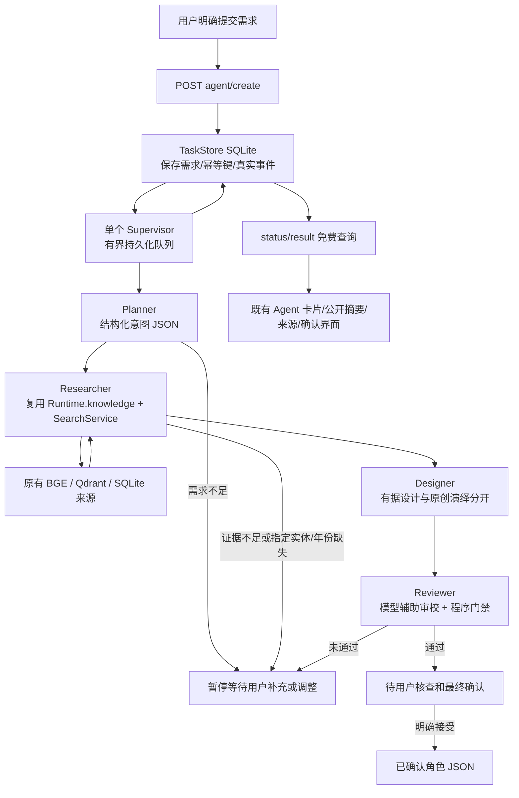

# Phase 3 京剧文化 IP 多 Agent 实现架构

更新日期：2026-10-11（Asia/Shanghai）。本文按现有源码说明实现边界；不是验收报告，不宣布 Phase 3 COMPLETE，也不以接口返回 200 代替文化质量评价。批准方案见 [检查点 A 方案](../reports/phase-03-agent-architecture-proposal.md)；实际测试、费用、失败和修复由阶段报告及原始证据分别记录。

## 1. 实现范围与继承

沿用八页静态 HTML、独立 CSS、ES Module、FastAPI、SQLite、BGE-small-zh-v1.5、Qdrant 本地持久化和唯一 DeepSeek Provider。没有新增 LangGraph、CrewAI、消息队列或独立向量服务。四个角色通过经过校验的结构化产物顺序协作，不是四个互不关联的聊天窗口。

Phase 2 的 `SearchService`、SQLite 来源与片段、512 维向量索引、问答接口及证据协议继续复用。研究角色直接调同一检索服务，不调用聊天接口让模型补资料；模型不能访问 shell、文件写入、任意网页或自主工具循环。

本阶段输出角色**文字设计和 JSON**，包括视觉提示词。概念图、Neural4D、三维查看器及模型下载仍未接入。用户草稿表单继续只整理页面内输入；新增的“提交 Agent 创作”才上传必要需求并启动真实任务。

## 2. 数据流和模块



| 文件 | 实际职责 |
|---|---|
| `backend/app/api/agents.py` | 五个任务 API、严格请求字段、任务操作参数及统一 requestId |
| `backend/app/agents/supervisor.py` | 生命周期、一个工作流消费者、队列调度、总期限及安全中断 |
| `backend/app/agents/store.py` | 任务、阶段、产物和递增事件持久化；事务状态转移、确认和取消 |
| `backend/app/agents/workflow.py` | 顺序交接、各阶段实际开始/结束、澄清/资料不足/审校门禁 |
| `backend/app/agents/schemas.py` | 计划、设计和审校的严格 Pydantic JSON 模型；证据别名与真实 ID 映射 |
| `planner.py`、`researcher.py`、`designer.py`、`reviewer.py` | 四个职责的独立实现及公开执行元数据 |
| `backend/app/providers/llm.py`、`budget.py` | 共用 Provider、全局模型并发、持久化累计及 Phase 3 增量预算 |
| `js/ai-workshop/agent-workflow.js` | 明确提交、恢复、有界查询、真实状态、结果/引用/确认及本地 JSON 导出 |
| `contracts.js`、`services.js`、`main.js` | 兼容问答协议；Agent 数据校验/API；隔离挂载与能力文案 |

## 3. 四角色的输入、输出和调用边界

| ID | 上游输入 | 实际产物 | 模型使用 |
|---|---|---|---|
| `planner` | 用户 requirements、style | theme、target、原 style、顺序 R1 起的 requirements、researchQueries、clarificationQuestions、requiredEntities | DeepSeek JSON；最多 384 输出 tokens |
| `researcher` | 计划中的必要文化查询、指定实体 | 实际 queries、证据、来源/片段版本与哈希、候选需求覆盖、limitations、knowledgeGeneration | 不调用模型；实际本地 RAG |
| `designer` | 原需求、已校验计划、本次研究证据和限制 | 严格角色 JSON，文化依据和原创元素分别标记 | DeepSeek JSON；最多 800 输出 tokens |
| `reviewer` | 原需求、计划、角色方案、本次证据和限制 | verdict、issues、suggestions、checkedEvidenceIds、needsHumanReview；程序检查摘要 | DeepSeek JSON；最多 400 输出 tokens |

正常四阶段路径只有三次模型生成。澄清或研究资料不足时，后续阶段没有执行；未执行的 Agent 保持 `pending`。JSON 无效、输出截断、超时或审校失败不会自动付费重试，也不循环“设计→审校”。用户调整需求后明确提交新任务，`parentTaskId` 关联前一版本，但不继承“事实已验证”的结论。

### 3.1 意图控制

Planner 保留原风格，验证 requirement ID 顺序、查询不重复。`requiredEntities` 只能逐字来自用户需求，不能把原创名称变成历史事实。当前还对用户明确提出的演员名称做窄范围文本提取，防止规划遗漏后用相似人物代替。

计划有 `clarificationQuestions` 时立即暂停；问题进入公开摘要，用户补充需求后重新创作。仅这个澄清路径允许 `researchQueries=[]`；没有澄清问题时必须至少有一个研究查询。theme/target 仍需非空，v4 Prompt 指导不足时写“待补充”，requirements 仍需至少一项。单字传统术语如“蟒”“靠”可以进入 requiredEntities，必须原文存在，不能擅自扩写成用户没有写的名称。Planner 不负责断言京剧事实、确认史实或生成来源。

计划校验失败不保存原始模型 JSON、异常字符串或用户输入到诊断。仅保存白名单契约字段路径/错误类型、经过过滤的实际 usage、模型、耗时、请求 ID、Prompt 版本与 hash；未知字段名改为 unknown_field。浏览器收到统一安全错误和阶段公开摘要，而不是原始 Pydantic 错误文本。

### 3.2 真实 RAG 研究

Researcher 对每个查询调用：

```python
await runtime.knowledge(lambda: _retrieve(runtime, question))
# _retrieve 在原有知识执行器线程中调用：
runtime.search_service.search(question, top_k=5,
                              category=None,
                              mode=runtime.settings.retrieval_mode)
```

不另开 SQLite/Qdrant Client、不重新加载 BGE、不向自身 HTTP 服务回调。每次查询检查证据 ID、实际片段和 sourceId 与 SQLite 一致，且来源必须 `external_llm_allowed=True` 才能进入云模型上下文。证据附来源版本、来源 content hash 和片段 hash。

计划查询与实体补查合计最多三次，最终最多五条证据；先保留指定实体的候选，再轮转取各查询命中结果。排序与分数仍由 Phase 2 检索服务产生，不能把候选覆盖叫作逐项事实验证。

当前 research policy v4 保留每次原始 uncertain、retrievalUncertain 和实际分数。初次候选缺少指定实体时，仅当实体确实存在于既有 SearchService.entities，且语料元数据有包含该实体的多字词，才允许相关实体补查；所有检索合计最多三次，没有额外 LLM 或硬编码文化事实。查询记录用 origin、expandedTerms、resolvedBy 和 effectiveUncertain 区分原查询不足与补查后的门禁；有效补查只能补齐对应缺失实体，不能绕过年份缺口或不相关的资料不足。仍缺实体或必需查询不足时暂停。词同现只表示候选覆盖，不证明人物、年份、服饰或整个用户前提真实；语义适用范围仍由辅助审校及用户复核。

### 3.3 角色设计结构

`CharacterDesign` 当前字段：

| 字段 | 源码约束和含义 |
|---|---|
| `schemaVersion` | 固定 `1.0` |
| `name`、`positioning` | 原创名称最多 24 字符，定位最多 120 字符 |
| `costume[]`、`colors[]`、`visualElements[]` | 每类 1～3 项；每项 description 最多 120 字符、interpretation、evidenceIds |
| `interpretation` | `evidence_based` 或 `creative`；有据项必须有引用，原创项引用必须为空 |
| `creativeElements[]` | 明确原创表达；最多三条 |
| `visualPrompt` | 最多 320 字符的文字提示词；不是生成图片或三维任务 |
| `usedEvidenceIds[]` | 1～5 个本次真实 ID，集合必须恰好等于有据元素实际使用的 ID |
| `limitations[]` | 最多三条限制；不能用一个笼统限制掩盖无依据的事实断言 |

模型上下文中的证据仅使用临时别名 `E1`～`E5`。后端校验后映射回本次真实片段 ID，不采用模型生成的标题、网址、定位或引文。未知、重复、不属于本次证据的 ID 会阻断阶段。模型输出的额外字段被严格 Schema 拒绝。

### 3.4 文化审校与误判边界

审校 verdict 为 `pass`、`needs_revision` 或 `insufficient_evidence`。非 pass 必须指出问题；pass 不能含未解决 issues，且 checkedEvidenceIds 覆盖设计所用证据。问题引用须属于已检查的本次资料。`needsHumanReview` 恒为 true，不打固定漂亮分数，不冒称专家认证。

当前 v3 设计/审校 Prompt 要求逐个核对设计断言及视觉提示词：净行脸谱或声音资料不能被当作具体服饰规范；文化事实与新增造型必须拆分；脸谱颜色不得被绝对化；相似人物/年份不能代替用户要求的事实依据。Reviewer 同时阅读 visualPrompt、creativeElements、limitations 和 interpretation；不能在已有明确原创/非传统声明时误报“未标注”，也不能凭偏好增添用户没有要求的条件。

当前还实现服饰引用窄范围守卫：有据服饰描述提到特定细节，而所引片段未包含对应词时，加入公开问题并将 verdict 降为 `needs_revision`。词表只用于检出引用缺口，不提供硬编码京剧答案；文字同现也不能证明语义、流派或版本适用。该检查不是完整的文化审校引擎。

首版真实脸谱创作曾出现“ID 合法但服饰证据不支持，Reviewer 仍 pass”的问题；原始记录保留在 [real-face-first.json](../evidence/test-results/phase-03/real-face-first.json)。v1 Prompt 未被删除，v2 增加断言核查与上述守卫。v2 辅助审校又出现原创已声明却被误报的情况，[real-face-v2.json](../evidence/test-results/phase-03/real-face-v2.json)保留原始结果，v3 Prompt 改为核对完整方案再定位真实遗漏，而不是对所有原创造型一概拒绝。是否改进以真实后续复测为准，不在架构文档填入最终测试数字或宣称幻觉已消除。

## 4. 状态持久化与恢复

默认文件为 `RAG_DATA_DIR/agent-tasks.sqlite3`，位于网站仓库以外。SQLite 短事务不跨越模型/RAG 调用；连接上下文在提交/回滚后通过 finally 明确 close，不将 `with sqlite3.connect(...)` 误认为会自动关闭连接。费用账本使用相同的明确关闭原则。

| 表 | 当前记录 |
|---|---|
| `agent_tasks` | UUID task ID、唯一幂等键、输入 hash、原需求 JSON、task 状态、sequence、currentAgent、confirmation、result、cancelRequested、时间 |
| `agent_steps` | task + agent 唯一；五种 Agent 状态、公开 summary、开始/结束时间和错误码 |
| `agent_artifacts` | task + agent + version；已校验结构化产物、content hash、时间；每个任务阶段一次产物 |
| `agent_events` | task + sequence 唯一；公开任务或 Agent 事件 |

当前 `runId=taskId`。Task 状态和 Agent 状态分别保存，不互换枚举：

| Task 状态 | 含义 |
|---|---|
| `waiting` | 已实际保存，等待调度 |
| `running` | Supervisor 已启动工作流 |
| `awaiting_confirmation` | 需求澄清、资料不足、修订要求或最终接受；由 confirmation.reason 区分 |
| `completed` | 四个阶段完成、审校通过，并已经用户明确接受 |
| `failed` | 实际阶段/工作流失败，中止后续执行 |
| `cancelled` | 取消已生效，没有继续后续步骤 |

Agent 状态继续使用 `pending/running/completed/failed/awaiting_confirmation`。阶段 `pending→running→completed/failed/awaiting_confirmation`；终止的阶段不会回到运行中。任务取消后，未执行阶段保持 pending，已完成阶段仍 completed。`completedSteps` 是实际 completed 阶段数量，不是模型思考进度或正确率。

每个事件 sequence 在 SQLite 事务中递增；Agent 事件 `kind=agent` 使用 agentId/state，Task 事件 `kind=task` 使用 taskState。公开内容只有状态、时间、摘要、错误码和确认标识，不记录隐藏思维链。

Supervisor 先获得独占的 `RAG_DATA_DIR/agent-tasks-owner.lock`，再执行恢复和启动消费者。第二进程未获锁时 diagnostic=`AGENT_TASKS_LOCKED`，工作者不 ready、能力为 false；它不得把第一进程仍在执行的任务错误地“恢复”为失败。任务锁与原知识库 index-owner.lock 各有职责，不能因为知识库加载失败就越过任务锁。

锁获得后，启动时将先前 `waiting/running` 任务标记 `failed`、错误 `WORKFLOW_INTERRUPTED`，保留完成阶段和产物，不重新执行可能已计费的模型请求。已结束或等待确认的任务继续持久化；浏览器刷新只凭 task ID 免费恢复查询。启动异常释放任务锁；FastAPI lifespan 的 finally 无论启动或退出成功与否，都先关闭 Supervisor，再在独立 finally 关闭 Runtime，避免部分启动留下线程/索引锁。

## 5. 五个 Agent API

所有接口采用既有统一错误 `{error:{code,message,retryable},requestId}`，requestId 表示本次 HTTP 请求；taskId/runId 表示持久化创作任务。读取失败任务的 status 仍可返回 HTTP 200，不能把读取成功当作创作成功。

| 方法与路径 | 请求 | 当前响应与行为 |
|---|---|---|
| `POST /api/v1/agent/create` | requirements、style；可选 parentTaskId；header `X-Idempotency-Key` | 202：taskId/runId/state/sequence/statusUrl/resultUrl/requestId；持久化后快速返回，不等待三次生成 |
| `GET /api/v1/agent/status/{task_id}` | 可选 `afterSequence`，0～2^63-1 | task 状态、四 Agent、完成阶段数、最多 50 个增量 events、lastSequence、confirmation、resultReady、cancelRequested、时间、requestId |
| `GET /api/v1/agent/result/{task_id}` | 无 | 设计/审校均存在时返回完整证据包；尚无方案为 409，不补造空 AI 结果 |
| `POST /api/v1/agent/confirm/{task_id}` | confirmationId、expectedSequence、`action="accept"` | 验证最终确认门禁，返回当前 status；不执行新模型调用 |
| `POST /api/v1/agent/cancel/{task_id}` | expectedSequence | 持久化取消意图并返回 status；等待/确认任务可直接取消，运行任务等当前阶段收尾 |

创建请求非空，最多 1200 个 UTF-16 字符单位；风格只接受现有 `京剧写意/国风幻想/舞台角色`，拒绝额外字段与非法控制字符。原有 HTTP body 最大 8192 字节。幂等键 8～128 个 ASCII 字母、数字、连字符或下划线。

同键同输入返回原任务，**可能已经 running、awaiting_confirmation、completed、failed 或 cancelled**，不是始终 waiting；同键异输入为 409。幂等记录跨重启保存，并在能力尚未就绪时也能找回已存在任务。不存在的 parentTaskId 为 404；已满队列为 429；服务未就绪为 503。默认 `AGENT_QUEUE_LIMIT=2`，waiting + running 总数不超过三个，单消费者实际只运行一个创作任务。

结果保留：`taskId/schemaVersion/design/review/citations/uncertain/publicationAllowed/userConfirmed/knowledgeGeneration/promptVersions/requestId`。引用沿用 Phase 2 的 `id/title/sourceId/locator/url/excerpt/contentKind`，由真实研究证据映射。

`confirmation.reason` 当前为 `clarification/insufficient_evidence/needs_revision/final_acceptance`。只有四阶段 completed、审校 pass、uncertain=false 且有完整方案时，canAccept=true。确认还要求匹配当前 confirmation ID 和 expectedSequence；旧页面操作为 409。afterSequence 和 expectedSequence 在后端限定 0～2^63-1，后者要求严格整数，避免超大 SQLite 绑定整数变成 500。前端进一步使用 JavaScript 安全整数范围。成功后 publicationAllowed/userConfirmed 才为 true。相同确认再次提交幂等返回原完成状态，不触发生成。

运行中取消先保存 cancelRequested=true，Task 仍 running；当前步骤回收真实产物和费用后停止后续调用，转 cancelled。无法声称撤回已送达供应商的请求或退回费用。已结束任务不能因迟到取消被改写。

## 6. 前端安全、幂等及查询

保留原工坊五个面板、聊天 DOM 和草稿逻辑。`agent-workflow.js` 隔离初始化；Agent DOM 不完整时不能阻断 Phase 2 问答。全部资源 import 链采用一致的 Phase 3 缓存版本。

`startAgentWorkflow(brief, {idempotencyKey})` 只调用 FastAPI，不访问供应商；另外有 getAgentWorkflowStatus、getAgentWorkflowResult、confirmAgentWorkflow 和 cancelAgentWorkflow。任务 ID 校验后组成本项目路径，不跟随响应中的任意 statusUrl/resultUrl。

创建响应丢失时，手动重试沿用**原需求与原幂等键**，即使输入框已编辑也不自动改请求；不会自动创建新任务。浏览器 sessionStorage 只保存当前 task ID，不存正文、模型输出或密钥；刷新不会重新提交模型。GET 确认保存的任务不存在时，清除失效标识，用户可明确发起新创作。

查询约每秒一次，前一次结束后才安排下一次，无重叠请求。单次请求 10 秒超时；自动查询最多 180 次或 240 秒，达到上限后保留最后状态，用户可手动免费查询。活动 Task 才查询，终止或等待确认时停止；页面隐藏暂停，返回时读取真实状态。`runId+sequence` 去重，快照不向旧序号回退；事件 cursor 取已收到事件序号，与用于确认的 lastSequence 分开，避免分页丢事件。

网络断开显示无法获取状态，保留上次实际 Agent 状态，不把通信失败画成 Agent failed，也不继续推进假进度。能力重查免费，不自动重发模型。进度仅显示 completedSteps/totalSteps。

设计、Prompt、摘要、问题和来源都用安全文本节点显示；HTTP(S) 来源链接拒绝带凭证或可执行协议，使用 noopener noreferrer。角色中的事实引用及审校引用须属于真实 citation 包；确定导出还检查四 Agent 完成、pass、无不确定性、用户确认及后端 publicationAllowed。没有图片占位冒充生成结果。

## 7. 模型与费用保护

沿用官方 DeepSeek HTTPS 和 `deepseek-flash`，明确 `thinking.type=disabled`、JSON 模式、不流式生成，供应商请求默认 35 秒。返回的模型/模式、内容完整性和实际 usage 会被检查，不保留 reasoning_content。

全站共用一个 Provider，聊天与三个生成角色共用最多两个在途模型名额；最多等候五秒，满载返回 LLM_BUSY，不无限排队。工作流默认总期限 150 秒，覆盖执行阶段、不含用户确认等待。各角色调用 ID 为 taskId:agentId，任务关联、实际 tokens、耗时、Prompt 版本/hash 写入公开执行元数据及本地账本；不记录 Authorization Header、Key 或私有配置。

`api-budget.sqlite3` 保留 Phase 2 原记录，增设持久化 `phase3` 范围及调用归属。每次调用在同一 SQLite 事务中保守预留，**同时检查累计 3 元与 Phase 3 增量 0.5 元**；Phase 3 配置启用后的所有 Provider 调用，包括普通问答回归，都占用该增量范围。重启不重置已用/预留金额，降低预算可收紧，不能用重启或新进程默默增大已保存范围上限。

成功调用按实际输入/输出及缓存 token 使用结算；鉴权等已知拒绝记为零生成费用；网络超时、取消或未知结果保留预留，不宣称免费。预算不足拒绝后续生成。估算依据代码记录的官方价格及核对日期，**应用层门禁不是供应商官方扣费上限**，最终账单以账户为准。

## 8. 本地运行与数据边界

当前为本地单用户比赛应用，应绑定 `127.0.0.1`、单 uvicorn worker。沿用 Runtime 单线程拥有 SQLite/BGE/Qdrant 和 index-owner 锁；不得多 worker、reload 复开索引或另进程同时修改本地存储。知识入库/重建前停止应用。

精确 CORS 只允许现有 localhost/127.0.0.1 的 8000/8877 来源；CORS 不是访问控制。当前 Agent API 没有公开部署所需的账户权限/完整限流体系，不应直接暴露到公网；公开部署需另行设计授权、费用和资料访问保护。

Key 保存在仓库外私有 `.env`，运行数据库、模型缓存、任务需求和产物在仓库外 `.runtime`；Git 只保留公开代码、Prompt 和明确测试案例的脱敏证据。静态服务仅白名单开放八页及已有资源目录，不挂载根目录，不公开 backend、docs、数据库或私有配置。

来源是项目原创事实摘要，不能在 UI 写成官方文章逐字原文。当前文化审核为助手对照来源与 AI 辅助审校，保留专家复核需求；有来源 ID 不等于每个语义断言已经正确。

## 9. 版本、证据与后续接口

当前角色采用 `agent_planner_v4/agent_research_v4/agent_designer_v3/agent_reviewer_v3`，保留此前 Prompt 文件与真实失败。研究角色是检索 policy，不伪造它的第四次模型对话。计划/研究/设计/审校的已校验产物分别持久化，不能用后续成功覆盖第一次错误。计划 Schema 失败可另存安全诊断产物，始终不含原始错误或原始模型文本。Prompt 原文、用户批准、真实修改及复测记录归档到 [Phase 3 Prompt 目录](../prompts/phase-03/)。

`backend/scripts/evaluate_agent_workflow.py` 每次明确执行一个真实案例，需 `--allow-paid`，不覆盖已有证据文件、不自动重试。pytest 与前端离线双桩测试必须与真实模型/HTTP/浏览器记录分别表述。最终测试数量、质量复核、API费用及用户阶段验收均以阶段报告为准。

Phase 4 可读取**已确认角色 JSON**中的 design.visualPrompt、文化引用、审校、userConfirmed 和 knowledgeGeneration，明确转换成后续图像生成需求。必须先生成或提供真实、允许使用的图片，才能进入未来 Neural4D 图生3D。Phase 3 不自动上传 JSON，不调用图像/三维服务，不把文字 Prompt 叫作概念图成果。
