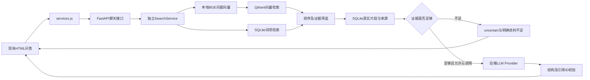

# Phase 2 京剧私有 RAG 技术选型与实施方案

- 日期：2026-10-09，Asia/Shanghai。
- 状态：**PROPOSED / AWAITING_CHECKPOINT_A_APPROVAL**。
- 当前只完成代码只读审查、环境查询、官方文档核实与方案归档。没有安装依赖、下载模型、创建知识库/数据库、修改功能代码或调用付费模型。
- Phase 1 基准：`04b2c571e068ec0b26205fcce0c075395caeebce`。
- 正式开发只在用户明确回复 **“Phase 2检查点A批准，开始RAG正式开发。”** 后开始。

## 1. 实际项目与 Git 审查

工作区审查开始时干净，HEAD 与指定 Phase 1 提交完全一致；当前分支 `feature/ai-workshop-phase1`，六次原始提交仍在。origin 是用户提供的 GitHub 仓库。此前实际 `git ls-remote --heads origin` 成功确认远端 `main` 和 `feature/ai-workshop-phase1` 均指向同一验收提交。第一次沙箱查询遇到 DNS 失败；获准的只读外网查询成功，最后一次复核又遇到连接重置，说明网络存在波动。没有 fetch/pull/push 或修改 Git，也不能以 GitHub 可访问推断模型 API 可用。

[GitHub 仓库](https://github.com/3503799261-blip/xijing_ai) 当前可匿名访问，标为 Public。Phase 1 README 中“无远端”的表述是当时记录，已经不适合作为当前仓库状态依据；本次不改写历史阶段报告。

已读取实际 about、工坊CSS、三个模块、接口文档、README、Phase 1报告、环境模板与忽略规则。主要发现：

| 文件与位置 | 实际能力 | Phase 2 最小衔接 |
|---|---|---|
| about.html:11、285 | 独立CSS及ES Module入口；8页结构保留 | 继续加载本页专属代码，更新资源缓存版本 |
| main.js:1、154–170 → services.js:22–24 | `askOperaQuestion({question})` 忽略请求，只返回UnavailableResult；没有fetch | 保留函数名，改为调用项目后端，不访问供应商 |
| contracts.js:49–70 | Citation、QuestionRequest、QuestionAnswer已用JSDoc约定，无运行时验证 | 保留answer/citations/uncertain/requestId；补运行时校验与错误类型 |
| about.html:120–144 | 消息log、加载、错误、状态与引用侧栏均存在 | 实际等待才显示加载，增加助手回复与可展开真实引用 |
| main.js:136–170 | 安全文本、最多12条用户消息；无请求锁/超时/助手消息 | 加pending锁、完整回合上限、请求标识与引用归属 |
| services.js:4–5、contracts.js:22–27 | 同步能力查询返回冻结全false；main未调用它 | 保留同步缓存接口，新增异步能力加载，按后端真实就绪结果更新 |
| main.js:172–204、about其他区 | 用户临时草稿、Agent原生详情、3D空态实际可用 | 原样保留，其他三AI能力继续false |
| CSS:497–568、638–654 | 消息滚动、长文本折行、换行、错误色已具备 | 仅追加助手、引用与不确定性样式，使用ai-workshop命名空间 |
| .env.example、.gitignore | 模板只有Phase 1说明，.env/.venv已忽略，运行索引规则尚无 | 批准后增加后端配置与运行数据排除，不写前端密钥 |

当前问答是前端服务说明，不能当成已接入RAG。旧loading和引用位置尚未被真实服务驱动。代码与基准字节比较、实际命令结果另存 `docs/evidence/test-results/phase-02-code-audit.json`；没有沿用旧浏览器结果冒称本阶段已通过。

环境实际查询：Python3.11.1、SQLite3.39.4且编译支持FTS5、Node24.15.0、Git2.56.0.windows.1；32逻辑CPU、约31.8GiB内存，D盘剩余约209GiB。未核实GPU，推荐固定CPU方案。CIM查询在沙箱失败，随后用Python标准库读取CPU/内存；没有变更机器设置。当前Python的pip查询发现torch2.11.0，但未验证其推理；FastAPI、uvicorn、pydantic、httpx、qdrant-client、sentence-transformers等尚未安装到该解释器。正式开发使用隔离环境，不复用未经验证的全局依赖。

## 2. 推荐架构与两种部署方案比较

推荐 **FastAPI + SQLite/FTS5 + Qdrant Client本地持久化 + BGE-small-zh-v1.5 CPU + 单一LLM供应商**。首版不引入LangChain、LlamaIndex、Reranker、Redis、Docker或独立数据库服务。

| 比较维度 | A：推荐轻量本地方案 | B：PostgreSQL + Qdrant独立服务 |
|---|---|---|
| 一周周期 | 主要时间用于资料/检索/引用/测试 | 额外服务、迁移、网络、备份调试 |
| 原生静态前端 | 同一FastAPI可白名单提供8页，与现有fetch接口对接 | 前端方式相同，后端运维更多 |
| Windows | Python3.11隔离环境，无GPU要求 | Qdrant服务需容器/服务部署，Windows卷和WSL须验证 |
| 模型可用性 | 本地Embedding独立于LLM账号；LLM仍须真实权限 | 依然需要Embedding与LLM，数据库不能解决账号问题 |
| 京剧词语质量 | 中文语义向量 + 人物/剧目词项检索，凭测试调优 | 可加服务端索引/Reranker，但不会自动获得文化质量 |
| 安装与初始化 | 模型及CPU依赖首次下载是主要成本 | 增加数据库/镜像/端口/账号初始化 |
| 测试难度 | 少量组件，可逐层定位 | 额外服务失败与数据一致性测试 |
| Phase 3复用 | 独立SearchService/Python方法与search API | 多实例/多人访问更方便 |
| GitHub复现 | 无Docker；有缓存时启动简短 | compose/卷/迁移/多个服务要求更多 |
| 隐私边界 | 资料和向量在本地；仅问题和获准top-k证据发给LLM | 自托管也可本地，但增加服务凭证与权限边界 |

Chroma本地 `PersistentClient` 同样可持久化并接收显式Embedding，是可行备选；本项目优先Qdrant Client以保持清楚的向量操作与未来服务端迁移路径。以上风险/时间是工程判断，尚未安装两种存储作本机性能对比。[Qdrant官方客户端](https://github.com/qdrant/qdrant-client)、[Chroma客户端](https://docs.trychroma.com/docs/run-chroma/clients)。

Qdrant **local模式做真实余弦向量检索，但不是服务端HNSW部署**。30–60片段适合其小规模用途；目录有独占锁。方案限定单uvicorn worker、一个长期Qdrant实例，入库离线运行，先停应用；禁止多个进程共享同一活动目录。后端使用专属单线程执行器拥有SQLite连接、Embedding与Qdrant实例，避免跨线程滥用连接。[本地实现与文件锁](https://github.com/qdrant/qdrant-client/blob/master/qdrant_client/local/qdrant_local.py)。

## 3. Embedding选型、维度与下载条件

采用发布者的 `BAAI/bge-small-zh-v1.5`，明确中文、MIT，512维；配置和tokenizer上限512 tokens。规模约24M参数为发布配置推算，不是本机加载核计。单safetensors权重约95.8MB，模型仓库约192MB包含重复bin，下载只取必要配置/tokenizer/一种权重，不盲目整仓双下载。[模型卡](https://huggingface.co/BAAI/bge-small-zh-v1.5)、[配置](https://huggingface.co/BAAI/bge-small-zh-v1.5/raw/main/config.json)、[文件清单](https://huggingface.co/BAAI/bge-small-zh-v1.5/tree/main)。

CPU float32，归一化向量，余弦距离；通过SentenceTransformers显式指定设备和模型。短问题采用发布者的检索query指令，文档正文不加指令。批准后固定实际下载revision与文件Hash，记录实际CPU延迟；当前没有模型下载、Embedding调用或速度测试结果。[发布者检索用法与阈值说明](https://huggingface.co/BAAI/bge-small-zh-v1.5)。

分块以约300–400汉字为初始目标、重叠约60–80字，但**实际tokenizer硬限制正文约480 tokens**，长段按句子再拆，短段不填充凑数。600字不等于600 tokens。前端维持600 UTF-16 code units兼容上限，后端统一该长度规则，并额外检查问题加query指令后的token长度；过长明确返回缩短提示，不静默截断。此限制与测试题须写入界面帮助。

BGE的相似度不是置信概率；不能直接用“>0.5”宣称资料充分。根据京剧正例、混淆例和资料外问题校准阈值，并将模型revision、分块参数、校准集版本一起保存。初期不用大型Embedding或Reranker。LLM的兼容聊天接口不代表支持Embedding；本方案不依赖供应商Embedding端点。

首次安装还包含PyTorch CPU wheel及传递依赖，95.8MB不是全部下载量；尚无下载速度/首次安装时长实测。已有依赖和模型缓存时争取十分钟复现，首次空环境不承诺十分钟。[PyTorch Windows安装](https://pytorch.org/get-started/locally/)、[SentenceTransformers模型配置](https://sbert.net/docs/package_reference/sentence_transformer/model.html)。

## 4. LLM选择、真实权限与费用

**暂推荐DeepSeek官方API的 `deepseek-flash`，非思考、非流式问答。** 本次官方文档显示该别名对应V4.1-Flash，base URL为 `https://api.deepseek.com`，聊天使用 `/chat/completions`；不是沿用旧印象写死deepseek-chat/reasoner。显式 `thinking.type=disabled`，避免默认思考增加延迟；JSON模式要求response_format及Prompt中的json指示，且官方提示可能出现空内容，因此必须验证返回。[当前官方接入](https://api-docs.deepseek.com/)、[思考开关](https://api-docs.deepseek.com/guides/thinking_mode/)、[JSON模式](https://api-docs.deepseek.com/guides/json_mode/)。

用户账号、Key、余额及网络调用权限尚未确认，**没有实际API调用成功证据**。已通过文本问题询问可用平台，不要求发Key。获批后先在本地配置做小额真实连通/JSON测试，记录model、最终回答、usage、延迟和结果；失败则诚实阻断LLM验收，不用固定答案替代。若用户只具备百炼权限，可改为用户实际有额度的Qwen型号及地域端点，先核实再单独接这一家，不同时实现多供应商。[百炼模型及地域价格](https://help.aliyun.com/zh/model-studio/model-pricing)。

按本次DeepSeek中文官方价目，Flash缓存未命中输入空闲/高峰为1/2元每百万tokens，输出4/8元；缓存命中输入0.02/0.04元。预算保守使用高峰且不假设命中缓存。假设每次3000输入、800输出，单次约0.0124元，50次约0.62元；这是估算，不含额外重试/迭代，实际以返回usage和账户计费为准。价目和别名可能变化，首次调用前再次核实。[官方价目](https://api-docs.deepseek.com/zh-cn/quick_start/pricing/)。

LLM Provider只提供服务端结构化生成接口；不向浏览器传Key、系统Prompt、供应商原始异常或reasoning_content。需要记录的是真实最终输出和用量，不收集隐藏思考链。

## 5. 真实资料候选与许可审核

首版目标约10个独立资料单元、30–40个有效片段；8–15/30–60为目标范围，不为数量复制重复内容。以下页面经只读研究列为**候选**，还没有入库或标记approved：

| 候选来源 | 组织 | 主题与真实定位 |
|---|---|---|
| [京剧非遗名录](https://www.ihchina.cn/project_details/13201) | 中国艺术研究院/中国非遗保护中心 | 项目简介：形成、声腔、行当、剧目；公布日期与文章日期分开 |
| [形成于哪个朝代](https://www.cnpoc.cn/cnpoc/gjkt/200902/b849c852b5944d1792780a669311a1ab.shtml) | 国家京剧院 | 形成过程；具体年代需要交叉核查 |
| [京剧行当](https://www.ncfta.gov.tw/cp.aspx?n=1774) | 国立传统艺术中心 | 行当介绍、长靠/短打武生等条目 |
| [净行小讲堂](https://www.cnpoc.cn/cnpoc/gjkt/202505/1429cdcaf7384ed985ac6b90b8af2309.shtml) | 国家京剧院 | 正净、副净、武净条目与角色实例 |
| [旦行小讲堂](https://www.cnpoc.cn/cnpoc/gjkt/202510/a326678b61884605ab9ed5bf511a83e8.shtml) | 国家京剧院 | 青衣、花旦、刀马旦、花衫、武旦、老旦 |
| [京剧脸谱](https://www.cnpoc.cn/cnpoc/gjkt/200807/f1f8824fe1f4433a8f95a53f8e9278fa.shtml) | 国家京剧院 | 分类与色彩、主色和副色条目 |
| [包公为什么画黑脸](https://www.cnpoc.cn/cnpoc/gjkt/200902/09f53e26870c4beb84b4f6ddad52fda2.shtml) | 国家京剧院 | 扮相、月牙及颜色的不同用途 |
| [服装与人物身份](https://www.cnpoc.cn/cnpoc/gjkt/200902/6e64e9feb4274a109d5211075c533bcd.shtml) | 国家京剧院 | 褶/蟒/披/靠/衣、靠旗与身份变化 |
| [霸王别姬](https://www.cnpoc.cn/cnpoc/mbb/200806/2c0fcc00d04849efa36386594e273bae.shtml) | 国家京剧院 | 剧目简介中的项羽、虞姬与舞台故事 |
| [穆桂英挂帅](https://www.cnpoc.cn/cnpoc/mbm/200806/677c0bbf8a594b35901c47ea19f50a03.shtml) | 国家京剧院 | 主创/剧目简介；版本单独记录 |
| [三岔口](https://www.cnpoc.cn/cnpoc/mbs/200806/aa3b20102b2548378a92ccc640c25eb2.shtml) | 国家京剧院 | 剧目简介、任堂惠/刘利华/焦赞 |
| [Peking opera](https://ich.unesco.org/en/RL/peking-opera-00418) | UNESCO | 候选名录页；本次正文直接访问遇验证，未确认采集成功或许可 |

国家京剧院、中国非遗网、国立传统艺术中心均有版权条款，不能视为开放语料库。逐份记录署名、原始组织、授权范围和云调用/公开再分发条件。短摘录或改写本身不自动获得授权。[国家京剧院声明](https://www.cnpoc.cn/cnpoc/bqsm/public_detail_1.shtml)、[中国非遗网声明](https://www.ihchina.cn/about/206.html)、[传统艺术中心声明](https://www.ncfta.gov.tw/cp.aspx?n=1769)。

优先使用用户拥有权利/授权的资料、明确开放许可内容，或经过来源交叉核查且允许使用的项目事实笔记；不批量转载全文、照片、音视频或书籍。事实笔记标 `reviewed_fact_note`，来源摘录标 `source_excerpt`。前端展示“入库事实笔记/资料摘录”，不能把自己整理的摘要称作原网页原文。未确认许可/未完成文化审校的资料不参与生成。知识库留在本地不等于可以将受限内容发送给云LLM。

真实审校风险：形成过程的不同官方文章表述不完全一致，需要区分徽班进京与逐渐形成；同名剧目的教材介绍和舞台简介可能不同，不能拼成唯一版本。[刘长瑜文章](https://www.cnpoc.cn/cnpoc/gcjy/202506/65ccbd3907db40ea91939709392ccf14.shtml)、[穆桂英教材介绍](https://www.cnpoc.cn/cnpoc/gjkt/200807/5c24a8f8170a4689b42c37c8b2ea7a8b.shtml)。脸谱颜色使用“常见表达/具体角色与版本”的范围说明，不设绝对人格映射。Phase 1宣传文案也不自动当作权威已审核资料。

## 6. 数据结构与存储边界

输入采用受控JSON，每个资料单元包含source元数据与sections数组，便于标准库解析、Pydantic校验和章节分块。首版不安装PDF/OCR/任意网页爬虫。需要这些格式时另评估，不先造复杂解析框架。

| 实体 | 必须字段/约束 |
|---|---|
| Source | source_id、title、category、author_or_organization、source_url、publication_date（未知null）、collected_at、license_status、review_status、document_version、content_hash |
| 许可与范围扩展 | license_url、redistribution_allowed、external_llm_allowed、content_kind、scope、version_notes、reviewer及审核日期；未知许可不变成true |
| Document | document_id、source_id、version、content_hash、sections；内部文件路径不出现在公共API |
| Section | 标题、真实locator、content、entity_names、content_kind；来源页面持久定位不用浏览工具临时行号 |
| Chunk | chunk_id、source_id、document_id、content、section、locator、category、entity_names、content_hash、token_count、document_version |
| IndexGeneration | generation_id、模型ID/revision/维度/距离、分块参数、资料清单hash、实际数量、校准版本、构建结果 |

SQLite保存sources/documents/chunks与FTS5词项索引；Qdrant point采用稳定UUID映射chunk_id，payload仅存chunk_id/source_id/版本等关联字段，正文及来源以SQLite为准。有效片段必须能由ID反向找回。

推荐运行数据放项目外 `D:\京剧\.runtime\xijing-ai\`，版本目录内有SQLite、Qdrant及manifest；实际密钥配置放项目外 `D:\京剧\.private-config\xijing-ai.env`，由后端明确路径加载。允许公开的资料单元及测试题才进Git；模型权重、索引、缓存、真实Key、受限原始资料、敏感日志不进仓库。

## 7. 文档入库与索引维护

1. 校验JSON、分类和来源/许可/审核状态；无效、未审核或缺必要元数据拒绝，记录原因。
2. UTF-8规范化、去空白/无效段，计算真实Hash；相同来源版本重复执行返回skipped，不重复插入。跨来源相同内容保留来源关联，不膨胀成重复证据。
3. 按原章节/段落/句子分块，token检查及明确重叠；稳定chunk_id来自来源/定位/标准化内容Hash。
4. 本地真实BGE编码，检查向量512维、有限值、归一化；写新版本SQLite和Qdrant，验证向量与片段ID一一对应。
5. 校验构建结果后原子切换active manifest；失败保留原活动版本，不对正在打开的目录删改。不在线热重建本地共享实例。
6. 文档改动或模型/分块参数变化重建新generation；去掉已撤回来源的活动片段，旧版本用于证据回溯，不在活动检索中重复出现。
7. 每次入库记录added/updated/skipped/failed数量、错误与耗时；新环境提供同一命令重建。应用与入库脚本不能同时占用本地目录。

拟提供 `python -m backend.scripts.ingest --corpus knowledge/ --rebuild`；这是批准后实现的命令设计，目前不存在或未运行。

## 8. 检索、拒答与可复用服务

独立 `SearchService.search(question, top_k, filters)` 完成校验、真实问题Embedding、Qdrant余弦候选检索、词项候选检索、排序/筛选及SQLite证据回读；聊天只调用此服务，不把整库塞进Prompt。

先建立纯向量基线，再比较轻量混合。FTS5默认分词不能直接胜任无空格中文：拟用确定性中文字/二元词项及审核的entity_names建立专用索引，用相同处理查询，参数化MATCH、限制候选数，不把用户字符串直接作为搜索语法。RRF按两路名次融合，保留vector_score、keyword_score、rank、retrieval_mode；融合分数不伪装成语义置信度。[SQLite FTS5与BM25](https://www.sqlite.org/fts5.html)。混合策略是否保留由检索对照结果决定。

只使用许可/审核允许的活动资料；阈值根据标注集校准。空结果/低支持度/关键实体或问题前提无法核实，返回明确资料不足，`uncertain=true`，引用为空或仅保留实际相关支持证据。该状态提示是控制流程，不是硬编码京剧答案。不存在人物、只部分覆盖的问题、过宽的问题分别测试；单纯向量排名不能保证识别所有错误前提。

检索API可无LLM Key独立运行；Phase 3京剧研究Agent复用Python服务或 `/knowledge/search` 的结构化证据，不需要浏览器聊天记录，也不在本阶段开发Agent引擎。

## 9. 基于证据的Prompt与引用验证

保存可版本化 `rag_answer_v1`：检索材料是数据而非指令；仅据支持内容解释、中文清楚、说明剧目/流派范围、不编来源、证据不足说明限制、不泄露配置；仅允许本请求候选引用ID。

模型内部返回结构化answer、usedCitationIds、uncertain（必要时补分句对应的引用ID）；后端检查JSON、类型、长度、空内容/截断、引用ID是否属于真实检索集合。来源标题/URL/locator/excerpt由SQLite组装，不采用模型编造的文献信息。无有效引用却声称确定回答、越权ID等作为校验失败处理，不悄悄丢弃坏引用后继续展示确定答案。

对浏览器仍返回既有 `answer/citations/uncertain/requestId`；Citation保留id/title/sourceId/locator/url/excerpt，可加contentKind。ID存在性验证不等于语义支持正确，回答事实和引用支持度仍须人工核查。Prompt注入、无证据杜撰、版本混淆列入实际测试。

Prompt变更记录版本、真实改动原因、测试runId及Commit；失败API/模型输出不删掉，不预先写出漂亮结果。必要的离线故障测试明确标test double，不当作真实LLM调用或比赛输出。

## 10. FastAPI接口与安全配置

| 方法/路径 | 拟实现行为 |
|---|---|
| GET /api/v1/health | 状态、索引/Embedding/LLM readiness；无配置值/堆栈，不每次触发付费探测 |
| GET /api/v1/capabilities | questionAnswering只有Embedding、索引与真实LLM连通检查就绪才true；其余三能力永远false；可附knowledgeSearch与checkedAt |
| POST /api/v1/knowledge/search | question、topK（默认5且上限10）、可选分类 → requestId、evidence[]、检索方式/分数、资料不足状态 |
| POST /api/v1/chat | question、可选conversationId → 兼容QuestionAnswer |
| GET /api/v1/knowledge/sources | 可公开来源元数据/许可/版本；不包含服务器文件路径或受限全文 |

连续提问首版均独立检索，不承诺已具备持久对话记忆。conversationId可兼容保留为会话标识，但没有实现的语义记忆不能写成已完成。

错误统一为 `{error:{code,message,retryable},requestId}`，中文message不泄露异常详情。400输入/Embedding长度超限、422结构错误、503索引或配置缺失、429额度/并发、504上游超时、502供应商/模型结构错误、500内部错误；无有效检索是业务结果，通常200且uncertain=true。

后端默认45秒总请求预算（含排队），前端约55秒超时；最多一次有条件重试（连接建立失败或可明确处理的429），读超时不自动重发聊天，避免重复计费。专属执行器使用有界队列；异步超时不会自动终止同步Embedding，超时后不重提同一任务。增加pending锁及服务端有界幂等缓存，按一次逻辑提交的X-Idempotency-Key和内容Hash防双击；同Key不同问题拒绝。并发/请求数设低上限，日志只记录requestId、状态、耗时、模型名、usage和检索ID，禁止记录Key/Authorization。

**推荐同源单端口运行**：FastAPI仅白名单提供8个HTML与css/js/images/audio/media目录，浏览器默认相对 `/api/v1`，前端和后端均使用8000。不将整个项目目录挂成静态根，不暴露backend、.git、env、索引或私有资料。尤其不能在配置真实密钥后，继续用Python HTTP Server把含密钥/数据库的整个目录暴露。密钥和运行数据放项目外，双重避免这种风险。

如需要独立前端调试，使用白名单静态服务8877，meta配置公开的后端URL；精确CORS仅 `http://127.0.0.1:8000`、`http://localhost:8000`、`http://127.0.0.1:8877`、`http://localhost:8877`，无通配符，credentials=false、限定方法，headers白名单包含Content-Type与X-Idempotency-Key，并测试跨端口预检。[FastAPI CORS](https://fastapi.tiangolo.com/tutorial/cors/)。本地绑定127.0.0.1；CORS不是身份认证。公开部署须另做HTTPS、鉴权/费用和频率保护，不在本阶段无条件暴露付费接口。

## 11. 现有问答页面最小修改

- services.js：保留askOperaQuestion签名，增加fetch/AbortController、HTTP/JSON校验和统一错误；同步getServiceCapabilities保持缓存语义，新增异步loadServiceCapabilities。
- contracts.js：补成功/资料不足/错误/能力响应校验；原四能力初始false，其他三个服务保留UnavailableResult。
- main.js：只改问答相关函数，提交前pending锁，禁用发送，实际请求期间显示loading，finally恢复；用户与助手节点用textContent。历史最多12个完整回合，避免只删用户留下孤立答案。
- 每个助手回合绑定requestId和独立引用details；侧栏明确当前对应回答，失败不沿用上一题引用。引用URL仅允许http/https、拒绝凭证/不安全协议，新窗口加noopener noreferrer。
- about.html：复用现有ID及data-service-state，同步更新状态徽章和相关ARIA状态，调整“所有AI未接入”等涉及问答的文案为真实动态状态；初次连接失败后可重新加载能力，服务恢复时不被旧false缓存永久禁用。其他区的未接入与草稿说明保留。原7文化页不改主体。
- CSS：仅ai-workshop助手消息、引用卡与不确定提示，复用酒红/金/米白、长文本换行和移动断点。
- 缓存：整条module import链统一版本策略或明确禁缓存头，不只给main/CSS版本而留下旧services/contracts。

## 12. 依赖与需要用户提供的条件

拟依赖：fastapi、uvicorn、pydantic-settings、httpx、qdrant-client、sentence-transformers、PyTorch CPU及其必要依赖；测试pytest。SQLite、Hash、JSON等用标准库。不使用前端SDK、Markdown HTML渲染库或供应商Embedding SDK。

批准后在Python3.11隔离环境验证兼容并锁定实际版本；现在不填虚构“已验证依赖版本”。使用官方CPU wheel来源和发布者模型，记录下载文件/许可，不关闭TLS或改系统安全设置。

批准后拟在 `.env.example` 说明下列后端配置；当前不写入真实配置：

| 配置 | 拟定用途/值 |
|---|---|
| LLM_API_KEY | 留空示例，真实值仅在本机私有env |
| LLM_BASE_URL、LLM_MODEL | 暂定 https://api.deepseek.com、deepseek-flash，按真实账号核实 |
| EMBEDDING_MODEL、EMBEDDING_REVISION | BAAI/bge-small-zh-v1.5及正式下载后固定的revision |
| RAG_DATA_DIR | 项目外运行目录，包含活动generation与索引 |
| ALLOWED_ORIGINS | 第10节精确本地白名单；不使用通配符 |
| LLM_TIMEOUT_SECONDS | 纳入总请求预算的供应商超时，实际验证后确定 |

私有env路径通过启动参数或进程变量明确指定，不让前端读取。API地址是公开配置，Key不是。

需要外部条件：

1. 用户说明可用供应商、模型/地域权限和额度；真实Key仅在本机项目外私有env配置。没有Key时可验证真实入库与检索，但不能通过真实LLM验收。
2. 模型权重及Python依赖的下载连接；无法下载则不能用词匹配伪装向量。
3. 可用于本项目且允许必要云调用的资料，或用户持有授权的资料；许可不明确的记录pending，不能为了规模强行入库。
4. 20题黄金证据及回答正确性人工核查。可先准备来源核查的候选标注，再请用户确认；未完成人工标注时不能宣称有有效人工Recall@5或人工正确率。

计划环境字段：LLM_API_KEY（空）、LLM_BASE_URL、LLM_MODEL、EMBEDDING_MODEL、EMBEDDING_REVISION、EMBEDDING_DEVICE、RAG_DATA_DIR、ALLOWED_ORIGINS、LLM_TIMEOUT_SECONDS、LLM_MAX_OUTPUT_TOKENS。另由启动环境指定私有env文件路径，不能给浏览器加载.env。阈值存在校准配置中，不预填未经测试的“安全分数”。

## 13. 测试、对照实验与验收指标

测试集至少20题：基础6、行当/人物5、脸谱/服饰4、多片段3、无依据/错误前提2。每题保存真实source/chunk证据标签、预期事实、版本适用范围及拒答预期。人工确认标注与被测LLM输出分开；缺标注的题不算Recall分母。可另加少量调参题，避免在最终评估题上反复调优却宣称独立测试。

| 检查 | 计划证据与验收方式 |
|---|---|
| 入库 | 实际Embedding非零512维、持久化后可重启回读；重复入库数量不增长；资料变更重建、撤回旧活动片段、失败保留旧版本 |
| 检索 | ≥20题向量/混合候选和分数；来源ID与实际片段一致；有人工标注证据集才计算Recall@5 = 每题top5命中正确证据数/该题正确证据数的平均；仅统计有正确证据的题，空证据题单列拒答指标，公开纳入题数 |
| 生成 | 真实Provider调用、usage/耗时/失败；引用ID有效与来源映射100%是结构门槛，语义支持另人工核查 |
| 拒答 | 无依据题不编来源；计算明确预期集合中的合理拒答率，不能用拒掉所有问题提高指标 |
| A/B | 同一LLM/问题与输出预算：普通LLM vs RAG；记录事实正确、来源可验证、无依据内容、平均延迟、token/费用，保存原始差的结果 |
| API | 5接口、空/超长、缺Key、未初始化、锁冲突、超时/429/5xx、错误JSON/引用、注入资料；离线故障注入与真实调用单列 |
| 前端 | 真实发送/回答/引用展开、连续提问、双击仅一次、断网/后端停机恢复、无旧引用串题、1920与手机、8页回归、控制台/资源/截图 |
| 安全/复现 | 静态白名单拒绝.env/.git/backend/私有数据及路径遍历；Git不含Key/索引；冷/热启动计时并标明缓存、权限、网络条件 |

必须报告引用有效率、人工回答正确率、合理拒答率、API成功率、平均响应时间；目标不是预先承诺漂亮数字。可暂定“Recall@5争取≥0.8、人工事实正确率争取≥0.9”为调优方向，但是否满足应用需据真实结果/问题分布评审，不能将目标写成测得值。无依据/虚假引用/阻断错误属于验收缺陷，即使平均分高也要修复。

本检查点以上全部是**测试计划**，尚无Phase 2数值结果、真实LLM回答或浏览器接入截图。

## 14. 预计新增及修改文件

| 范围 | 预计文件 |
|---|---|
| 后端应用新增 | backend/app/main.py、config.py、schemas.py、errors.py、static_frontend.py |
| 数据与服务新增 | backend/app/knowledge/store.py、chunking.py、embedding.py、vector_store.py；backend/app/services/search.py、chat.py；backend/app/providers/llm.py |
| 实际系统Prompt新增 | backend/prompts/rag_answer_v1.txt及版本记录 |
| 工具新增 | backend/scripts/ingest.py、check_provider.py、evaluate.py；如需独立8877调试，scripts/serve_frontend.py白名单服务 |
| 可公开语料/标注新增 | knowledge/sources.json、knowledge/documents/*.json、knowledge/evaluation/questions.json及来源/许可说明；受限资料不进Git |
| 依赖与测试新增 | backend/requirements.txt及验证后的锁定清单、backend/tests/接口/入库/检索/引用/安全测试 |
| 原前端修改 | about.html、css/ai-workshop.css、js/ai-workshop/main.js、js/ai-workshop/contracts.js、js/ai-workshop/services.js |
| 文档配置修改 | README.md、.env.example、.gitignore、docs/architecture/ai-workshop-contracts.md（增Phase2说明，不覆盖Phase1事实） |
| 阶段证据新增 | docs/prompts/phase-02、docs/evidence中Phase2截图/评估/运行记录、docs/reports/phase-02.md |

当前只新增本方案、原Prompt和只读审查记录。上述功能文件还未创建/修改，最终实施以必要功能为准，不为目录数量拆分空模块。

## 15. Git与Prompt证据策略

批准后复核工作区，把当前方案/原Prompt安全归档，基于准确验收提交创建 `feature/phase2-opera-rag`。保留六次Phase1历史，不force reset/rebase/squash或改提交时间；main不自动合并/推送。

按真实独立成果提交：方案/配置、资料入库、检索、LLM/引用、前端连接、真实测试修复、最终报告。提交数量依实际完成而定，不造空提交。各Prompt版本/数据版本/运行记录关联Commit Hash；报告自包含Hash问题用实际git日志补充，不编Hash。

本次完整Phase2用户Prompt从明确的本会话日志单条input_text精确提取，记录UTF-8 Hash，不从摘要重写。方案/批准、代码工具过程、真实失败与修复、实际API/浏览器结果持续保存；只导出公开主会话，排除隐藏推理、system/developer、内部会话信息及敏感配置。没有发生的用户反馈和Bug指令不补造。

## 16. 时间计划、主要风险与停止点

工程估算20–28小时，约3–4个工作日，不含账号/授权等待、异常网络或额外研究；不是已验证工时。一周总周期还需后续阶段，Phase2先完成可验证最小范围。

| 步骤 | 估算 | 结束条件 |
|---|---|---|
| 环境/账号/一次真实连通 | 1–2小时 | 独立依赖可安装，模型可下载/调用，失败如实记录 |
| 资料、许可与人工证据准备 | 4–6小时 | 获准语料/适用范围/真实来源，标注状态清晰 |
| 入库/检索/持久化 | 5–6小时 | 真实512向量、复跑/重建、结构证据 |
| LLM与引用校验 | 3–4小时 | 有真实调用及可验证引用，失败/不足状态正确 |
| 现有前端接入 | 2–3小时 | 加载/回答/来源/并发与其它模块互不影响 |
| 20题实验、浏览器、复现及报告 | 5–7小时 | 真实指标/失败修复/截图/Git与README完成 |

核心风险：账户权限未知、首次依赖/模型下载、公开资料许可、中文分块/token超限、评分阈值与实体误匹配、LLM证据忠实度、Qdrant文件锁、前端旧模块缓存、原静态服务暴露秘密目录、首次安装超过十分钟。对应防范已进入架构与测试计划，没有以安全检查替代真实应用验证。

若真实LLM、Embedding、可信资料或强制测试受阻，Phase2最终报告标PARTIAL/BLOCKED并说明，不标COMPLETE。本次只交付检查点A方案，立即停止实施。批准后才开发；完成后等待检查点B，只有 **“Phase 2验收通过，进入Phase 3。”** 才进入多Agent。
