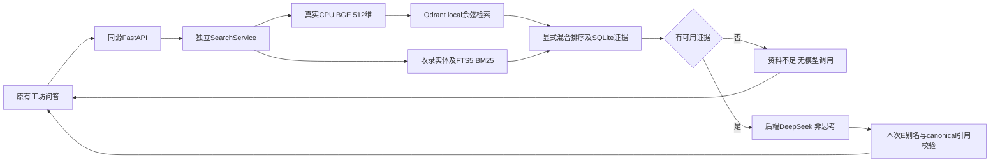

# 「戏境 AI」Phase 2 阶段总结

## 1. 阶段状态

- 阶段：京剧私有知识库RAG、真实DeepSeek问答及原生前端接入。
- 执行日期：2026-10-09～10，Asia/Shanghai。
- 工程状态：**COMPLETE，等待用户检查点B正式验收**。本次实现与强制实测已完成，不代表用户已经验收通过。
- 技术：HTML/CSS/ES Module、Python3.11.1/FastAPI、SQLite、Qdrant Client local持久化、CPU BGE-small-zh-v1.5、DeepSeek deepseek-flash非思考模式。
- 开发分支：`feature/phase2-opera-rag`。继承Phase 1正式基线`04b2c571e068ec0b26205fcce0c075395caeebce`；原6次真实提交保留，未合并main，未开发Phase 3。

## 2. Phase 1继承与实际修改

8页结构、原文化导航、图片/音视频、酒红/金色/米白体系保留。HTTP脚本实际比较首页、历史、行当、脸谱、音乐、视频、画廊这7个HTML与Phase 1验收提交，**逐字节一致**；公共`css/style.css`和文化资源没有修改。

修改前端仅`about.html`、`css/ai-workshop.css`、`js/ai-workshop/{contracts,services,main}.js`：复用原问答DOM和askOperaQuestion协议，增加真实状态、Fetch、加载/错误/重试、每回合引用；样式限定ai-workshop命名空间。另修改README、环境模板、.gitignore和架构文档以支持真实后端及私有运行目录。

新增`backend/app`配置/API/存储/检索/供应商/业务层，`backend/scripts`下载/入库/评价/复现脚本，`backend/tests`离线错误与持久化测试，`knowledge`真实来源摘要与评价题，`scripts`前端/HTTP/凭证门禁，及本阶段docs证据。完整文件差异以`git diff --name-status 04b2c571e068ec0b26205fcce0c075395caeebce..HEAD`复核。

Agent职责、展开说明、角色需求草稿、概念图/Neural4D容器继续保留；其执行服务、图像和3D能力均为false/待接入。

## 3. RAG技术架构



SQLite是正文与来源的canonical存储，Qdrant稳定UUID保存真实512维Cosine向量并关联source/chunk/version。检索与聊天分离，后续研究Agent可独立取结构化证据。选择批准的轻量本地方案，无React/Vue、LangChain、GPU或独立数据库服务依赖。详见[实际架构](../architecture/phase-02-rag.md)。

后端仅回环8000单worker，同时提供8页与白名单静态目录，不公开env、.git、backend、docs、knowledge或运行目录。默认Key位于仓库外私有env；模型、SQLite/Qdrant和预算账本也在仓库外。

## 4. 知识库构建

真实资料单元**12份**，主题段落/最终片段**35条**，原创摘要正文共**1,960字符**。没有为了达到字数建议填充重复文章：短知识条目保持主题完整，不把全部知识直接塞入Prompt。

来源包括中国非遗网、福建省文旅厅、国家京剧院、国立传统艺术中心，覆盖历史、行当、脸谱、服饰、经典剧目、人物文化。每份含真实URL、机构、分类、日期或null、收集时间、定位、版本、许可/审核范围；实际content_hash由入库计算。[来源清单](../../knowledge/sources.json)、[核查记录](../../knowledge/review/source-checks.json)、[许可与范围](../architecture/knowledge-provenance.md)。

资料是经助手对照真实来源核查的**本项目原创事实摘要**，不是官方全文或官方逐字引文。review_status为source_checked_by_assistant，专业人工审核pending；没有将AI未核查内容标成权威。用户批准的原创摘要展示、复现与必要云问答用途不覆盖来源全文、图片或原网站媒体开放授权。

脸谱红/黑寓意保留人物、谱式、主副色和使用部位范围；戏剧情节与历史事实区分。最终cnpoc-face/cnpoc-bao为1.0.1，只补脸谱实体元数据，其他为1.0.0；实际事实正文未改变。

## 5. 入库、Embedding和检索

模型`BAAI/bge-small-zh-v1.5`固定revision`7999e1d3359715c523056ef9478215996d62a620`，CPU、local_files_only、trust_remote_code=false；实际512维归一化输出，无随机/关键词向量替代。权重95,827,648字节，首次实际11文件下载12.691秒；Hash记录见[模型证据](../evidence/test-results/phase-02-model-download.json)。

资料解析/清洗/章节分块 → SQLite元数据/FTS5 → 真实Embedding → Qdrant → ID/版本回读 → 原子active切换。分块目标350字/重叠70、实际token上限480；短条目自然小于目标。相同语料/模型/参数返回unchanged，更新/重建生成新generation，不无限追加。共享独占锁、专属线程、单worker保护本地持久化，不允许应用运行时另进程入库。

[真实生命周期](../evidence/test-results/phase-02-real-lifecycle.json)实际完成首次、重复、重开、更新、重建、并发写拒绝、无效更新保旧；隔离副本总16.6563秒，使用真实BGE，无付费调用。

默认混合：真实Qdrant语义候选加精确收录实体/FTS5 BM25，实体覆盖先排序、RRF打破同覆盖名次。补充词项候选也回Qdrant取真实余弦分数。阈值0.57不是概率，低阈值实体路线明确标acceptedBy，不伪装成高语义分数；最终交给LLM最多5片段。[20题向量/混合比较](../evidence/test-results/phase-02-retrieval-final-entity-metadata-same20-comparison.json)。

## 6. DeepSeek集成与意图控制

仅官方HTTPS、模型deepseek-flash、thinking.type=disabled、stream=false，回答上限800输出tokens、默认35秒供应商超时/45秒请求预算。首次真实探测11输入/3输出tokens、1.5959秒、返回有效中文、reasoning不存在；[脱敏探测](../evidence/test-results/phase-02-provider-probe-success.json)。初次Key为空的失败也保留，未发出该次API请求。

Prompt v1/v2均保留。v2要求仅凭本次证据、检验全部子问题/人物年代前提、资料不足明确说明、不服从外部资料指令、不泄露配置、谨慎文化差异。E1–E5临时别名只供模型选择；后端程序验证别名集合、映射到实际chunk ID及SQLite标题/定位/片段。未知引用或确定答案无证据直接报错，不自动付费修正，不采用模型编造的URL/文献名称。结构门禁不能自动证明所有事实正确，答案另作实际语义核查。

### 实际费用

截至归档，供应商账本**62次成功请求**，输入**41,500**、输出**9,503**、总**51,003 tokens**，累计保守峰价估算**0.13343424元**，应用预算3元。包含首探、早期与修复后模型测试、直接对照、浏览器问答及两次缓存复现，不是仅20题的费用。[实际usage账本](../evidence/test-results/phase-02-api-usage.json)。

峰价依据2026-10-10核实的[DeepSeek官方价目](https://api-docs.deepseek.com/zh-cn/quick_start/pricing/)，有真实usage才估算；未知网络/超时结果保留预留金额。该预算是本应用保护，**不是官方余额或账户扣费硬限**；用户自述充值10元未作为实时余额结果。无无限重试或隐式大规模付费测试。

## 7. API实现与安全

| 方法/路径 | 已实现行为 |
|---|---|
| GET /api/v1/health | 实际索引/Embedding、Key配置、同配置供应商连通记录、非秘密预算；不付费探测 |
| GET /api/v1/capabilities | questionAnswering、knowledgeSearch真实状态，其他3能力false |
| POST /api/v1/knowledge/search | question、topK、category；真实evidence/source/locator/vectorScore/keywordScore/acceptedBy/requestId |
| POST /api/v1/chat | 兼容question/conversationId；answer/citations/uncertain/requestId |
| GET /api/v1/knowledge/sources | 白名单可公开来源与许可元数据 |

空/过长/控制字符、body过大、模型token超限、Key缺失、鉴权/余额/模型/限流/超时、无效返回/引用、索引未初始化及内部异常均统一中文error.code/message/retryable/requestId，不返回上游原错/秘密/堆栈。问题600个UTF-16单位、有限并发、精确本地CORS。

X-Idempotency-Key绑定请求正文，进行中冲突、同Key异正文拒绝、有界10分钟成功缓存；前端pending禁重复发送。无自动付费重试，手动错误重试沿用原Key。供应商错误失效已验证状态，页面网络错误同步失效能力缓存，旧异步结果不会复活旧ready。

请求日志只有ID/方法/状态/耗时；Key不进入浏览器、Git、截图或日志。用户曾误发旧Key，用户确认撤销，公开对话脱敏；新Key由用户本地配置。公开精确凭证扫描零匹配，历史原件不复制入公开仓库。静态受保护路径实际HTTP返回404。

## 8. 前端与实际浏览器

askOperaQuestion真实Fetch到同源FastAPI；保留Phase 1协议、55秒浏览器超时、JSON校验、网络/错误提示。正文和引用使用textContent，无未经清理HTML注入。连续问答最多12完整回合，资料与回合独立绑定；每题独立检索，没有服务器跨问题记忆。

1920×1080桌面、390×844手机的8页回归实际完成；另768×1024检查Agent面板。四推荐题实际填入并真实回答，引用展开、旧回合资料切换、空问题、加载禁重复、安全文字、真实停机/恢复、Agent展开与待接入、草稿保留均验证。正常页面控制台warn/error为空，破图/横向溢出为空/false。浏览器返回的截图实际像素尺寸与设定DOM视口不完全相同，见[截图尺寸清单](../evidence/test-results/phase-02-screenshot-manifest.json)，没有重绘或冒充精确1920截图。

[浏览器完整报告](../evidence/test-results/phase-02-browser-test-report.md)。[最终桌面问答](../evidence/screenshots/phase-02/qa-final-demonstration.jpg)、[首页](../evidence/screenshots/phase-02/home-desktop.jpg)、[Agent](../evidence/screenshots/phase-02/agents-desktop.jpg)、[手机工坊](../evidence/screenshots/phase-02/workshop-mobile-final.jpg)、[手机问答](../evidence/screenshots/phase-02/qa-mobile.jpg)。

## 9. 真实测试与RAG评价

| 测试 | 实际结果 | 范围 |
|---|---|---|
| 后端pytest | 124通过，0失败；1条Starlette/httpx弃用警告 | HTTP mock/fake encoder明确为离线；实际Qdrant持久化另测试 |
| 前端离线 | 25通过，0失败 | services/DOM double与静态检查，非浏览器/LLM |
| 实际HTTP | 8页、62资源、6受保护路径通过 | 7文化HTML逐字节保持Phase 1 |
| 最终本地20题检索 | 18支持题候选章节全部Top5覆盖；2资料不足 | 助手核对候选，非人工gold Recall@5；约17.515ms均值，排除初次载模 |
| 4推荐题本地检索 | 候选证据全部覆盖 | 浏览器漏取问题专项回归，不是独立盲测 |
| 5题补充检索 | 2支持完整，3不足中1被近似片段误接受 | 记录真实检索层不足识别4/5限制 |
| 最终20题真实RAG | 20有效HTTP响应，18实际模型调用+2免费控制响应，均值1.103882秒 | 不是20次都收费或20题直接模型对照 |
| 引用 | 37/37程序映射与结构追溯有效 | 不等于自动语义证明 |
| 主助手语义复核 | 18题支持、2题合理不足 | 阅读实际答案及真实摘要；专业人工正确率仍null/N/A |
| 5题补充真实RAG | 全部有效响应，3模型+2控制，均值0.6617498秒 | 错误人物资料不足且无无关引用 |
| 直接LLM vs RAG | 实际5对；原始回答、tokens/费用/耗时及逐题说明保留 | 两组非同一时点，未假定RAG必然更好 |

最终检索候选章节集合由助手核对且同题用于调参，不称人工Recall@5；补充集也用于诊断，不称独立盲测。无专业人工标注的正确率不编数字。[最终20题原始结果](../evidence/test-results/phase-02-answers-rag20-final-hybrid.json)、[逐题/引用核查](../evidence/test-results/phase-02-answers-rag20-final-hybrid-assistant-review.json)、[实验比较](../evidence/test-results/phase-02-experiment-comparison.md)、[单元回归](../evidence/test-results/phase-02-final-unit-regression.json)。

## 10. Bug修复与Prompt证据

首版正文出现长chunk ID → v2短别名映射；组合题缺通用净行证据 → 显式完整性Prompt先说明不足，再修复混合排序；泛问脸谱漏已有颜色 → 元数据和实体混合专项回归；网络错误残留ready → 失效缓存/旧检查隔离，真实停机恢复；手机固定导航遮根标题 → 只补工坊锚点偏移，首页重入通过。

保留标题上下文/低阈值无改善实验、初次API单元失败、fake encoder旧API五失败、前端网络回归三失败、HTTP中文URL与Range测试脚本失败、归档脚本一次账本字段错误，以及实际修复和重跑。测试定位/整理错误与产品缺陷区分，没有补造用户Bug指令或失败事件。

[完整用户Prompt与公开协作快照](../prompts/phase-02/README.md)、[演进索引](../prompts/phase-02/04-development-evolution.md)、`backend/prompts/rag_answer_v1.txt`与`rag_answer_v2.txt`均保留。快照排除隐藏推理/内部指令并脱敏凭证，原始Prompt字节一致性和导出实际时间可核验。

## 11. 实际Git记录

以下为真实提交，未改日期、压缩Phase 1或创建空提交。报告归档提交从实时git log定位，避免制造包含自身最终Hash的伪历史。

| 完整Commit Hash | 实际内容 |
|---|---|
| 84a34bab741f840c29fa4ac23b04d51ef12a3f54 | 后端/私有配置/预算及首次API探测 |
| 5e3e4d25b754e78ab44bfd6fa9468704491b12a5 | 真实知识资料、CPU Embedding与持久化生命周期 |
| f7dee30d713dcd36fc76dd8d9f1a990df7a37d65 | 真实RAG问答、Prompt别名映射与引用/真实模型测试 |
| 8e6a78a6821adc8ddbc948c0e4eb0064da2aadec | 最终实体混合修复及真实20题回归 |
| 8a5499edf1e70629cf70034ead8c95ee109c9855 | 原生问答接入、停机恢复、浏览器与手机锚点修复 |

实际命令：`git log --format='%H %s' 04b2c571e068ec0b26205fcce0c075395caeebce..HEAD`、`git status --short`。公开分支交付时仅push feature分支，不merge main；远端实际成功与最终归档Hash见交付证据，不提前假设。

## 12. 复现与外部条件

[README](../../README.md)与[无密钥环境模板](../../.env.example)包含Windows路径、单worker、固定模型、私有配置、入库与启动。

实际运行命令：

```powershell
.\.venv\Scripts\python.exe -m backend.scripts.download_model
.\.venv\Scripts\python.exe -m backend.scripts.ingest --corpus knowledge
.\.venv\Scripts\python.exe -m backend.scripts.check_provider --output docs/evidence/test-results/local-provider.json
.\.venv\Scripts\python.exe -m uvicorn backend.app.main:app --host 127.0.0.1 --port 8000 --workers 1
.\.venv\Scripts\python.exe -m pytest backend/tests -q
node scripts/phase2_frontend_test.mjs
# 独立检索/重建前停止服务；下面第一项免费，后两项使用真实Key与预算。
.\.venv\Scripts\python.exe -m backend.scripts.evaluate_retrieval
.\.venv\Scripts\python.exe -m backend.scripts.evaluate_answers --label my-rag-run
.\.venv\Scripts\python.exe -m backend.scripts.reproduce_smoke --label my-reproduce-run
```

本机Python3.11.1、Node24.15.0，复用已安装CPU torch的system-site-packages虚拟环境；requirements指定实际主依赖和CPU wheel来源。首次空白机全依赖安装没有计时验证。无Key可做真实Embedding、入库、检索及离线测试，不能生成假LLM答案。

最终缓存条件实测 **25.6704秒**：已有依赖、固定模型缓存、私有有效Key和之前成功探测、服务已停止、官方API可达。实际全索引重建→新进程启动→HTTP前端→一次真实RAG完成；[原始证据](../evidence/test-results/phase-02-cached-reproduction-final-hybrid.json)。此前22.2354秒运行也保留，不以较漂亮旧数字取代最终。没有承诺空白电脑10分钟安装完成。

## 13. 比赛评分对应

| 维度 | 实际证据 |
|---|---|
| 过程可复现性25% | Phase 1历史保留、5个真实功能/修复提交、完整原Prompt/公开工具快照、失败和缓存复现 |
| 有效性25% | 真实京剧来源、512维检索与DeepSeek闭环、20题实测、引用追溯和资料不足 |
| 方法与意图控制20% | 检索/解释分层、来源范围约束、外部资料不当指令、E别名校验、真实对照及费用保护 |
| 工程质量15% | 模块分层、原子generation、持久化/写锁、有界并发/幂等、私有配置和124项离线测试 |
| 体验15% | 保留传统视觉、推荐题/加载/错误/引用、真实停机恢复、桌面/手机实测与局部锚点修复 |

此表不代替评审评分或宣称获得分数。

## 14. 已知限制与验收结论

限制：首批12资料/1,960字符覆盖有限；来源摘要与标注仍需专业人工复核，不能作为全面戏曲学术数据库。向量/实体命中不证明错误人物前提真实，已记录相似资料误接受，回答层能拒绝本次已测个案但不保证所有幻觉均消除。人工Recall/正确率、独立盲测、20对完整对照未执行；冷机全安装和多浏览器矩阵未完成。本地单worker/local索引需停机维护，无公开后端身份认证/互联网费用限流；当前服务只回环。页面无跨问题语义记忆，草稿/问答刷新清空。

| Phase 2核心验收项 | 本次判断 |
|---|---|
| 已批准方案、保护Phase 1、独立分支 | 满足 |
| FastAPI/SQLite/Qdrant真实持久化 | 满足，启动/生命周期/重开已运行 |
| 固定BGE真实512维及真实向量检索 | 满足，无假向量替代 |
| 实际资料、来源/许可/版本、重复与更新入库 | 满足，明确助手核查与人工pending |
| DeepSeek真实调用、非思考、Token与预算 | 满足，62实际成功、0.13343424元保守估算 |
| 检索证据参与问答、引用程序校验、资料不足 | 满足，20+5真实RAG与结构/语义核查 |
| askOperaQuestion真实后端、加载/错误/引用 | 满足，实际浏览器验证 |
| Agent/概念图/Neural4D仍未接入 | 满足，未越阶段 |
| 20题检索及评价、真实LLM数量明确 | 满足；18生成+2控制，人工指标不虚构 |
| API边界、8页桌面/手机与静态资源 | 满足，124项离线+真实HTTP/浏览器证据区分 |
| Git/Prompt/README/env/截图/阶段报告 | 已归档，公开快照脱敏，最终提交/远端交付以实时证据为准 |
| 没有已知阻断性功能Bug或当前密钥泄露 | 本次测试未发现；旧聊天凭证由用户确认撤销，公开材料已脱敏 |

工程测试完成状态为COMPLETE；尚未完成的高级评价、专家审核和冷机测试明确保留，**用户检查点B尚待验收**。若用户复核发现关键问题，应继续修复本阶段，不擅自进入下一阶段。

## 15. Phase 3准备与停止

技术上已有独立SearchService和`POST /api/v1/knowledge/search`，返回真实片段、source/locator、余弦与关键词分数、接受路径、资料不足状态；未来京剧研究Agent可直接复用，无需重写聊天检索。

当前只交付Phase 2，没有Agent执行引擎、概念图API或Neural4D。完成归档后停止功能开发，等待用户明确回复 **“Phase 2验收通过，进入Phase 3。”**。本报告不会自行启动Phase 3或合并main。
