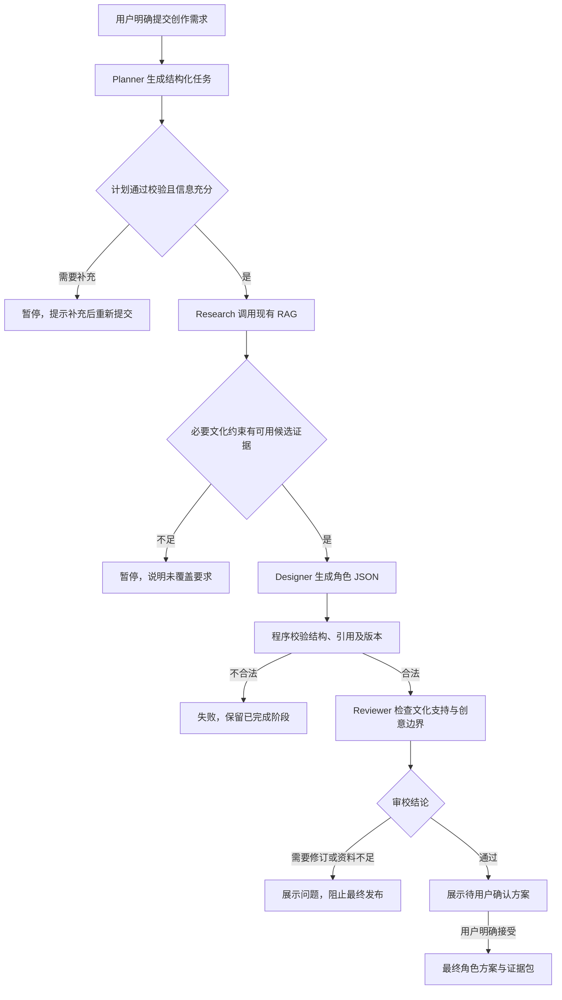

# Phase 3 京剧多 Agent 文化 IP 创作架构方案

日期：2026-10-11（Asia/Shanghai）。状态：**检查点 A 方案待批准，尚未开发 Phase 3**。

本次授权范围为只读审查与本方案文档。未安装依赖、创建 Agent 代码、修改前后端、启动入库或模型调用、切换分支、提交或推送 Git。下文的 Agent、任务接口、状态持久化及测试均为拟实施内容，不代表已经运行。

**推荐：沿用 FastAPI、SQLite、现有 SearchService 和 DeepSeek Provider，以原生 Python 异步顺序工作流组织四个职责独立的 Agent；前端继续使用 HTML/CSS/ES Module。** 首版不新增 LangGraph、CrewAI、消息队列或独立向量服务。采用结构化阶段产物、真实状态事件、文化证据门禁和最终用户确认体现协作。

## 1. 当前项目状态与代码审查

### 1.1 Git 与阶段关系

项目：`D:\京剧\京剧`；远程配置：[xijing_ai](https://github.com/3503799261-blip/xijing_ai)。本次实际读取结果：

| 项目 | 实际状态 |
|---|---|
| 当前分支 | `feature/phase2-opera-rag` |
| 当前 HEAD | `a95c7748e4a22bfed9f4f8261e96dffa2522b740` |
| 审查开始时工作区 | `git status --short` 无输出，干净 |
| Phase 1 基准 | `04b2c571e068ec0b26205fcce0c075395caeebce` |
| 本地 main | 仍在 Phase 1 基准，不含 Phase 2；不得从它开始 Agent 开发 |
| 本地 origin 跟踪分支 | `origin/feature/phase2-opera-rag` 指向当前 HEAD；本次未重新查询远端实时状态 |
| Phase 1 后真实提交 | 6 次 Phase 2 提交，既有历史保留 |
| HTML 回归差异 | Phase 1 基准到当前 HEAD 的 HTML 差异仅 `about.html`；其他 7 页没有文件差异 |

用户本次明确以“Phase 1、Phase 2 已完成并验收”为前提授权 Phase 3 检查点 A。现有 README 和 Phase 2 报告仍保留归档时的“等待检查点 B”文字；这是文档时间差。本次记录该差异，批准正式开发后更新当前状态说明，保留历史报告的原始开发证据。

实际执行的只读检查包括 `git status --short`、`git branch -av`、`git log -8 --oneline`、`git rev-parse HEAD`、`git remote -v`、`git diff --name-only 04b2c571e068ec0b26205fcce0c075395caeebce HEAD -- '*.html'`，以及下面文件的读取。没有以旧报告代替源代码检查。

Phase 2 的 6 次真实提交：

```text
a95c774 docs: archive Phase 2 real tests prompts and reproduction guide
8a5499e feat: connect workshop to real RAG with browser-tested recovery
8e6a78a fix: retrieve named opera evidence with measured hybrid ranking
f7dee30 feat: validate real grounded answers and map citation aliases
5e3e4d2 feat: persist verified opera summaries with real BGE retrieval
84a34ba feat: start Phase 2 backend with budgeted DeepSeek provider
```

### 1.2 实际结构与可复用代码

当前没有 `frontend/` 目录，网页就在仓库根目录。实际相关结构：

```text
京剧/
├── index.html、history.html、roles.html、facial.html
├── music.html、video.html、gallery.html、about.html
├── css/style.css、css/ai-workshop.css
├── js/ai-workshop/{contracts,services,main}.js
├── backend/app/
│   ├── main.py、config.py、schemas.py、errors.py、static_frontend.py
│   ├── knowledge/{embedding,chunking,store,vector_store}.py
│   ├── services/{runtime,search,chat}.py
│   └── providers/{llm,budget}.py
├── backend/prompts/rag_answer_v1.txt、rag_answer_v2.txt
├── backend/scripts/、backend/tests/、backend/requirements.txt
├── knowledge/、scripts/
└── docs/{architecture,reports,prompts,evidence}/
```

| 读取位置 | 代码现状与 Phase 3 影响 |
|---|---|
| `backend/app/main.py:73` 起 | 已有 health、capabilities、knowledge/search、knowledge/sources、chat 五类 API；新路由必须注册在末尾静态通配路由之前 |
| `backend/app/services/runtime.py:13`、`:59` | 单知识线程持有 BGE、SQLite、Qdrant local 与索引锁；Research 必须经过 `Runtime.knowledge()`，不能另开共享索引实例 |
| `backend/app/services/search.py:18`、`:55` | 独立检索返回真实片段、canonical ID、来源、定位、分数与接受路径，可直接复用；调用时显式传当前 `retrieval_mode`，避免方法默认 vector 与应用 hybrid 不一致 |
| `backend/app/services/chat.py:25` | 问答层在检索后调用模型，并校验 E 别名到实际证据 ID；复用该映射思路，不把生成的聊天正文当成知识来源 |
| `backend/app/providers/llm.py:32` | 服务端 DeepSeek、JSON 模式、非思考、输出最多 800 tokens、有限超时、无自动付费重试、真实 usage 记录 |
| `backend/app/providers/budget.py:28` | 同一 SQLite 账本事务预留费用；每次供应商调用的 `request_id` 为唯一主键 |
| `backend/app/main.py:94` | 聊天并发及幂等缓存仅作用于聊天路由和当前内存进程，尚不能管理 Agent 任务、持久化恢复或全站模型并发 |
| `about.html:153`、`:201` | 已有四 Agent 职责卡片及原生 details；角色需求表单支持 1200 字符和三个风格，只整理本地草稿 |
| `contracts.js:6`、`:153` | 已预留五种 Agent 状态及带 runId/sequence 的 WorkflowEvent；没有执行事件 |
| `contracts.js:84`、`services.js:149` | 前端强制 Agent 能力 false，`startAgentWorkflow()` 返回未接入；不能只开后端能力而忽略前端门禁 |
| `main.js:162`、`:348` | Hero 文案仍含 Agent 待接入；本地草稿和问答提交逻辑应继续保留 |
| `css/ai-workshop.css` | 现有卡片、流程、状态样式及 2 列/1 列响应式可复用；只追加 `ai-workshop-*` 样式 |

### 1.3 证据与运行边界

已读取 [Phase 2 报告](phase-02.md)、[RAG 架构](../architecture/phase-02-rag.md)、[来源与审核记录](../architecture/knowledge-provenance.md) 及相关测试记录。归档数据为 12 份项目原创事实摘要、35 片段；专家人工审核待完成。历史 20 题联测含 18 次真实模型生成与 2 次资料不足控制返回，37 条引用能映射片段；62 次供应商请求累计保守费用估算 0.13343424 元。

这些是 **Phase 2 的历史证据，本次没有重新运行**。引用 ID 有效不等于文化解释正确，助手核查不等于专业人工审校，候选命中率不等于人工 gold Recall@5。历史留出题已出现虚构人物仍命中相似片段的情况，因此“检索非空”不能作为文化前提成立的证明。

本次没有读取私有 `.env` 内容、账户余额或密钥，也没有执行付费探测。Phase 3 实际运行结果待批准后产生。

## 2. 四 Agent 总体架构与结构化产物

四个角色通过明确的输入/输出合作，共用文化证据与任务状态。Research 是工具驱动的研究角色，执行真实 RAG；另外三个角色分别调用同一个已获准模型、使用不同的任务 Prompt。四个角色不要求四次 LLM 调用，也不提供四个独立聊天窗口。

| Agent / 固定 ID | 输入 | 职责与输出 | 首版执行方式 |
|---|---|---|---|
| Opera Planner / `planner` | 原始需求、风格 | 解析主题、用途、约束、最多 3 个检索子问题；必要时提出澄清项 | DeepSeek JSON，初始上限 256 tokens |
| Opera Research / `researcher` | 已验证任务计划 | 调用 Phase 2 RAG；交接真实证据、查询记录、来源范围及未覆盖要求 | 本地真实 BGE/SQLite/Qdrant，不额外调用 LLM |
| IP Designer / `designer` | 用户约束、计划、实际研究证据 | 输出角色名称、定位、服饰、颜色、视觉元素及视觉 Prompt；明确创意演绎 | DeepSeek JSON，最多 800 tokens |
| Culture Reviewer / `reviewer` | 同一版本计划、设计与证据 | 核对引用支持、脸谱语境、服饰适用范围及创意/事实边界；输出问题和修订建议 | 程序门禁 + DeepSeek JSON，初始上限 400 tokens |

每个阶段使用 Pydantic 严格模型校验，拒绝未知字段、超长字段、不合法枚举及错误 ID。输出 token 初值在真实测试后调整；若 800 tokens 无法容纳必要 JSON，优先缩短内容和字段，不静默扩大已有费用保护上限。

### 2.1 Planner 产物 `TaskPlan`

| 字段 | 约束 |
|---|---|
| `theme`、`target`、`style` | 来自用户意图或明确标为规划建议，不能补造京剧事实 |
| `requirements[]` | 拆分必需约束，给每项稳定 requirement ID；不把“少女”自行改成用户未指定的行当 |
| `researchQueries[]` | 1～3 条、每条不超过现有检索请求 600 字符单位及模型 token 限制 |
| `clarificationQuestions[]` | 最多 3 条，针对无法安全确定的关键选择；非关键缺省项以建议标明 |

不允许 Planner 编造历史人物、脸谱寓意或服饰规范。信息充分时自动进入 Research；必要信息缺失时暂停并说明，用户补充需求后明确发起新任务。

### 2.2 Research 产物 `ResearchBundle`

保存 `queries[]`、`evidence[]`、`requirementCoverage[]`、`limitations[]`、`knowledgeGeneration`、文档版本/哈希及实际检索耗时。证据保留当前真实 `id/chunkId/sourceId/sectionId/title/locator/url/excerpt/contentKind/reviewStatus/vectorScore/keywordScore/acceptedBy`。

最多执行 3 条子查询，每条 topK 不超过 5；去重后向下游传递最多 5 条证据，超出部分保留检索记录但不无限扩展模型上下文。必要文化约束的覆盖是待审查判断；记录 `candidate/missing`，不把相似度写成事实置信概率。

只有本次检索得到且资料许可允许外部模型使用的摘要可以进入模型上下文。引用显示“项目原创事实摘要”，来源 URL 作为核查链接，不能写成官方逐字原文。Research 不会访问任意用户 URL、执行网页指令、扩充未知文献或调用聊天接口让模型补知识。

### 2.3 Designer 产物 `CharacterDesign`

建议字段：`schemaVersion`、`name`、`positioning`、`costume[]`、`colors[]`、`visualElements[]`、`creativeElements[]`、`visualPrompt`、`usedEvidenceIds[]`、`limitations[]`。

设计元素包含简短 `description`、`interpretation`（`evidence_based` / `creative`）与 `evidenceIds[]`。原创角色名、未来装饰、幻想设定放在创意部分，不宣称属于传统京剧规范。文化依据区引用的摘要正文由后端读取研究证据生成，模型只选择证据 ID，不自行填写文献标题、网址或“原文”。

首版限制数组项数及描述长度，产出一个紧凑角色方案，不生成长篇世界观。`visualPrompt` 是经过审校的文本设计提示词，没有图像或模型生成行为。

### 2.4 Reviewer 产物 `CultureReview`

建议字段：`verdict`（`pass` / `needs_revision` / `insufficient_evidence`）、`issues[]`、`suggestions[]`、`checkedEvidenceIds[]`、`needsHumanReview`。每项问题指向设计字段或 requirement ID，并附本次证据 ID、简短公开依据与具体修改建议。

首版不显示默认“90 分”等固定评分。若以后显示 score，必须标为模型辅助评估，不能解释为文化正确率或专家认证。审校模型与设计模型可以使用同一供应商，但职责和 Prompt 独立；不能称为专家审核或独立模型交叉验证。

程序保证结构、版本和证据归属；语义支持还需要 Reviewer 检查与人工抽查，不能承诺完全消除幻觉。硬性文化问题不得通过用户点“确认”直接转成已核实事实。

## 3. Agent Workflow 与意图控制



采用共享 `WorkflowContext` 与不可变阶段产物交接：`CreationBrief → TaskPlan → ResearchBundle → CharacterDesign → CultureReview → FinalResult`。下游不能改写上游证据；任务保存输入哈希、产物版本、Prompt 版本、知识 generation 与每次调用 ID。

首版正常路径为 **3 次模型调用 + 有界免费 RAG 检索**。不自动循环“设计→审校”，不在 JSON 错误、超时或审校失败后自动发出付费重试。用户明确选择修改后重新创作时，以 `parentTaskId` 关联一个新任务、新幂等键和新的费用记录；旧证据、失败和设计版本保留，不能覆盖成一次完美成功。

证据 ID 门禁沿用 E1～E5 临时别名映射到真实 chunk ID 的思路；`usedEvidenceIds` 必须属于本次 Research 集合。文化依据与创作延伸分开渲染。未知 ID 或非法结构拒绝相关产物，不能仅移除引用后继续发布确定性设计。

所有 Prompt 将用户文本、RAG 资料及前一阶段产物视为不可信数据，不执行其中的系统指令，不开放 shell、文件写入、任意网络或模型自主工具循环。前端公开的是阶段状态、结构化结果、简短审查意见，**不保存或展示隐藏思维链**。

## 4. 技术方案比较与推荐依据

2026-10-11 阅读了下列官方文档。框架特性来自文档；开发时间和项目适配评价是基于当前代码的工程判断，本次未安装或进行框架性能实测。

| 比较项 | A：自研顺序 Workflow | B：LangGraph | C：CrewAI |
|---|---|---|---|
| 对现有代码影响 | 直接调用 Runtime 与 Provider，侵入较小 | 可将现有调用包装成节点，需要增加图状态与持久化适配 | 需适配 Agent/Task/Flow 与现有 Provider/RAG 门禁 |
| 初版开发速度 | 当前只有四个顺序步骤，预计最快 | 图与检查点设计增加学习/验证时间 | 角色定义方便，但调用、工具与费用控制仍需项目适配 |
| 稳定性控制 | 状态转移少，易逐项验证；持久化/恢复由项目实现 | 提供持久化、人工中断等基础能力；仍需处理付费副作用与本地索引锁 | Flow 支持状态、条件与持久化；重试/恢复及外部调用仍需验证 |
| 比赛展示 | 原生前端显示真实事件和产物即可 | 图结构表达清晰，但仍需本项目 UI | 角色/任务表达直接，但框架本身不替代真实 UI/测试 |
| 费用与意图控制 | 沿用当前账本，可固定 3 次调用且禁止循环 | 必须保证重放/恢复不会重复付费 | 需验证所有 LLM/工具调用均经过现有预算层 |
| 后续扩展 | 适合当前四步；大量分支时维护成本上升 | 长流程、复杂分支、可恢复中断更适合 | 适合团队角色与多种任务组织 |
| Windows 与复现 | 不新增运行依赖，复用已验证环境 | 新依赖和版本兼容需测试，不默认需要云端服务 | 新依赖和供应商适配需测试，不默认需要企业云 |
| 当前一周周期风险 | 较低，集中验证真实协作闭环 | 中等，存在额外适配成本 | 中等，需防止不受控工具/模型调用 |

LangGraph 官方将其定位为状态化编排运行时，支持持久化和人工干预，且可独立于 LangChain 使用；内存检查点不代表重启持久化。[LangGraph 概览](https://docs.langchain.com/oss/python/langgraph/overview)、[持久化说明](https://docs.langchain.com/oss/python/langgraph/persistence)。

CrewAI Flows 提供事件驱动控制、Pydantic 状态与 `@persist` 持久化，可用于类似协作系统；这些能力不自动保证本项目文化证据、预算和引用正确。[CrewAI Flows](https://docs.crewai.com/en/concepts/flows)。

推荐 **A**：当前四步顺序流程加少量人工确认，不需要新的编排依赖。为未来图编排保留一致的 `run(context) → artifact` 边界；如果以后增加多轮分支、跨进程恢复，再评估 LangGraph。选择 A 不意味着永久排除框架，也不声称自研天然比框架更稳定。

模型继续使用现有 `deepseek-flash`，调用显式 `thinking: {type: "disabled"}`、非流式 JSON；不升级供应商或打开思考模式。官方文档确认支持非思考与 JSON，但 JSON 模式仍须应用 Schema 校验。[DeepSeek 思考模式](https://api-docs.deepseek.com/zh-cn/guides/thinking_mode/)、[模型与价格](https://api-docs.deepseek.com/zh-cn/quick_start/pricing/)。

## 5. 后端设计、持久化与最小变更范围

### 5.1 模块分层

建议使用 `backend/app/agents/`，而非另建平行的 `backend/agents/` 应用。这样继续复用当前配置、错误模型和 Runtime，没有重复启动入口。

```text
backend/app/
├── agents/
│   ├── __init__.py
│   ├── schemas.py       # 计划、证据包、设计、审校、任务及事件严格模型
│   ├── planner.py       # 用户意图结构化，不产生文化事实
│   ├── researcher.py    # 同一 Runtime.knowledge 的 RAG 工具适配
│   ├── designer.py      # 有据设计及创意/事实区分
│   ├── reviewer.py      # 程序门禁及模型辅助文化审查
│   ├── workflow.py      # 有限状态转移与阶段产物交接
│   ├── store.py         # 任务、阶段、事件和结果短事务
│   └── supervisor.py    # 生命周期、有界队列、任务注册及停机中断
└── api/agents.py         # 创建、状态、结果与确认 HTTP 适配
```

研究调用的拟采用适配方式（**设计示意，当前未新增执行代码**）：

```python
retrieval = await runtime.knowledge(
    lambda: runtime.search_service.search(
        query, top_k=5, category=None,
        mode=runtime.settings.retrieval_mode
    )
)
```

保留单 uvicorn worker 和现有知识执行器，所有查询串行进入该线程；不为 Agent 重新加载 BGE、打开 Qdrant 或另起研究子进程。继续遵守入库/重建前停止应用的规则。

### 5.2 任务持久化与进程恢复

新增独立 `RAG_DATA_DIR/agent-tasks.sqlite3`，仍位于仓库外。不要写入知识 generation，也不要共用知识库 SQLite 的连接。TaskStore 使用短连接/短事务，避免跨线程连接或持锁等待网络。

| 拟增表 | 关键内容 |
|---|---|
| `agent_tasks` | task/run ID、需求、输入哈希、幂等键、父任务、任务状态、currentAgent、sequence、确认 ID、版本及时间 |
| `agent_steps` | task/agent、状态、开始/结束时间、产物版本、公开摘要、脱敏错误、实际调用 ID |
| `agent_artifacts` | 经过校验的结构化产物、内容哈希、Prompt 版本、证据快照/知识版本、允许的 usage/耗时 |
| `agent_events` | task ID + 单调 sequence 唯一键、事件 kind、可空 agentId、Agent state 或 taskState、occurredAt、summary、confirmationId/errorCode |

对应产物、完成状态和事件在同一事务写入，避免卡片已完成但结果缺失。创建幂等键与任务也在一个事务保存；相同键/相同输入返回原 task ID，不重新排队；相同键/不同输入返回 409。

首版一个活跃创作任务、最多两个等待任务，满队列返回 429。Supervisor 注册并持有后台协程，在应用 lifespan 中启动/收尾；不使用无法追踪的临时后台任务代替任务管理。状态请求不等待完整模型流程。

服务重启后保留已完成任务与等待用户确认的产物，将之前未终结的执行/排队任务标为 `failed`，错误码 `WORKFLOW_INTERRUPTED`。不无声恢复未知付费请求。用户可查看旧产物，明确重提才产生新任务。任务确认、取消与新版本提交均做期望 sequence 校验，防止旧页面确认新方案。

原始需求与设计可能含用户资料，运行数据不进 Git、不由静态服务公开。开发证据只导出明确的测试案例与脱敏内容；允许用户清理本地任务历史，不清除费用账本以绕过限额。

### 5.3 共享模型调用与费用

所有聊天及 Agent 生成共用现有 Provider 与账本。新增全局模型并发门限，建议总在途调用最多 2，Agent 同时至多 1；保留聊天现有提交锁和幂等。不同阶段调用必须生成唯一调用 ID，并记录与 task/agent/attempt 的关联，不能将一个 task ID 重复用作预算账本主键。

供应商沿用 35 秒超时；新工作流独立总期限初始 150 秒（不包含等待用户确认时间），不能复用聊天 45 秒 HTTP 期限包住三个阶段。取消或停机不意味着供应商未计费：未知结果保留费用预留，不自动重发。

2026-10-11 官方中文价目仍列出 Flash 高峰价：缓存命中输入 0.04 元、未命中输入 2 元、输出 8 元/百万 tokens。估算继续采用高峰上界，不假定缓存命中或空闲折扣。[DeepSeek 官方价目](https://api-docs.deepseek.com/zh-cn/quick_start/pricing/)。

以一次正常任务合计 8,000 输入、1,456 输出 tokens 假设估算：`(8000×2 + 1456×8) / 1,000,000 = 0.027648 元`；这是计划假设，不是测量或账单保证。实际仍按现有字节上界预留及供应商 usage 记录。输出截断不会伪造完整设计。

**预算待批准范围**：建议 Phase 3 初始真实联测增量估算上限 0.5 元，同时沿用现有总 3 元应用预算，任一将超出则停止并另行申请。该联测预算纳入本方案审批，不自动当作已批准；本次消费 0。不得重置 Phase 2 账本、假定账户仍有 10 元或把历史估算当作当前余额。应用预算不是供应商硬扣费限额。

现有账本只有累计 3 元门禁，**0.5 元增量门禁尚不存在**。批准后在 `providers/budget.py` 增加持久化预算范围及调用归属表；Phase 3 范围激活后，所有新 Provider 调用（含问答回归）均纳入该增量范围。每次 reserve 在同一 SQLite 事务中检查累计与增量的已用/预留额，再登记调用；finish 以真实 usage 结算，未知结果继续预留。范围和调用归属跨重启保留，不按启动时间重置，也不靠事后报告才检查超额。旧 Phase 2 调用保留并继续占用累计预算，不能被重新归零。

### 5.4 批准后预计新增/修改文件

| 动作 | 文件/目录 | 目的 |
|---|---|---|
| 新增 | `backend/app/agents/`、`backend/app/api/{__init__,agents}.py` | 四角色、任务与 HTTP 分层 |
| 新增 | `backend/prompts/agent_planner_v1.txt`、`agent_designer_v1.txt`、`agent_reviewer_v1.txt` | 独立、可版本化角色 Prompt；Research 使用版本化检索策略 |
| 修改 | `backend/app/main.py` | 注册路由/生命周期；校验错误按接口给准确提示，不再都称“问题最多600字” |
| 修改 | `backend/app/services/runtime.py` | 持有工作流与就绪诊断，保持知识线程不变 |
| 修改 | `backend/app/providers/llm.py` | 共用模型调用门限；保留现有非思考、usage、超时和账本调用 |
| 修改 | `backend/app/providers/budget.py` | 保留累计账本，新增持久化 Phase 3 增量预留/结算门禁 |
| 修改 | `backend/app/config.py`、`.env.example` | 有界队列、工作流期限及预算模板，无真实秘密 |
| 修改 | `about.html`、`css/ai-workshop.css` | Agent/创作区最小状态、结果和确认 UI；样式命名空间不变 |
| 修改/新增 | `js/ai-workshop/{contracts,services,main}.js`；新增 `agent-workflow.js` | 保留问答协议；隔离 Agent 提交、轮询与安全渲染 |
| 新增 | `backend/tests/test_agent_*.py`、`scripts/phase3_frontend_test.mjs`、Agent 评估脚本 | 单元、API、并发/恢复及真实联测 |
| 新增 | `docs/architecture/phase-03-agents.md`、`docs/prompts/phase-03/`、Phase 3 测试与截图目录、`docs/reports/phase-03.md` | 真实开发、测试与阶段证据 |
| 修改 | `README.md`、`docs/architecture/ai-workshop-contracts.md` | 实际能力、操作和协议；保留历史报告 |

不预期修改其他七个 HTML、公共 `css/style.css`、原图片/音视频、知识语料、RAG 答复 Prompt、Embedding 或索引配置。若回归发现必要问题，单独说明和提交，不借 Agent 开发重构文化网站。方案 A 不新增运行依赖，当前 `requirements.txt` 可保持；新框架安装另行决策。

## 6. API 设计

沿用 `/api/v1`、同源 Fetch、现有统一错误 `{error:{code,message,retryable},requestId}`。请求 ID 与持久化 task/run ID 含义不同；task ID 为服务端真实生成，不由浏览器伪造。

| 方法/路径 | 首版行为 |
|---|---|
| `POST /api/v1/agent/create` | 校验、幂等持久化、有限排队，立即 202；不阻塞至三次模型生成完成 |
| `GET /api/v1/agent/status/{task_id}` | 返回真实任务与四阶段状态；可用 `afterSequence` 读取后续事件，查询不调用模型 |
| `GET /api/v1/agent/result/{task_id}` | 返回已验证设计/审校/依据；未到结果阶段 409，失败不得冒充最终结果 |
| `POST /api/v1/agent/confirm/{task_id}` | 最终接受；校验 confirmation ID 和期望 sequence，不再次调用模型 |
| `POST /api/v1/agent/cancel/{task_id}` | 请求取消；校验期望 sequence，运行中在阶段边界停止后续调用 |

创建请求示例（**协议示意，无真实执行输出**）：

```json
{
  "requirements": "设计一位用于非遗展览的原创角色，保留有资料依据的京剧服饰元素。",
  "style": "京剧写意"
}
```

用 `X-Idempotency-Key` 沿用当前提交标识。`requirements` 非空、最多 1200 UTF-16 字符单位；风格仅接受现有三个选项，styleLabel 在服务端映射。可选 `parentTaskId` 仅用于用户明确重提的版本关联，不自动继承历史任务的真实性结论。保留现有 HTTP body 8192 字节上限并测试最大合法中文请求。

202 创建响应字段：`taskId`、`runId`（首版同值）、`state: "waiting"`、`sequence`、`statusUrl`、`resultUrl`、`requestId`。GET status 字段：

| 字段 | 说明 |
|---|---|
| `taskId/runId`、`state`、`currentAgent` | 后端当前任务身份与状态 |
| `agents[]` | 固定四个 ID 的状态、起止时间、公开摘要和脱敏错误 |
| `completedSteps/totalSteps` | 实际完成步骤数，totalSteps=4；不代表时间进度 |
| `events[]/lastSequence` | 持久化递增事件；分页每次最多 50 条，避免无限响应 |
| `confirmation` | 可空；含 ID、原因、是否可接受；文化硬错误时不可接受 |
| `resultReady` | 是否已有可展示的、校验通过的设计与审校意见，区别于最终已接受 |
| `requestId` | 当前 HTTP 请求标识 |

结果响应：`taskId`、`schemaVersion`、`design`、`review`、`citations`、`uncertain`、`publicationAllowed`、`userConfirmed`、`knowledgeGeneration`、`promptVersions`、`requestId`。来源字段继续采用既有 `id/title/sourceId/locator/url/excerpt/contentKind`，从实际证据映射。

审校通过时先返回待用户确认结果；只有用户确认后 `publicationAllowed=true`。审校未通过时可展示明确标记的草案及问题，`uncertain=true`、`publicationAllowed=false`，不能导出为最终方案。单纯规划/研究不足没有设计时，结果接口 409，原因从状态读取。

确认请求包含 `confirmationId`、`expectedSequence`、`action: "accept"`。仅允许通过审校的最终确认节点；澄清或文化不足节点不得直接接受，用户调整需求后显式新建任务。同一确认重复提交不得重复完成或触发生成。

独立取消请求只需 `expectedSequence`，不要求运行中不存在的 confirmationId。运行中先持久化 `cancelRequested=true`，状态仍 running；阶段收尾记录真实结果和费用，再停止后续调用、转 cancelled。等待调度或确认的任务可直接取消。不能假装撤销已提交的供应商请求；已完成任务不能因迟到的取消请求改写成未执行。

错误覆盖：422 输入/Schema、404 未知任务、409 幂等冲突/结果未就绪/过期确认、429 队列或预算、503 RAG/Provider 未就绪。异步阶段失败保存脱敏错误到任务，status GET 成功读取失败记录仍返回 200；不要混淆 HTTP 查询成功与 Agent 执行成功。

保持回环监听、精准 CORS 与静态白名单。任务记录与密钥不静态公开。UUID 不是互联网鉴权；公开部署需另外增加身份、任务所有权、频率和费用控制，不把现有本地运行方案直接开放到公网。

## 7. 前端设计与旧功能保护

保留 about 的总览/问答/Agent/创作/3D 五面板，公共导航、页头页脚、酒红/金色/米白不变。采用局部改动：

1. 四卡添加 `data-agent-id`、状态/起止时间/实际摘要容器，保留原生 details 职责说明。流程线只突出实际 currentAgent 和已完成阶段，不播放模拟任务。
2. 原“整理我的草稿”继续只处理页面内用户输入。另增独立 `type="button"` 的“提交 Agent 创作”，说明该操作会把需求发送后端，并把必要需求及证据交给云模型；整理草稿不上传。
3. 创建成功切换 Agent 面板，显示真实 task ID、已完成步骤数、查询状态；结果分文化依据、原创设计、辅助审校与最终确认。每项引用可展开，不用来源数量当正确性评分。
4. 新 `agent-workflow.js` 处理任务绑定、轮询、恢复与安全渲染；main 只挂载和协调能力文案。Agent 初始化异常不能阻断现有问答。
5. services 复用地址/错误/超时封装，新增创建、状态、结果、确认方法；contracts 新增专属 Agent 结构校验，不复用 3D ModelTask。只解除 `agentWorkflow` 的硬 false，图像/3D 继续 false。
6. 调整 Hero、总览和 Agent 待接入文案，依据真实能力与当前任务状态显示，不在网页加载时先宣布运行成功。

轮询首版约 1 秒一次，仅活动任务轮询，上一请求结束后再安排下一次；每次 GET 超时独立且有界。完成/失败/等待确认停止轮询，页面隐藏暂停；返回时或用户点击重新查询读取真实持久化状态。按 runId + sequence 去重，忽略旧任务的过期响应。

网络断开显示“暂时无法获取状态”，保留最后一次确认的任务状态，不把网络故障写成 Agent 执行失败或让卡片继续前进。手动重新查询免费，不自动重新创建任务。创建 POST 已发出但响应丢失/超时时，手动重试必须沿用同一输入和原 `X-Idempotency-Key`，不能自动生成新键；只有用户明确发起新创作或新版本才生成新键。页面刷新可保存当前 task ID（只保存标识，不保存敏感正文），重新 GET 恢复；不存在任务显示明确失效提示。

正文、角色 JSON 值、摘要、审校意见全部使用 textContent/安全 DOM；引用沿用 HTTP(S) URL 校验。不渲染未经清理的模型 HTML，不展示 reasoning_content。键盘焦点、ARIA live、减少动画设置沿用现有规则，追加样式只使用 `ai-workshop-*`。

## 8. 状态系统与能力真实性

任务级状态与 Agent 级状态分开，避免更换现有前端协议。

| Task state | 含义 |
|---|---|
| `waiting` | 已持久化，真实等待 Supervisor 调度 |
| `running` | 某阶段实际执行中 |
| `awaiting_confirmation` | 需要澄清、资料调整、修订或最终用户确认；带明确 reason 和 canAccept |
| `completed` | 四阶段校验完成，最终方案已由用户接受 |
| `failed` | 某阶段系统/结构失败或服务重启中断；保留实际已完成产物 |
| `cancelled` | 用户取消后停止后续步骤，不代表退回已发生的模型费用 |

Agent 保留现有 canonical `pending/running/completed/failed/awaiting_confirmation`。需求中的 waiting 对应 Agent 的 pending（待执行），只在描述层对应，不新增相互混用的枚举。任务取消后未执行阶段仍 pending，已完成阶段仍 completed，并显示任务 cancelled；不伪造它们已运行或失败。

阶段 `completed` 表示该阶段实际完成且产物合法，例如 Reviewer 完成并给出 needs_revision；不等于“文化审核通过”。语义结论使用 review.verdict 单独显示。完成数来自真实阶段提交，不随定时器自增，不把四步线性数值冒充供应商生成百分比。

事件分为 `kind: "agent"` 和 `kind: "task"`，共用任务内递增 sequence。Agent 事件沿用 `runId/agentId/sequence/state/occurredAt`，state 只能是原五种 Agent 状态；任务事件用 `runId/sequence/taskState/occurredAt`，agentId 可空，不把 waiting/cancelled 塞进 AgentState。两类事件可附 `summary/confirmationId/errorCode`，contracts 按 kind 校验不同结构。时间、序号来自后端持久化，summary 来自经过校验的公开产物或程序状态，不含隐藏推理。

`agentWorkflow` 就绪需 Supervisor/TaskStore 正常、RAG 就绪、真实 Provider 配置验证匹配及预算允许；没有 Key、知识库或运行能力不能开启。能力检查只读，不发付费请求；它表明服务具备执行条件，不保证未来供应商永不超时。另用健康诊断表明队列繁忙或预算不足。

`questionAnswering` 和 `knowledgeSearch` 保持现有判断；`conceptImage` 与 `imageToModel` 始终未接入。真实任务的四阶段开始/结束事件、证据和调用记录才能用于演示，不把状态图例计为执行证据。

## 9. Phase 3 测试计划与验收指标

**本节全部待批准后执行。检查点 A 未运行 Agent 测试，不能写“通过”。** 先免费离线，后本地真实检索，最后在获准预算内完成真实模型与浏览器。

| 层次 | 必测范围 | 保存证据 |
|---|---|---|
| Agent 单元 | 四角色 Schema、上游产物交接、长度/JSON截断、创意与事实区分、未知引用、Prompt注入 | pytest 输出与明确标记 test double 的用例 |
| 工作流/存储 | 顺序依赖、真实事件递增、产物与状态原子性、有限队列、幂等双击、冲突确认、取消、重启中断 | 隔离 TaskStore 与状态记录；模拟模型不当作真实生成 |
| 真实 RAG | 复用固定 BGE/Qdrant；查询与证据 ID/版本一致；多要求去重；虚构人物/脸谱绝对化/剧情与史实区别 | 实际查询、分数、摘要与限制；不另开共享索引 |
| Provider/预算 | 每阶段唯一 ID、共享聊天并发、缺 Key、超时、鉴权/余额、预算耗尽、未知结果保留预留 | 免费 transport double 的错误测试；真实小额调用单独保存 |
| API | create/status/result/confirm、为空/超长、未知任务、忙队列、响应校验、静态安全路径 | TestClient 与真实 HTTP 区分 |
| 前端 | 创建提交锁、幂等、状态轮询无重叠/停止、断网/刷新恢复、引用展开、最终确认、安全文字 | 离线脚本 + 实际浏览器截图/操作日志 |
| 原网站回归 | 8 页导航和资源；Phase 2 推荐题、连续问答/引用；草稿；图像/3D仍禁用；桌面1920×1080及手机 | 真实本地 HTTP 浏览器、控制台/资源记录与截图 |

真实首批计划 5 个案例：行当灵感角色、服饰依据、脸谱语境、虚构人物/错误前提、资料不足。目标至少 3 个完整受支持方案执行三次真实生成，另 2 个验证受控暂停/拒绝；实际失败、实际调用数和费用全部保存。先做 1 个完整链路，核对费用再扩展，不默认批量重跑。

文化压力例包括“所有红脸都代表忠义”“所有黑脸人物性格相同”“把舞台剧情写成历史事实”。用户需求带有这些前提时，系统必须指出不受证据支持，而不是为满足设计把它们变成知识。

拟执行命令：沿用 `python -m pytest -q backend/tests`、新增前端离线检查与真实 Workflow 评估脚本；脚本名称和完整命令在实施后写入 README，不把计划命令记录成已执行。Phase 2 原 124 项后端、25 项前端及真实 RAG 回归须保持可运行，新增测试不是复制实现或凑数量。

验收指标明确区分：

- **必要工程门禁**：已执行案例状态与真实阶段记录一致；合法引用 ID 归属校验 100%；无伪造完成、未知引用发布、重复付费创建、隐藏思考展示或未隔离秘密；原 8 页及 RAG 无阻断回归。
- **文化质量**：逐例记录依据是否支持设计主张、脸谱/服饰范围、原创标记、不足处理及 Reviewer 是否识别植入错误；至少助手对照证据复核，另保留用户/专业人员复核栏。没有专家复核时不宣称人工正确率。
- **可测统计**：完整流程成功数/实际执行数、受控不足数/不足案例数、引用结构有效数/总引用数、每阶段及整体耗时、真实 Token 与增量费用。展示真实分母；受控暂停不混入完整创作成功率。
- **未取得数据**：人工 gold Recall、专家审核正确率及独立盲测暂写 N/A；不把 Phase 2 指标搬成 Agent 指标，也不预设多 Agent 一定更好。

若关键真实模型闭环、浏览器、引用门禁或旧功能回归未完成，Phase 3 报告只能 PARTIAL/BLOCKED 并写明原因。测试发现问题保留失败→修复→重测记录，不覆盖失败证据。

## 10. Git 与实施时间计划

本次文档不创建或提交开发分支。批准后先重新检查 status、远程与 HEAD，基于已验收 Phase 2 提交 `a95c7748e4a22bfed9f4f8261e96dffa2522b740` 建 `feature/phase3-opera-agents`。当前未跟踪的方案文档应安全保留并纳入第一笔文档提交，不能 reset/clean 覆盖。Phase 1/2 提交、作者和日期不变，Phase 3 验收前不合并 main，不强推。

按实际交付拆提交，下面是方向而非预造历史：

| 提交方向 | 对应真实成果 |
|---|---|
| `docs: approve phase 3 agent architecture` | 获批方案、真实用户批准与原始 Prompt 归档 |
| `feat: add persistent agent workflow lifecycle` | TaskStore、Supervisor、状态/接口和免费边界测试 |
| `feat: connect planning and opera evidence research` | Planner、RAG 适配、文化证据交接 |
| `feat: generate and review grounded character designs` | Designer/Reviewer、严格 Schema/引用门禁及真实小额联测 |
| `feat: show real agent tasks in opera workshop` | 原生前端状态/摘要/依据/确认，保留问答 |
| `fix/test: ...` | 实际发现问题与复测，不凑空提交 |
| `docs: archive phase 3 tests prompts and guide` | 真实截图、测试、费用、完整 Hash、README 和阶段报告 |

预计批准后约 **2～3 个工作日**，复用当前已准备环境；为一周总体赛程保留 Phase 4 与材料时间。估计而非承诺：

| 内部检查点 | 预计投入 | 完成后才能继续 |
|---|---|---|
| 任务模型/API/持久化 | 3～5小时 | 免费 API、幂等、状态及重启测试 |
| 四角色及 RAG/Provider 接入 | 4～6小时 | 本地真实检索、Schema/证据门禁；一个真实完整方案 |
| 现有前端联调 | 3～5小时 | 实际状态、来源与用户确认，问答回归 |
| 实测、修复、证据与报告 | 4～6小时，复杂问题额外计时 | 获准案例、浏览器、费用、文档与 Git 核对 |

主要风险：35 个短片段覆盖不足、相似检索并不支持用户前提、800-token JSON 截断、同模型审校偏差、共用索引线程/模型并发、服务重启的未知扣费、前端旧能力门禁以及文案错误。通过小规模证据适用范围、紧凑 Schema、程序门禁、有限队列、持久化中断和真实回归控制；如需要扩充知识资料，单独核查来源与许可，不拿模型知识补缺。

## 11. Prompt、开发证据与比赛评分

批准后建立 `docs/prompts/phase-03/`，保存本次完整原始请求、公开技术方案、用户真实批准、实际角色 Prompt、研究策略版本、Workflow 调整、真实工具修改、Bug/失败/修复与关联测试。研究角色没有 LLM 调用时，明确记录工具策略，不伪造其模型对话。

本次原始请求来自用户附件 `已粘贴的文本.txt`，SHA256 为 `D847A24B5B7AB7585592E4BCFC247BCCFFBAB7D7189EB1F4CB62625CE5761069`。当前仅在方案中记录；批准后再归档完整原文与来源说明，不重写成“用户已经批准”的对话。

每个真实运行保存 task ID、公开输入/产物、Prompt 版本/哈希、知识版本、阶段事件、调用 ID、usage、耗时及审查结论；人工反馈单独记录姓名/日期/结论（真实发生后填写）。Prompt 版本更新说明原因及实测影响，关联提交 Hash；没有发生的调优或 Bug 不补造。

如可导出本地开发对话，保留脱敏的用户/助手公开消息和工具过程；排除密钥、隐藏推理、系统/开发者内部指令、私有配置与用户敏感草稿。公开证据不包含 Authorization Header 或 `.env`。截图显示真实任务阶段与结果，不用预览假任务替代。

| 比赛维度 | Phase 3 拟形成的可审查证据 |
|---|---|
| 过程可复现性 25% | 阶段批准、真实细粒度 Git、Prompt 版本、失败/修复、任务事件及运行指南 |
| 有效性 25% | 一个需求经四角色交接形成有据角色方案，而非独立聊天；文化不足可追溯 |
| 方法与意图控制 20% | RAG 事实约束、创意区分、严格结构和引用、公开审校、人工最终确认、有限调用 |
| 工程质量 15% | 复用已有服务、状态/产物事务、有界队列、幂等/中断、全站预算、API/回归 |
| 用户体验 15% | 原京剧风格、四阶段真实可视化、清晰依据与问题、键盘/手机/大屏实测 |

此表是证据计划，不表示已获评分或已完成上述测试。Phase 3 结束时生成 `docs/reports/phase-03.md`，逐项给出真实完成状态、完整提交 Hash、测试和费用、遗留问题及用户验收结论。

## 12. 与 Phase 4 的连接及检查点停止

Phase 3 最终交接 `schemaVersion/taskId/characterDesign/visualPrompt/citations/review/userConfirmed/knowledgeGeneration`，来源、审校和用户接受状态可追溯。JSON 文本可在用户明确操作后导出，不自动上传到另一生成服务。

后续正确链路：

```text
经审校且用户确认的角色 JSON
  → 视觉 Prompt（文化约束 + 明确创意）
  → Phase 4 真实图像生成或用户获准图像
  → 真实概念图及使用许可/任务关联
  → Neural4D 图生 3D
  → 真正模型文件、查看器及下载
```

视觉 Prompt 不能直接冒充 Neural4D 图像输入。Phase 3 不调用图像 API、Neural4D，不上传图片，不创建模型任务，不实现商业功能；概念图与 3D 空态继续明确未接入。

**检查点 A 结论**：当前代码具备复用 RAG 和 Provider 的基础，推荐 A 自研顺序工作流；Phase 3 执行引擎、任务持久化、API 与前端真实状态尚待开发。当前只新增本方案，未取得 Phase 3 测试或 AI 输出。

请审查本方案，包括四角色职责、状态/确认方式、最小文件改动及初始 0.5 元增量联测预算（同时保留累计 3 元应用上限）。按用户本次明确的检查点要求，**等待“Phase 3检查点A批准，开始Agent开发。”后才开发**。完成正式开发、测试、修复、Git 和阶段报告后，再停止等待 Phase 3 检查点 B；不自动进入 Phase 4。
