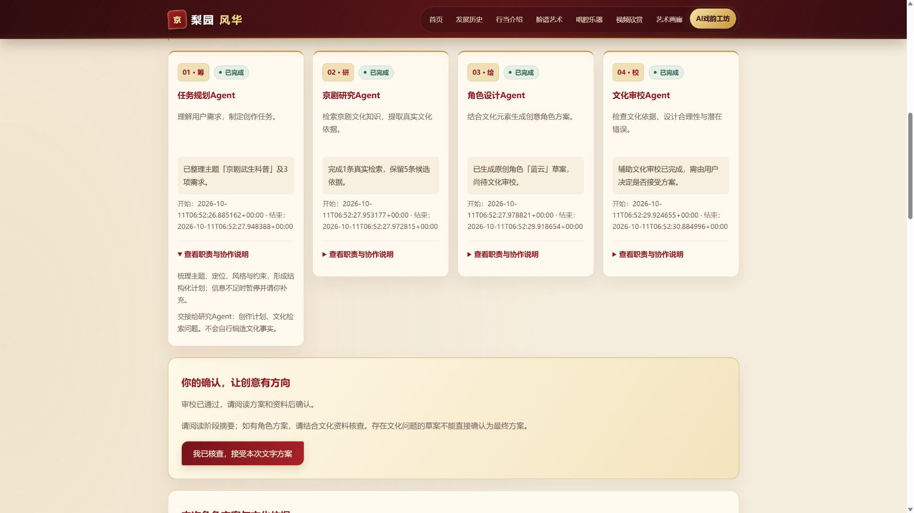

# 戏境 AI — Phase 3 多 Agent 协作阶段报告

## 1. 阶段基本信息

- 日期：2026-10-11（Asia/Shanghai）。
- 阶段：真实多 Agent 京剧文化角色文字创作、前端联调与验证。
- 工程完成状态：**COMPLETE（本地单用户范围）**。
- 用户检查点B：**待验收**；此报告不是用户验收批准。
- 检查点A真实批准：“Phase 3检查点A批准，开始Agent开发。”
- 分支：`feature/phase3-opera-agents`；未合并main，未开发Phase 4。
- 最终功能代码提交：`d96ee0c3f29e4782675df23f16b1470a522df25e`；本报告及证据的后续归档提交以真实Git记录为准，文件不自引用尚不存在的提交Hash。

已实现四角色结构化协作、复用真实RAG、持久化任务/事件、三次真实DeepSeek生成、引用与文化门禁、人工确认及文字JSON下载；正常、资料不足、澄清、审校暂停和失败均有实际证据。辅助文化审校仍可能误判，专家复核与独立质量评估尚未完成，不据工程COMPLETE宣称文化正确率100%。

## 2. Phase 1/2继承与检查

Phase 1基线 `04b2c571e068ec0b26205fcce0c075395caeebce`，Phase 2验收版本 `a95c7748e4a22bfed9f4f8261e96dffa2522b740`。在原仓库建立独立分支，保留既有历史和未提交架构资料，未重置、压缩或篡改时间。

重新检查about、工坊CSS/模块、FastAPI、RAG、Provider、环境模板、阶段报告及Git。8页多页结构、公共导航、酒红/金色/米白保留；除about工坊之外的七个文化HTML逐字节等同Phase 1。没有换React/Vue/Next.js、没有修改知识语料或Phase 2向量检索实现。

原问答协议askOperaQuestion、独立SearchService、CPU BGE 512维、SQLite来源与真实Qdrant索引继续使用；当前活动generation=`gen-20261010T104704-f628d57b`，12资料单元/35片段。本阶段不把既有摘要扩充或重新贴上“官方原文”标签。

## 3. 实际技术架构

`明确提交需求 → FastAPI创建任务 → TaskStore持久化 → 单Supervisor → Planner JSON → Research真实RAG → Designer JSON → Reviewer JSON/程序门禁 → 待用户确认 → 已确认角色JSON`。

沿用Python3.11.1、FastAPI、原生ES Module；没有新增Agent框架依赖。选择顺序编排是因为本阶段流程固定、用户控制点明确、一周周期短。四角色交接可检验产物，不是四个独立聊天窗口；没有自主任意工具、shell、网页抓取或无限循环。

| 角色 | 实际职责、输入和输出 | 模型/当前版本 |
|---|---|---|
| 任务规划 | 原始需求/风格→主题、定位、需求项、必要检索、指定实体、澄清问题 | DeepSeek；agent_planner_v4；384输出tokens |
| 京剧研究 | 计划→本次真实片段、来源/定位/分数、许可与Hash、候选覆盖、限制 | 原SearchService工具；agent_research_v4；不调用LLM |
| 角色设计 | 需求/计划/证据/限制→姓名、定位、服饰、颜色、元素、文字视觉Prompt、引用 | DeepSeek；agent_designer_v3；800输出tokens |
| 文化审校 | 原需求/完整设计/证据→pass或needs_revision或不足、问题、建议、检查ID | DeepSeek；agent_reviewer_v3；400输出tokens |

正常流程三次模型调用。全部使用既有官方DeepSeek HTTPS、deepseek-flash、非思考、JSON输出；不保存reasoning_content。公开执行记录保存真实requestId、模型、usage、耗时、Prompt版本及Hash，没有隐藏思维链。

详细模块、状态与数据字段见 [实际架构](../architecture/phase-03-agents.md)、[兼容协议](../architecture/ai-workshop-contracts.md)。

## 4. RAG研究与文化依据

Research通过原Runtime知识线程调用原SearchService，不另开Qdrant/Embedding进程；检查每条ID/摘要/sourceId一致以及external_llm_allowed许可后才交云模型。

每次保留原检索分数和uncertain。计划查询与补查合计最多三次、最终五候选；指定实体没有命中时，仅用已存在实体目录和实际语料元数据中的相关多字词补查，记录origin/expandedTerms/resolvedBy/effectiveUncertain。年份缺口、未知目录实体和不相关不足不能因此绕过。补查没有编造同义词或硬编码事实，原始失败不被覆盖。

最后真实“蟒与靠”案例先命中蟒，继而用既有“大靠/硬靠/靠旗”词查询命中靠。原query的uncertain=true和0.6144实际向量分数保留；补查靠段vectorScore约0.556、acceptedBy=exact_entity_keyword，明确不是伪称超过0.57语义阈值。之后进入设计/审校，但审校要求更具体形制，结果仍needs_revision，禁止导出。这验证漏检修复和门禁，不能称该方案通过文化审校。

指定“司雨青澜/1932”或“量子星舰行当”无真实依据时暂停，后两个阶段不执行。候选词同现不证明语义正确；资料是项目原创事实摘要，核查者为助手、京剧专家审核仍待进行。

## 5. 状态、持久化、意图控制和费用

SQLite四表保存任务、阶段、校验产物、递增事件；短事务明确关闭连接。任务waiting/running/awaiting_confirmation/completed/failed/cancelled与Agent pending/running/completed/failed/awaiting_confirmation分开。实际阶段开始/完成才推进，不用定时器假进度。

单消费者运行一个任务、最多两个等待；进程先获得agent-tasks-owner.lock才恢复/调度。另一进程未获得锁时诊断AGENT_TASKS_LOCKED，不能把活跃任务恢复为失败。启动/退出finally释放资源。重启中断任务保留历史并标WORKFLOW_INTERRUPTED，不自动重发可能计费的请求；完成与待确认任务保留。

模糊需求先澄清；研究不足先补资料；审校不通过请用户调整。新任务通过parentTaskId关联旧任务，保留演进，不自动循环设计。确认要求当前confirmationId/sequence、四阶段完成、审校pass、uncertain=false；只有接受后userConfirmed/publicationAllowed=true。取消阶段收尾后停止后续调用，已有费用不撤回。

共用Provider最多两次并发生成、等待最多五秒；工作流执行限150秒。请求无自动模型重试。累计3元与Phase 3增量0.5元在持久化账本同事务预留/检查；重启不能重置或提高增量上限。未知网络/取消费用保留预留，应用门禁不是供应商硬扣费上限。

## 6. API实现

| 方法与路径 | 实际行为 |
|---|---|
| POST /api/v1/agent/create | 严格requirements/style/可选parentTaskId，幂等键；持久化后202 |
| GET /api/v1/agent/status/{taskId} | 四阶段、公开摘要、完成数、增量events、确认原因、真实时间 |
| GET /api/v1/agent/result/{taskId} | 实际design/review/citations/uncertain/版本/确认；尚无结果409 |
| POST /api/v1/agent/confirm/{taskId} | 当前确认ID/序号，accept；验证所有文化与完成门禁 |
| POST /api/v1/agent/cancel/{taskId} | 当前序号；持久化取消意图，终态操作不重新调用模型 |

输入上限1200个UTF-16单位，风格限既有三项；幂等键ASCII8～128。相同键/相同输入返回原任务任意真实当前状态，相同键异输入409；满队列429、未就绪503、不存在404、非法参数422。游标/序号上限2^63-1防SQLite溢出。

沿用安全错误结构`{error:{code,message,retryable},requestId}`，不返回密钥、第三方原始错误或堆栈。能力同时检查真实索引/模型/消费者/预算；概念图与图生3D始终false。只绑定127.0.0.1单worker，精确CORS；本阶段没有公网账号授权及完整防滥用体系。

## 7. 前端实现与网站保留

新增隔离agent-workflow模块，保留问答和本地草稿。明确“提交Agent创作”与整理草稿不同；收到后端真实事件才更新四卡、进度和摘要。结果使用textContent、来源安全HTTP链接，显示有据设计/原创演绎及专家审核限制；没有模型文本HTML注入。

每秒约一次免费查询，不重叠、最多180次/240秒，隐藏暂停。sessionStorage只存task ID；刷新GET恢复而非创建付费任务。网络错误保留最后阶段，响应丢失的人工重试保持原body/key；失效task清除，不自动替代。确认前下载禁用，确认后实际下载JSON。

about必要DOM/CSS变化均在工坊命名空间与既有色系；其他七页不改。实际浏览器桌面/手机、八页导航、真实RAG回归、网络停机恢复、引用、取消、确认下载通过。详见 [浏览器实测报告](../evidence/test-results/phase-03/browser-test-report.md)。

## 8. 修改和新增文件

| 范围 | 文件与原因 |
|---|---|
| 后端Agent新增 | backend/app/agents下store、supervisor、workflow、schemas与四角色；backend/app/api/agents.py |
| 后端必要修改 | main.py生命周期/API注册；runtime.py能力；config.py开关/队列/期限/预算；providers/llm.py与budget.py共用并发及持久化增量保护 |
| Prompt新增/保留 | backend/prompts/agent_planner_v1～v4、designer_v1～v3、reviewer_v1～v3；Research为策略版本 |
| 前端必要修改 | about.html、css/ai-workshop.css、contracts.js、services.js、main.js；新增agent-workflow.js；保留原问答格式及草稿 |
| 测试/工具 | Agent角色、存储、调度、API、预算、生命周期测试；scripts/phase3_frontend_test.mjs；三项实际评估/归档脚本；HTTP脚本增加可选输出路径 |
| 文档 | README、.env.example、方案/架构/协议、本报告、Prompt目录、真实截图/测试证据；公开对话导出脚本 |

运行库、模型、私有env均在仓库外，未提交真实数据库。兼容风险主要是模型输出变动、浏览器缓存和本地单worker限制，已有严格校验/统一缓存版本/运行说明。

## 9. 实际测试结果和质量边界

环境：Windows、Python3.11.1、Node24.15.0、原有依赖/CPU BGE缓存和活动索引、真实DeepSeek权限；没有新安装依赖。离线与真实证据严格区分。

| 实际执行 | 结果 |
|---|---|
| `.venv/Scripts/python.exe -m pytest -q backend/tests --junitxml=<仓库外路径>` | 213通过、0失败、0跳过；终端6.70秒，JUnit套件6.653秒；一个原有Starlette/httpx弃用警告 |
| `node scripts/phase3_frontend_test.mjs --output ...` | 25项Agent离线双桩/静态检查通过 |
| `node scripts/phase2_frontend_test.mjs --output ...` | 25项原问答离线回归通过 |
| `python scripts/phase2_http_smoke.py --output .../http-regression-final.json` | 真HTTP8页、62资源、6受保护路径通过；七文化页字节一致 |
| `python -m backend.scripts.evaluate_agent_api --task-id <已有UUID> --output ...` | 真HTTP14项通过，免费幂等重放，无新增模型请求 |
| `python -m backend.scripts.evaluate_agent_workflow --case ... --allow-paid --output ...` | 16次显式真实运行，29次模型调用，保留早期失败和受控暂停 |
| 真实浏览器操作 | 4次创作、10次模型调用，加一次真实RAG问答；确认/下载、刷新/重启、停机恢复、手机引用/取消均实测 |

16次脚本覆盖武生、服饰、净行脸谱、刀马旦、错误人物、未知行当、模糊需求七种需求；**不是20个成功设计或20题独立盲测**。全部provider请求成功不等于所有工作流成功：结构校验失败或审校问题仍正确返回failed/待确认。

| 真实案例 | 主要结果 |
|---|---|
| sheng首轮 | 四阶段完成、pass、待确认；3调用、3567tokens、5.7593秒 |
| face首轮 | 虽模型pass但助手发现不支持的服饰引用，记质量失败并取消旧任务 |
| false-person首轮→v2 | 首轮相似资料不能证明前提，后续人物/年份守卫令Research暂停，后两阶段未调用 |
| costume首轮/v2/v3/v4 | 过宽查询、Schema失败、靠漏检等均保留，不掩盖为成功 |
| face v2→v3 | v2误判原创声明；v3主要文化断言有据、服饰标原创、pass；3调用、3699tokens、4.6922秒 |
| dan v3 | 硬靠/雉尾与靠旗有据，配色/细节原创、pass；3调用、3675tokens、4.6749秒 |
| clarify v3→v4 | v3空检索字段被Schema拒绝；v4正确澄清，1调用483tokens，后续未执行 |
| costume Research v4 | 原不足保留、真实元数据补查补齐；4阶段完成但needs_revision，不能接受；3调用3653tokens、5.7197秒 |
| 最终浏览器“蓝云” | 最终版本4阶段完成，pass、待用户确认；3调用3861tokens，实际阶段开始至审校完成约4.00秒 |

所有输出引用映射检查可查看原始JSON；身份/文本相等校验不代表语义有效率。助手另行对照关键事实，见 [文化复核记录](../evidence/test-results/phase-03/assistant-cultural-review.md)，专业人工评价仍未完成。不制造Recall、人类正确率、盲测质量或提升百分比。

证据：[后端213项](../evidence/test-results/phase-03/backend-unit-final.json)、[Agent前端](../evidence/test-results/phase-03-frontend-offline.json)、[原问答前端](../evidence/test-results/phase-03/phase2-front-regression.json)、[全部实际脚本案例](../evidence/test-results/phase-03/real-cases-summary.json)、[浏览器产物](../evidence/test-results/phase-03/browser-tasks-final.json)。

## 10. 真实API用量和费用

Phase 3账本实际 **40次success供应商请求**：29次脚本工作流、10次浏览器创作、1次原RAG问答回归。实际输入33387、输出6599、合计39986 tokens；缓存命中6016、未命中27371。增量保守估算 **0.10777464元**，在0.5元批准预算内。

保留Phase 2原62请求/0.13343424元后，全站累计102请求、保守估算 **0.24120888元**。没有读取官方实时余额或将此估算称作账单。估算使用代码所记已核对峰价：输入未命中2、命中0.04、输出8元/百万tokens；来源和核对日期在 [费用证据](../evidence/test-results/phase-03/api-usage-final.json)。无自动大规模付费重试。

## 11. Git与真实Prompt演进

| 完整提交Hash | 真实变更 |
|---|---|
| b6041be91fb26f39c002182ca45eca7b5ff772d8 | 归档用户批准、原需求和检查点A方案 |
| 381d62e746306d66193de1c3e62db1be25ae1b1a | 持久化任务、生命周期、共用费用保护 |
| 903fe1d94a6b927f13aca52460c30a858e2399ea | 四角色及结构化交接/真实RAG研究 |
| 81dd4516a5d42854ef488488f8aec83c24b555b0 | 真实前端协作、确认/结果/导出 |
| 63ce099081bc46a370e765b13de0c166fb2df2fd | 文化引用缺口、独占任务调度等修复与真实初次结果 |
| 3d50f70f68137a19de604690bf7de5930d11a1ee | 保留检索不足、紧凑计划与单字实体校验 |
| d96ee0c3f29e4782675df23f16b1470a522df25e | 模糊需求澄清、缺实体有界补查与真实v4复测 |

本报告与完整证据作为后续非空归档提交；最终交付回复列其实际Hash。没有空提交、回填日期、一次性initial commit或main合并。

原始用户需求完整保存，SHA256=`d847a24b5b7ab7585592e4bcfc247bccffbab7d7189eb1f4cb62625ce5761069`。批准、公开AI消息/工具过程、角色Prompt版本和实际Bug链保存在 [Phase 3 Prompt目录](../prompts/phase-03/README.md)；公开对话导出是时间快照，排除系统/隐藏推理、私有子Agent记录、秘密与未来验收，数量/Hash由metadata记录。没有编造用户反馈。

## 12. 实际发现和修复

| 问题 | 修改/验证 |
|---|---|
| 阶段completed后再次await重复产物 | 单次持久化与合法最终状态，角色/事件测试验证 |
| 相似人物/年份被当真实前提候选 | 指定实体及年份守卫，真实false-person v2暂停 |
| face首版服饰有引用但无语义支持 | 设计原创分层、审校Prompt、保守服饰文字守卫；保留首版错误与取消记录 |
| face v2对已有原创声明误报 | v3读取完整设计/视觉Prompt/限制再评判，真实face v3复测 |
| 单字文化实体与澄清空查询冲突 | 单字长度1、澄清条件允许空query、Planner v4；真实clarify v4不额外检索/生成 |
| 蟒/靠比较漏检已收录靠 | Research v4有界元数据补查，真实分数/不足记录保留；后续审校未通过也如实保留 |
| 第二进程恢复他人活跃任务 | 独占任务锁先于恢复；终态取消守卫；相关离线进程/状态测试 |
| 超大事件游标引发SQLite内部溢出 | 2^63-1限制，真实HTTP422复查 |
| SQLite连接/部分启动资源未释放 | 显式close、lifespan分层finally；生命周期回归 |
| 创建响应丢失/旧状态/取消反馈 | 原幂等body/key、多状态重放、序号门禁、cancelled优先；离线与真实浏览器复核 |

不是所有Schema失败都有原始模型文本证据。costume v2实际completion为111tokens，不记为已证实截断；单字限制确实由代码/离线测试发现，但不把它断言为那次模型响应的唯一根因。当前坏计划诊断只保存白名单路径/错误类型及脱敏usage，不存raw输出。

## 13. 可复现性和比赛评分对应

[README](../../README.md)提供当前分支、原依赖安装/模型与入库流程、仓库外env、单worker启动、真实协作步骤、免费测试及显式付费案例命令。Phase 3新增代码无需新框架依赖；本次复用了已有CPU模型、索引和API权限。最终真实网页协作约4秒；这不是冷电脑安装耗时，未承诺空机十分钟完成全部下载/安装。

| 比赛维度 | 本阶段真实证据 |
|---|---|
| 过程可复现性25% | 独立阶段分支、逐模块提交、完整原需求/批准/公开过程、版本与失败保留、可重跑命令 |
| 解题有效性25% | 文化检索支撑原创角色，真实RAG/LLM闭环、明确不足与澄清、来源和人工确认 |
| 方法创新/意图控制20% | 结构化四角色交接、事实与创意分离、文化证据门禁、实体补查与不确定性保留 |
| 工程质量15% | 分层模块、严格状态/Schema、持久化/幂等/锁/并发、两级费用、213后端与50前端离线检查 |
| 用户体验15% | 保留原网站、桌面四卡/手机流式布局、公开摘要/来源、恢复/取消/确认/文字导出，真实截图 |

## 14. 遗留问题与验收结论

当前无已知阻断性程序/布局问题；这不等于所有模型输出永远正确。保留风险：小语料专业覆盖有限，实体/年份文字门禁不是真值证明；Reviewer可能漏判或过度要求形制，服饰守卫可能误报；知识和方案尚无京剧专家审核；真实案例是开发调参集，非独立盲测；本地单用户、单worker，公网授权/限流/负载测试待后续设计。模型/索引/Key/预算不可用时能力真实失效。

| 工程验收项 | 判断 |
|---|---|
| 方案已批准、原项目检查与基线保护 | 满足，有实际原文与Git |
| 四角色职责、真实结构化交接与RAG研究 | 满足，真实产物/来源/查询/模型usage |
| DeepSeek实际生成、程序引用映射 | 满足，40调用及明确定义的语义限制 |
| 真实状态、持久化、幂等、重启/取消/确认 | 满足，离线/API/实际浏览器证据 |
| 文化不足/审校问题/模糊需求的受控暂停 | 满足，失败与修复记录齐全，不伪造成功 |
| 既有问答和七文化页面保留 | 满足，50前端离线检查、真实RAG回归、8页/资源与字节比较 |
| 桌面/手机浏览器、真实截图/控制台 | 满足，见浏览器报告及JSON |
| 费用/密钥/前端安全边界 | 满足预算范围；秘密扫描随最终归档保存；私有env/运行库不上传 |
| 真实Git/Prompt/README/架构/阶段报告 | 已归档，后续提交以真实Git为准 |
| 用户检查点B正式验收 | **待用户决定，未代替用户批准** |

## 15. 下一阶段技术条件与停止

已具备输出已确认角色JSON、design.visualPrompt、真实文化引用、审校及知识版本的基础。Phase 4可以在用户批准后读取这些文字，先获得真实且允许使用的概念图，再提交未来Neural4D图生3D；不能把文字Prompt直接冒充图片输入。

本阶段到此停止，不自动生成概念图、不调用Neural4D、不合并main。等待用户检查Phase 3报告并明确验收/批准下一阶段。
