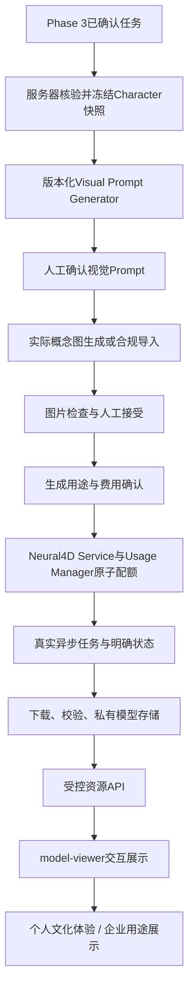

# 戏境 AI — Phase 4 数字IP与Neural4D架构方案（检查点A最终修订）

- 审查日期：2026-10-11，Asia/Shanghai。
- 项目：`D:\京剧\京剧`。
- 状态：**检查点A方案已完成，等待用户批准开发；Phase 4尚未实现或测试。**
- 方案版本：v4，三次真实建模提交尝试硬限制。
- 前次审查读取了真实代码、Git与既有证据，并查阅公开官方文档。本次最终修订仅编辑本方案文件；未修改功能代码、创建开发分支、安装依赖、启动服务、调用Neural4D或任何付费API。
- 当前分支：`feature/phase3-opera-agents`。
- 当前HEAD：`c89e63e1f5afa575b5e3972dd5cfa26a897d3942`。

## 1. Phase 4目标与现有成果审查

### 1.1 目标与边界

将“真实文化证据 → 四Agent角色创作 → 经确认的Character JSON → 视觉Prompt → 实际概念图 → Neural4D模型 → 网页交互与用途展示”连接成可追溯的数字IP生产流程。

继续保留8个静态HTML页面、原生ES Module、酒红/金色/米白视觉体系、已有RAG与Agent实现。新增数字资产模块不迁移React/Vue，不替换知识库，不扩建CRM、支付或游戏引擎。模型可供网页观察，不预先宣称已具备骨骼、动画、游戏低面数、可打印性或全部商业授权。

### 1.2 用户额度要求的真实演进

真实演进为：全部请求最多3次 → 全部请求最多8次 → 按实际需要不限制请求 → **本次最终确认：全项目最多3次新建模型任务的HTTP提交尝试，每次modelCount=1，最多3个模型。** 前三个表述保留为演进证据，不再用于取消建模配额。

当前唯一有效政策：**新建3D模型提交尝试上限固定为3，不能取消；余额/鉴权查询、图片预处理、状态查询、文件下载和仅格式转换的请求另行记账，不占新建模型尝试额度。** 后者仍须符合文档、费用与人工授权，不能被用来隐蔽重新生成。任何会创建新模型的接口、变体、重建或重新生成均经过同一Usage Manager，并消耗新建模型额度；操作性质无法确认时禁止发送。

技术验证、比赛核心模型、企业展示是三个拟定用途，不保证最终获得三个成功模型：失败和可能已发送的未知结果也占次数。**用户已拥有Neural4D API Key，但本地配置、实际鉴权和余额尚未验证。** 仍处于检查点A，当前不得调用任何实际供应商API；后续开发批准也不等于三次建模一次性获准，必须逐次明确确认。

### 1.3 Git与目录核对

审查开始时 `git status --short` 无输出，工作区干净。`git branch -vv` 显示当前分支与本地记录的 `origin/feature/phase3-opera-agents` 同为c89e63e；本次没有fetch，因此这不是对GitHub实时状态的重新验证。main仍停留在Phase 1，既有历史未合并或压缩。

真实主要结构（省略资源文件、缓存与既有测试明细）：

```text
京剧/
├── index.html / history.html / roles.html / facial.html
├── music.html / video.html / gallery.html / about.html
├── css/ai-workshop.css 与既有文化页面样式
├── js/ai-workshop/
│   ├── contracts.js
│   ├── services.js
│   ├── main.js
│   └── agent-workflow.js
├── backend/
│   ├── app/
│   │   ├── agents/         # 已实现四Agent、任务持久化和确认
│   │   ├── api/agents.py
│   │   ├── knowledge/      # SQLite/BGE/Qdrant
│   │   ├── providers/      # DeepSeek与金额账本
│   │   ├── services/       # runtime/chat/search
│   │   ├── main.py / config.py / schemas.py
│   │   └── static_frontend.py
│   ├── scripts/
│   ├── tests/
│   └── requirements.txt
├── knowledge/ / scripts/
├── images/ / audio/ / media/
└── docs/{architecture,reports,prompts,evidence}/
```

没有独立的 `frontend/` 或根目录 `agents/`；不能按不存在的目录制定迁移计划。已有 `backend/scripts/download_model.py` 属于Embedding准备工具，不能因为文件名就认定具有数字角色下载功能。

Phase 3八次真实提交均保留：

| Commit | 实际内容 |
|---|---|
| `b6041be91fb26f39c002182ca45eca7b5ff772d8` | 架构批准与原需求归档 |
| `381d62e746306d66193de1c3e62db1be25ae1b1a` | 持久化任务、队列与预算 |
| `903fe1d94a6b927f13aca52460c30a858e2399ea` | 有文化证据的四角色协作 |
| `81dd4516a5d42854ef488488f8aec83c24b555b0` | 工坊任务与人工确认接入 |
| `63ce099081bc46a370e765b13de0c166fb2df2fd` | 文化断言与任务独占修复 |
| `3d50f70f68137a19de604690bf7de5930d11a1ee` | 不确定性保留与方案校验 |
| `d96ee0c3f29e4782675df23f16b1470a522df25e` | 需求澄清与有限实体补查 |
| `c89e63e1f5afa575b5e3972dd5cfa26a897d3942` | 真实测试、费用与复现归档 |

Phase 1基线 `04b2c571e068ec0b26205fcce0c075395caeebce`，Phase 2基线 `a95c7748e4a22bfed9f4f8261e96dffa2522b740`。Phase 3报告记载工程COMPLETE，同时写明用户检查点B待验收、文化专家复核待进行。本次核实代码和证据完整存在，没有重新执行其测试，也不把报告视为用户对每份角色方案的最终素材批准。

### 1.4 Character JSON的实际适用性

`backend/app/agents/schemas.py:54` 的 `CharacterDesign` 是严格版本化文字结构：姓名、定位、服饰、颜色、视觉元素、原创元素、`visualPrompt`、依据ID与限制。元素区分 `evidence_based` 与 `creative`，视觉Prompt最多320字符。严格模型拒绝额外字段，不能直接往旧设计对象塞入图片、模型或企业字段。

`workflow.py`保留设计、审校、真实引用、知识库generation与Prompt版本。`store.py:170`检查四阶段完成、审校pass和无不确定性；`store.py:237`再检查确认ID和序号，完成后才能设置用户确认与允许发布。Phase 4应服务器端重读这些记录，不能相信浏览器上传JSON中的布尔值。

| 已归档任务 | 实际状态 | 资产使用判断 |
|---|---|---|
| `0a808e2b-182e-4457-b0bb-5e4f39a66263`，青旌将·霄羽 | 已确认；旧v1 Prompt | 可作为既有文字样本，仍需本阶段视觉、图片与调用确认 |
| `1a18ff2c-93bb-47fb-8060-3de45378a721`，蓝云 | awaiting_confirmation；Planner/Research v4、Designer/Reviewer v3 | 尚不可直接生成 |
| `174e97bf-4df1-4970-83e0-108afc81ec73`，银翎云将 | awaiting_confirmation | 尚不可直接生成 |
| `75783c7e-d83a-4129-8e7d-5d9482df05f9`，资料不足 | cancelled，无设计 | 禁止生成 |

依据为 `docs/evidence/test-results/phase-03/browser-tasks-final.json` 和 `browser-confirmed-character.json`。已确认样本是测试过程的真实确认记录，不能据此认定用户已经选择其为最终比赛角色。

Character JSON适合生成视觉指令；它不是几何、贴图、图像、骨骼或3D文件。当前视觉Prompt含“舞台写意背景”，需要另建适合图生3D的版本，保留原始文化意图并让用户审阅。

### 1.5 工坊与3D能力审查

`about.html:252`有概念图空态，`:260`有Neural4D面板，`:267`是未来Viewer容器；没有真实概念图或模型。全仓库源码与资源检索没有Three.js、model-viewer、Babylon、WebGL/canvas Viewer实现，也没有GLB/GLTF资产。

`services.js:205/208`中的概念图与模型提交仍抛未接入提示；`contracts.js:85`将这两项能力强制归一为false。只有类型注释不代表已经具有模型服务。Phase 4需要协调前后端协议、能力校验和按钮启用。

## 2. 总体技术架构

推荐沿用FastAPI与SQLite，新增独立资产层、供应商适配层和局部Viewer，避免复杂微服务。



RAG引用、Agent版本与角色快照作为资产溯源数据，不让Agent自动触发Neural4D。问答、Agent和资产模块分别初始化；资产异常不能阻断原问答。

### 2.1 Character Asset Schema设计

新建外层 `CharacterAsset`，保留旧CharacterDesign原样，拟包含：

| 字段组 | 拟保存内容 |
|---|---|
| 身份 | assetId、assetSchemaVersion、version、sourceTaskId、mode、purpose |
| 角色快照 | characterSnapshot、reviewSnapshot、citationSnapshot、sourceResultHash |
| 溯源 | knowledgeGeneration、promptVersions、来源/片段版本与Hash |
| 视觉指令 | originalVisualPrompt、imagePrompt、negativePrompt、templateVersion、promptHash |
| 图片 | imageId、hash、MIME、宽高、文件大小、来源方式、供应商/任务ID、许可说明 |
| 确认 | 角色确认引用、视觉确认、图片接受、调用批准ID、时间与输入Hash |
| 模型 | jobId、providerTaskId、format、size、sha256、内部存储键、校验报告、资源URL |
| 展示 | viewerState、用途说明、限制、商业许可核查状态 |

确认是三道独立门禁：**角色确认 → 视觉Prompt/概念图确认 → 本次真实生成批准**。修改图片、Prompt、源任务或用途后，旧批准失效。新资产版本不覆盖已确认快照。

### 2.2 Visual Prompt Generator

先采用本地确定性模板，无需新增文本模型调用。读取服饰、配色、依据与原创标签，另存模板版本和Hash，不重写Phase 3原始Prompt。技术约束包括单角色、全身完整、足部可见、构件边界清晰、简洁背景、均匀光照、适当正面或三分之四视角；禁止在画面叠加文字、水印和多人物拼贴。

靠旗、雉尾、长枪、薄片与镂空结构列为高风险部件。模板不能为了成模擅自删除文化元素；需要简化时列出取舍并等待用户接受。背面细节可能由供应商推断，应记录为生成内容，不能宣称全方位扮相已由文化资料证明。

### 2.3 概念图路径与外部条件

目前仅有DeepSeek文本Provider，没有已配置的图像生成Provider。**不能把视觉Prompt或空态图片称作已生成概念图。**

推荐先实现真实图片上传/登记与许可、内容确认，再接一个用户选定的图像Provider。上传图片可由用户在有使用权的工具中实际生成，标记 `imported_ai_image`；普通授权图片标记 `manual_image`。这两者不能被描述为本平台API生成。

Neural4D官方索引也列有图片生成接口，但尚未核实该账户权限、模型、价格与完整返回协议，因此本方案不默认调用它。平台概念图API的供应商、预算、凭证和商用条件须在开发时落实；未落实则保留“导入概念图可用，平台生成未接入”。[官方能力索引](https://docs.neural4d.com/llms.txt)

## 3. Neural4D服务设计

### 3.1 官方资料核验与适配边界

已阅读公开官方索引、Quickstart、模型查询说明及官方API Documentation 1.2。索引目前将3D接口放在old管理接口组，v1组主要列文件、图像与视频任务，不能把图像v1任务协议直接套到3D上。用户提供的概览属于能力介绍，不能单独决定具体请求字段。[官方索引](https://docs.neural4d.com/llms.txt)、[Quickstart](https://docs.neural4d.com/en/quickstart)

管理接口示例使用 `https://alb.neural4d.com:3000/api` 与服务端Bearer Token。传统图生3D链路为：`mattingImage(image文件)` → `getMattedResult(requestId)` → `generateModelWithImage(fileKey)` → `retrieveModel(uuid)` → 下载真实模型。图片建议JPG/JPEG/PNG/WEBP、低于10MB；生成请求必须显式指定 `modelCount=1`，避免默认多个输出。生成返回UUID，查询得到真实结果URL。[官方API文档1.2，第6—10页](https://blog.neural4d.com/wp-content/uploads/2026/01/Neural4D-API-Documentation.pdf)

上述旧文档可用于设计协议适配，但**不是已经验证账户当前接口可用**。部分索引中的新版图生3D页面抓取失败，尚未确认新字段或旧接口迁移情况。批准开发后，每种实际操作首次请求前核对当时的完整官方接口说明，锁定路径、参数、计费和返回协议，保存查阅日期与版本；不得凭营销文章自行补造参数。现在没有做鉴权、余额或连通测试。

### 3.1.1 已有凭证与不创建模型的连接验证

用户已经拥有Neural4D API Key。后端仅从本地环境变量 `NEURAL4D_API_KEY` 读取，沿用仓库外 `D:\京剧\.private-config\.env`；配置模板只含空值。本次不读取真实密钥，不创建或修改.env，不要求在Codex聊天中发送密钥。真实密钥不得进入代码、浏览器、日志、截图、Git或GitHub。

正式开发批准后，先检查配置存在，优先采用官方确认的只读余额或鉴权查询验证连接，不以创建测试模型探测Token。旧官方资料的余额接口为 `POST /api/queryPointsInfo`，实施前重新核对当前文档，确认不创建模型及计费条件；若没有合适的只读接口，显示“连接尚未验证”，不能回退为自动建模。[官方API文档1.2，第14页](https://blog.neural4d.com/wp-content/uploads/2026/01/Neural4D-API-Documentation.pdf)

诊断须由用户明确触发，保留脱敏状态、耗时和时间；启动、页面加载、Agent完成不自动调用。配置存在、鉴权成功、余额充足、具备建模权限分别显示，不能将“已有Key”标记为全部通过。真实建模仍默认关闭，只有后续单次建模授权、后端鉴权、输入确认与剩余额度全部通过才允许发送。

### 3.2 服务职责

`Neural4DService`只接收服务器登记并接受的imageId与资产版本，不接受浏览器任意外链、供应商fileKey或任意JSON。它负责参数白名单、预处理任务、提交、显式查询、响应校验与下载登记。所有真实模型创建只能走 `Neural4DService → Neural4D Usage Manager → 受控Transport` 同一入口；Agent、脚本、浏览器或其他供应商变体不得绕过它。浏览器从不持有供应商Token。

拟新增 `NEURAL4D_GENERATION_ENABLED=false`，默认关闭真实建模；仅配置Key或启用开发环境不足以解锁。启用后还必须逐次核验后端鉴权、概念图确认、输入Hash、人工批准、预算与原子剩余额度。固定发送 `modelCount=1`，服务端拒绝客户端大于1的参数；若当前接口不能保证单模型输出，不接入该创建接口。

拟定超时：提交/查询30秒、文件传输90秒，最终根据官方限制和实际测试调整。每次请求只有一个HTTP尝试，关闭库级自动重试与自动重定向。未知结果不自动重发生成。

查询结果的 `codeStatus` 应按当前官方协议映射：成功、生成中、Token失效、任务不存在、生成失败。HTTP 200不等于生成成功，UUID不存在也不自动创建新模型。[官方Retrieve model](https://docs.neural4d.com/en/api-reference/model-management/retrieve-model)

### 3.3 本地任务状态与查询

资产任务状态建议为 `awaiting_image / awaiting_approval / queued / preprocessing / submitted / processing / downloading / validating / succeeded / failed / unknown / pending_reconciliation / cancelled_local`。配额提交记录使用第4节的明确大写状态，Viewer状态另行管理。

- 网页刷新、查看本地任务状态、切换面板均只读本地SQLite，不隐含供应商请求。
- 提供“查询供应商状态”操作，一次明确操作对应一次查询，建议最小间隔15秒。
- 初始每任务20次查询或20分钟后暂停，显示最后真实状态；此为查询停止策略，不是全项目HTTP次数额度。继续查询需显式操作。
- 不建立无限轮询、自动重新生成或Agent后台循环调用。没有真实进度时仅显示阶段与时间，不编造百分比。
- 请求可能已发出但未取得明确结果时标记 `UNKNOWN / PENDING_RECONCILIATION`，显示“结果未知，额度已保留，请核对原任务”；保留已知UUID、输入Hash、发送时间和历史，不自动退款次数或新建模型。
- UUID已知时查询原任务；UUID遗失时，仅使用官方支持的记录查询或由用户核对供应商后台。不能假定存在按本地幂等键查询的供应商接口，查不到也不等于从未提交。
- 未发现官方已核实的Webhook签名协议；本阶段不假定可以靠回调省略查询，也不新增公网回调基础设施。

### 3.4 文件保存与错误处理

运行数据拟置于既有仓库外目录 `D:\京剧\.runtime\xijing-ai\assets\`，供应商链接用于服务端短期下载，不作为长期前端src。暂存 `.part` 文件，检查长度、内容与Hash后原子转入版本目录。

下载URL须HTTPS、经过实际供应商域名白名单、DNS/IP与重定向目标检查，拒绝本地、内网及任意外部地址；不向下载域名转发API Authorization。供应商URL可能携带签名参数，不进入公开日志或截图。下载只取得原任务文件，另行计数，不新建模型或消耗三次建模配额；下载失败不能触发重新生成。

统一中文错误至少覆盖缺少配置、鉴权/权限、余额、参数、限流、服务失败、超时、未知结果、响应字段不匹配、图像预处理失败、下载失败、文件过大和GLB无效。错误响应沿用requestId，不返回Token、签名URL、私有路径或原始堆栈。

### 3.5 拟新增项目内部API

以下均为设计，不是已存在的接口：

| 方法 | 路径 | 作用及是否出站 |
|---|---|---|
| POST | `/api/v1/assets/neural4d/verify` | 人工触发已核实的只读鉴权/余额查询；不创建模型、不占建模次数 |
| POST | `/api/v1/assets/characters` | 从真实已确认sourceTaskId建立资产快照；本地 |
| GET | `/api/v1/assets/characters/{assetId}` | 角色、Prompt、图片和模型摘要；本地 |
| POST | `/api/v1/assets/characters/{assetId}/visual-approval` | 确认特定Prompt版本；本地 |
| POST | `/api/v1/assets/images` | 合规上传并检查图片；本地 |
| POST | `/api/v1/assets/images/{imageId}/accept` | 人工接受实际概念图；本地 |
| POST | `/api/v1/assets/model-approvals` | 用户看过完整确认页后，确认绑定版本/参数/用途的单次批准；本地 |
| POST | `/api/v1/assets/model-tasks` | 消耗单次批准，通过Usage Manager原子预约再提交；新建尝试最多3次 |
| GET | `/api/v1/assets/model-tasks/{jobId}` | 读取本地状态；不出站 |
| POST | `/api/v1/assets/model-tasks/{jobId}/refresh` | 明确查询供应商并记录；出站 |
| GET | `/api/v1/assets/usage` | 请求、生成用途与费用记录；本地 |
| GET | `/api/v1/assets/models/{modelId}/file` | 加载已校验、获准展示文件；本地 |
| GET | `/api/v1/assets/models/{modelId}/download` | 授权下载已登记模型；本地 |

保持旧 `submitModelTask({imageId})` 的基本调用语义，增加assetId/version/purpose/approvalId与 `X-Idempotency-Key`。保留ModelTask核心jobId、状态、modelUrl、downloadUrl、errorCode，补全真实状态校验，不把供应商响应直接透传给前端。

## 4. Neural4D Usage Manager：三次硬限制、原子配额与费用保护

### 4.1 当前计数政策

采用 **Neural4D Usage Manager**，将新建模型尝试与普通供应商请求分账。全项目固定 `max_creation_attempts=3`、`max_models=3`、`modelCount=1`。新建提交被HTTP错误拒绝、生成失败、可能已发送后超时或取消，都占一次，不自动返还。失败后的重新创建同样是一笔新尝试，不是免费重试。

余额/鉴权、预处理、状态查询、下载及已核实不创建几何的格式转换不消耗新建次数，但各自记录请求及费用；禁用未知操作、通过别的创建接口绕过额度及供应商默认多候选。输出若返回超过一个模型UUID，标记契约异常并关闭后续创建，不能择一保存而隐瞒多余输出。

以下为拟定协议，null表示历史尚未核实，**不是额度无限或已使用0次**：

```json
{
  "policyVersion": "phase4-generation-attempts-v4",
  "max_creation_attempts": 3,
  "max_models": 3,
  "modelCount": 1,
  "used_attempts": null,
  "reserved_attempts": null,
  "remaining_attempts": null,
  "historicalUsageVerified": false,
  "realGenerationEnabled": false,
  "plannedGenerationPurposes": ["technical", "competition", "enterprise"],
  "automaticGenerationRetry": false
}
```

本次检查点A实际供应商请求和新建建模提交均为0。仓库没有实现不证明全项目历史用量为0；首次启用须核对并登记既有提交尝试、生成与费用。未核实历史时关闭真实创建，不能自动初始化满额。

显示“已使用/可能发送”“已预约”“剩余”三个值；剩余按 `3 - 已核实历史占用 - 当前已占用记录` 计算，预约和UNKNOWN均占用且不得重复计算。固定项目ID与仓库外唯一权威账本，不按分支、密钥、进程、用户或用途重新分配3次。重启、修改环境变量或切换分支不能增加额度；账本缺失、损坏或不一致时失败关闭，经历史核查恢复，不自动清零。

服务入口只能约束本应用，不能阻止用户另行从其他工具调用。要求该项目全部真实新建任务使用同一入口；任何发现的外部项目任务必须补入历史占用，不能以外部调用规避上限。

### 4.2 持久化与幂等

拟在私有运行目录新增资产SQLite，包括 `character_assets / image_assets / model_jobs / asset_approvals / model_creation_attempts / neural4d_requests / usage_policy`。复用现有SQLite `BEGIN IMMEDIATE`事务模式、Agent幂等设计和进程独占锁思想，不直接复用DeepSeek的Token金额算法。

核心持久结构：

| 表 | 关键约束与字段 |
|---|---|
| usage_policy | 固定projectId，max_creation_attempts固定3，历史核实、历史占用、政策版本；无环境变量调大或自动重置入口 |
| asset_approvals | 批准ID、角色/图片/Prompt/参数/用途Hash、费用快照、确认时间、有效期、消费状态 |
| model_creation_attempts | attemptId、projectId、唯一幂等键、唯一approvalId、payloadHash、用途、状态、预约/发送时间、providerTaskId、HTTP状态与脱敏错误 |
| neural4d_requests | 每次真实HTTP操作、是否模型创建、关联attemptId、耗时及实际费用；与创建额度分账 |
| model_jobs | 原任务UUID、图片/角色快照、文件与校验状态；不能通过修改jobId产生免费新提交 |

幂等键同内容仅返回既有记录/状态，不再出站；同键不同内容409。除唯一键外，检查同资产版本/图片/参数已有在途、未知或已完成任务，换一个新键重复点击也不能暗中绕过。再次建模必须走独立“重新创建”确认，新批准、新attempt，并消耗剩余额度；UNKNOWN未核清时拒绝该输入的重新创建。

每条新建记录的保守流程：

1. 事务外先完成官方协议、本地输入、真实鉴权、费用与人工确认预检，冻结最终fileKey与 `modelCount=1` 的请求Hash。预处理不自动创建模型。
2. 开启短事务 `BEGIN IMMEDIATE`，重查批准和Hash、历史核实、默认开关/鉴权状态、已有幂等记录以及所有占用。如果累计占用已达3，拒绝第四次并不出站。
3. 同一事务插入 `RESERVED` 记录并一次消费批准、占用一格，提交事务。额度计数和预约必须原子完成，不能先查询余额再单独插入。
4. 单一owner取得发送权，条件更新 `RESERVED → ATTEMPT_STARTED` 并持久提交，然后仅发送一次新建HTTP；禁用Transport自动重试、自动重定向、SDK内部重试与供应商自动重新生成选项。
5. 得到有效单模型UUID后保存 `SUBMITTED`，将后续处理限定为该任务查询/下载。失败保存 `FAILED`，不返还次数；未知结果保存 `UNKNOWN / PENDING_RECONCILIATION`，保留次数。

预约后本方案不自动释放额度，包含重启时遗留的RESERVED，以保守避免重复发送。正常本地预检失败应在预约前返回；任何可能已发送的记录永不自动退次。SQLite异常不得采用“先发送，恢复后补记”的降级方式。

数据库与远端HTTP无法形成同一事务。供应商幂等能力尚未核实时，只承诺**本应用每条attempt至多一次网络发送尝试**，不能声称远端恰好创建一次。不可假定供应商识别本地 `X-Idempotency-Key`；若官方明确提供幂等字段，才补充映射，且不放开重试/配额。

### 4.2.1 并发、失败与人工核查规则

| 场景 | 处理与额度结果 |
|---|---|
| 同按钮多次点击/同键重放 | 同一批准/幂等记录返回原状态，仅一笔预约；不能只靠按钮禁用 |
| 不同键并发提交 | SQLite串行检查占用；剩余1时最多一个预约成功；唯一批准消费防重复 |
| 两个服务或worker | 同一权威SQLite与进程owner锁；第二执行者不能领取/发送同一记录 |
| 预约后崩溃或服务重启 | 遗留记录转PENDING_RECONCILIATION并保留占用，不恢复为可自动发送队列 |
| 发送超时、断网、取消、5xx或响应不明确 | UNKNOWN/PENDING_RECONCILIATION，保留次数，查原任务，不自动重建 |
| 成功响应收到但本地保存失败 | 立即停用新的创建；已有UUID优先安全落盘/核查；UUID遗失则人工核对供应商记录，仍占次数 |
| 已有UUID却查询不存在 | 核查账号、UUID和供应商记录；不据此返还或自动新建 |
| 生成明确失败后用户要求再建 | 旧尝试保留；新图片/参数与新的逐次确认通过后消耗另一格，剩余0则拒绝 |
| 额度已用/预约3格 | 新建入口返回明确配额错误；原任务查询、下载和合法模型查看继续可用 |

只读供应商记录核查不能创建模型；官方没有可用记录接口或UUID丢失时由用户核对后台。核查结论、依据和时间作为追加记录保存，不删除或改写旧失败。恢复/核查绝不把“不确定”自动当成“从未请求”。

### 4.3 费用与权限

用户已有Neural4D Key，但余额、建模权限、套餐和商用条件仍待实际核实；概念图供应商和费用尚待确认。Neural4D、图像生成与DeepSeek是不同费用边界。旧官方PDF不能用来承诺当前人民币价格，最终依据请求时官方费率与实际返回记录Credit。

环境方案明确读取 `NEURAL4D_API_KEY`，新增默认false的真实生成开关；不提供将3次上限调大的配置项。模板不含真实密钥，日志不输出认证头。实际请求前核对官方文档，先以获准的只读余额/鉴权操作验证；真实建模必须另行逐次明确授权。

单次建模确认页面必须同时展示以下内容，后端从已冻结记录生成而不是信任浏览器转交：

| 必须展示 | 确认约束 |
|---|---|
| 当前角色名称与角色版本 | 来自服务器已确认任务及审校/文化依据快照 |
| 已确认概念图 | 显示实际图片及其接受状态，不能仅有文字Prompt |
| 图片SHA-256 Hash | 绑定实际输入字节；替换图片使批准失效 |
| 当前生成参数 | 完整影响生成的参数、Prompt版本/Hash，固定modelCount=1 |
| 预计Credit费用 | 已核实费率、计费来源/时间及是否包含预处理、转换；未知时不放行 |
| 已使用、已预约及剩余次数 | 展示可能已发送的UNKNOWN占用；后端事务内再次核验 |
| 本次用途 | 技术验证/比赛核心/企业案例，不沿用别的用途批准 |

用户明确确认后生成单次、有限有效期批准。前端禁用按钮只是体验保护，安全约束在后端；批准过期、重复消费、输入改变、鉴权未通过、开关关闭或无剩余额度均拒绝发送。开发总批准不能代替逐次建模批准。失败后的重新创建依旧需要新批准并占一次，次数耗尽不能自动追加。

### 4.4 三项用途安排

| 用途 | 执行前条件 | 完成判据 |
|---|---|---|
| 技术验证 | Mock、文件检查与Viewer离线验证通过；确认测试输入与费用 | 真实任务返回、实际GLB下载与交互加载；不宣称为最终角色 |
| 比赛核心模型 | Planner/Research/Designer/Reviewer、角色确认、最终图片接受与调用批准均有记录 | 文化方案/图片/模型关联一致，网页全向观察、证据完整 |
| 企业展示模型 | 明确游戏或文旅需求、许可与目标定位；同样通过Agent和人工门禁 | 实际企业案例模型与用途展示；商业限制清晰 |

这三项共同分享最多3次新建HTTP提交尝试，不是各有3次。任何用途失败或UNKNOWN会减少后续可用次数，因此不能承诺三项都生成成功。不能为了补齐三个案例突破上限；额度不足时保留真实失败与剩余成果，报告PARTIAL并说明缺少案例。预处理、查询、下载分别记账，不省略必要协议步骤，也不把多个默认候选冒充三个经独立需求审批的案例。

## 5. 3D Viewer技术方案比较

| 方案 | 开发成本与维护 | GLB与浏览器 | 比赛展示适配 | 判断 |
|---|---|---|---|---|
| A：Three.js + GLTFLoader + OrbitControls | 中；需自行处理相机、灯光、尺寸、渲染循环和资源释放 | 可加载glTF/GLB；可配置鼠标/触摸与无限水平观察，需WebGL条件实测 | 可高度定制舞台，当前会增加代码与验证成本 | 备用 |
| B：model-viewer Web Component | 低；与原HTML/ES Module局部接入自然，已有相机控制与状态事件 | glTF/GLB，官方声明覆盖近期桌面/移动浏览器；具体设备仍需实测 | 足够完成旋转、缩放与展示，开发时间集中在真实链路 | **用户已确认优先方案** |
| C：Babylon.js + glTF Loader + ArcRotateCamera | 中到高；完整场景引擎、模块注册和渲染管理 | glTF/GLB，支持相机拖拽与触摸缩放 | 适合未来复杂场景，当前没有复杂场景需求 | 暂不引入 |

技术依据：[Three.js GLTFLoader](https://threejs.org/docs/pages/GLTFLoader.html)、[OrbitControls](https://threejs.org/docs/pages/OrbitControls.html)、[model-viewer](https://modelviewer.dev/)、[Babylon相机控制](https://doc.babylonjs.com/lite/typedoc/functions/attachControl/)、[Babylon glTF导入](https://doc.babylonjs.com/setup/frameworkPackages/es6Support/treeShaking/usingPureImports/)。开发成本和适合性是本项目工程判断，不是供应商性能测量。

批准后固定经测试的model-viewer版本，保存发行文件Hash与Apache-2.0许可，优先同源托管并按进入面板延迟加载。现在未选择未经测试的版本号、没有下载库或安装包。[官方许可](https://github.com/google/model-viewer/blob/master/LICENSE)

## 6. 3D交互硬性要求及实现设计

用户确认使用 **model-viewer + 真实GLB** 作为优先方案。Viewer启用 `camera-controls`，支持鼠标水平拖拽旋转、手机单指拖拽、滚轮和双指缩放。至少260°连续观察是硬性验收，优先360°；垂直角度适度约束，缩放限制按模型包围盒确定，避免进入模型或缩到不可见。采用官方支持的参数形式，不把 `Infinity` 字面值填进属性。[model-viewer相机API](https://modelviewer.dev/docs/index.html)

手机保留页面滚动，提供“进入模型操作/退出操作”控制；交互区域内处理单指旋转和双指缩放，区域外正常滚动。真实触摸测试要确认不会被父元素截获。设置可聚焦区域、清晰中文操作说明、放大/缩小与复位按钮，按钮键盘可用。

不默认自动旋转；尊重系统减少动画。概念图在独立预览区显示，不冒充模型。只有真实几何加载成功才展示可操作Viewer；静态图片、GIF、视频不计入3D验收。

至少260°的验证采用真实鼠标/触摸拖拽，同方向相机角度展开后覆盖范围须达到 `260 × π / 180 ≈ 4.538`弧度，目标达到2π。记录实际交互事件、正面/侧面/背面截图及操作录像；不能靠往返小幅拖动累计绝对角度，也不能只用程序设置相机位置声称鼠标测试通过。`camera-change`需区分真实用户来源与自动变化。

## 7. 3D Viewer状态设计

Viewer状态与Neural4D任务状态分开：

| 状态 | 显示与行为 | 进入条件 |
|---|---|---|
| idle | 尚无模型，提示先选择已生成资产 | 没有获准模型 |
| loading | “正在加载京剧数字角色模型…”；显示真实加载事件，不编造供应商进度 | 已有通过文件检查的资源，开始加载 |
| ready | “模型加载完成”；显示旋转/缩放提示和下载入口 | 真实load/首帧完成且具有有效几何 |
| error | “模型加载失败，请检查资源”；错误分类、返回和本地重新加载 | 404、格式/纹理、超时、模块失败或WebGL不可用 |

利用真实load/progress/error事件，不把获得URL当成ready。Viewer重新加载只访问本地文件，不能隐含重新生成。源码库加载失败、GPU上下文异常和容器隐藏后恢复都要有明确提示。[官方事件说明](https://modelviewer.dev/docs/)

现有 `main.js:73`以hidden切换面板，Viewer首次进入后再初始化、按可见尺寸展示；隐藏时停止无意义交互和动画，模型替换时释放旧实例。未加载、失败或下载过程中均不留无解释空白。

## 8. 3D格式、文件管理与检查流程

优先使用**自包含GLB 2.0**，服务正确MIME `model/gltf-binary`。GLTF兼容路径使用 `model/gltf+json`并通过受控清单提供相对资源，禁止任意远程URI、路径穿越和未登记纹理。GLB也可能含外部URI，不能仅凭扩展名认为自包含。[Khronos glTF](https://www.khronos.org/gltf/)

检查流程：下载临时文件 → 文件大小/实际格式 → GLB magic/版本/声明长度/区块边界 → glTF JSON结构 → buffer/accessor/纹理/扩展检查 → Khronos Validator → 实际Viewer首帧与交互 → 人工几何/文化检查 → 发布或拒绝。[官方Validator](https://github.com/KhronosGroup/glTF-Validator)

拟定初始运行保护值：图片小于10MB、模型下载上限50MB、纹理尺寸上限4096、记录实际面数；这些是拟定应用限制，需按真实生成结果与手机测试调整，不宣称是Neural4D硬限制。优先下载原任务的GLB，不重复建模获得另一种格式。只有原输出不能直接加载、官方确认转换不新建几何且用户接受额外费用时，才考虑格式转换；否则采用合法离线GLTF→GLB打包并保留原文件、转换参数和Hash。损坏文件不能通过自动重新生成来“修复”。

初版不依赖Draco/KTX2压缩，减少解码器与WASM路径复杂度；若供应商实际输出必需扩展，应同源固定对应解码器并验证，不假装已支持。可离线做有记录的优化，保留原文件Hash与衍生版本。

`static_frontend.py`当前不允许glb/gltf/bin/json/wasm，不能挂载整个仓库根目录来解决。新增按modelId查记录、检查展示授权的资源路由；不暴露.env、SQLite、Embedding权重或企业私有素材。现有 `.gitignore`忽略所有bin，GLTF外置buffer与测试夹具需按实际目录明确处理；正式模型和数据库不默认进入Git。保留文件长度、ETag与适合的Range支持，实际验证后才记为可用。

## 9. 前端“AI数字IP生成中心”设计

将现有 `#ai-workshop-model` 面板升级为数字IP生成中心，保留锚点、五面板导航与其他七个HTML文化页面。概念图入口复用 `#ai-workshop-create` 的预留区域，避免重复建设两套角色编辑器。

| 区域 | 拟展示内容 |
|---|---|
| 1 Agent创作过程 | 原任务四步骤、真实状态、引用与角色确认；链接到既有Agent工作台 |
| 2 角色方案 | 已确认设计、传统依据/原创标签、版本、视觉Prompt、实际概念图与接受操作 |
| 3 3D Viewer | 已登记模型、加载/失败状态、真实旋转缩放、任务与文件信息、允许的下载 |
| 4 企业入口 | 个人/游戏/文旅用途选择、企业需求、文化限制与交付范围 |

采用 `ai-workshop-*` 样式隔离，沿用金边和深酒红背景。现有桌面Viewer容器最小380px、手机310px，850px以下已单列；按真实模型适配投影大屏与手机，字体和点击目标不缩得过小。

能力分开报告：已登记图片可用、平台概念图API可用、Neural4D生成可用、已有模型查看可用。Neural4D真实创建默认false，后端鉴权、开关、服务和配额符合条件时才可提供申请入口，实际发送仍需要逐次批准。配额耗尽或关闭生成不应阻断已合法保存模型的查看；Mock只在测试界面明确标注，不能导致正式能力为true。更新contracts中强制false逻辑必须依据真实后端状态。

全部不可信文本使用textContent；模型src只接受后端受控路径。双击生成、刷新页面、恢复任务和Agent完成不产生新生成。所有可选资产模块初始化失败应隔离，不使聊天或Agent模块停摆。

## 10. 企业模式设计

个人模式用于京剧文化理解与原创体验；企业模式覆盖游戏IP概念和地方文旅角色案例。增加独立 `enterpriseBrief` 元数据：机构类型、受众、使用场景、设计目标、文化边界、技术交付与授权状态。

```text
企业需求 → 现有Agent团队 → 真实文化研究 → 已审校/人工确认设计
→ 视觉Prompt/概念图确认 → 真实3D资产 → 网页展示与用途说明
```

现有风格枚举只有京剧写意、国风幻想、舞台角色，不能把“游戏公司”新增为style导致旧校验失效。企业用途与风格独立；需求规范化到既有最大1200字符协议，超限报错而不是静默截断。

企业案例必须保留完整文化证据和原创边界，不把不确定地方史实编入角色。下载可包含模型、角色方案与来源/用途说明；不得未经核实宣称已完成商标、人物肖像、第三方图片或模型商用权授权。是否具有商业权取决于用户输入权利与实际供应商套餐/条款，尚未验证。

企业模式在本阶段是案例需求与资产展示，不是多租户商业SaaS。若未来公网服务，应另做认证、费用与数据隔离，本方案首先维持本地单用户。

## 11. Phase 4测试计划、实际验收与时间风险

### 11.1 Mock与API测试

先使用进程内Fake Transport和真实、获准使用的简单GLB夹具；Mock必须阻断外网并标明模拟，不能使用随机向量、假模型URL或静态图冒充生成成功。**真实建模不得放进普通自动化测试、CI、启动自检或重试测试**；测试环境未注入Fake Transport或检测到外网尝试即失败关闭。开发完成后的真实创建由用户逐次确认单独执行，不能从测试集合顺便启动。

- 新Schema拒绝伪造确认、审校失败、不确定任务、未知taskId与不匹配引用。
- Prompt确定性、文化元素保留、Hash变化与批准失效。
- 文件上传、格式伪装、过大文件、图片尺寸、许可记录、路径穿越。
- 配额0/1/2/3占用边界：第四次新建尝试被拒绝且无出站，所有请求固定modelCount=1，多模型参数被拒绝；普通只读查询不误占建模配额。
- 同键双击只预约一次，同键不同内容409；换键重复同输入不得绕过，批准只消费一次，过期或Hash变化被拒绝。
- 四个并发候选最多三个预约成功，剩余1时两个不同请求最多一个成功；两个worker不能发送同一attempt。
- 服务重启、切换分支/密钥/用途或配置修改不重置/扩大上限；账本缺失、损坏、历史未核实均关闭创建。
- 预约后崩溃、发送前持久标记后崩溃、超时、成功响应本地保存失败、UUID遗失均保留占用并进入UNKNOWN/PENDING_RECONCILIATION；恢复和重复点击不自动重发。
- 明确失败后重新创建需新批准并消耗新次数；无额度则拒绝，即使供应商未收费也不退次数。
- 未配置Token、401/402/403/429/5xx、超时、响应缺字段、供应商生成失败、下载损坏与限额保护。
- 默认真实建模关闭；只有Key、仅前端确认或仅启用开关不能创建；未经后端鉴权、人工授权或额度检查的调用被拒绝。
- 前端本地轮询、刷新和Agent执行产生0个Neural4D出站；显式诊断/查询才出站，任何新建都必须经唯一Usage Manager入口。
- Mock与真实调用记录分别保存，错误案例不覆盖。

现有 `main.py`统一POST中间件先读取完整body并限制8192字节，图片上传会被直接拒绝。批准后仅为受控图片路径实现流式/有界读取和独立大小限制，普通JSON继续保留8KB限制；不能简单取消全部请求长度保护。为此必须增加边界与回归测试。

### 11.2 真实API检查点

正式开发批准后可按明确授权，以不创建模型的余额/鉴权查询先验证连接；不消耗一次建模额度来探测密钥。完成Mock全部相关测试、合法已有GLB的Viewer与真实鼠标/触摸/260°/缩放验收、图片供应商和费用确定后，才申请第一笔真实新建模型授权。

每笔真实建模分别展示并确认角色、已接受图片及Hash、全部生成参数、Credit预估、已使用/预约/剩余次数与用途；由用户逐次明确确认，再通过Usage Manager发送一次。记录真实供应商ID、耗时、创建尝试占用、普通请求次数、实际积分/费用及文件Hash，不保存认证头或签名URL。技术/比赛/企业用途合计最多3次；任何失败与未知结果都占次数，不自动再生成。

本次A没有做上述真实验证。API文档存在不等于API调用成功，Mock成功不等于供应商成功。

### 11.3 3D与浏览器测试

| 检查 | 实际开发时的证据与通过条件 |
|---|---|
| GLB完整 | Validator报告、文件Hash、非空几何、贴图正确、无禁止外链 |
| 加载 | 真实模型进入ready并显示，资源请求与首帧记录 |
| 鼠标 | 真实拖拽左右旋转，同向展开观察≥260°，目标360° |
| 手机 | 真机浏览器单指旋转、双指缩放、退出交互后页面滚动正常 |
| 缩放与复位 | 鼠标滚轮、放大/缩小按钮、双指均有效；重置视角恢复默认相机，前后截图与相机记录 |
| 状态 | 慢加载显示Loading；404、损坏GLB、WebGL不可用显示Error；本地重载不生成新模型 |
| 布局 | Chrome 1920×1080、常见桌面宽度、390×844手机视口；记录实际浏览器/设备版本 |
| 原站 | 8页导航、图片/媒体/原有交互、聊天与Agent、无新增阻断控制台或资源错误 |
| 企业 | 用途切换不改变角色依据；企业确认和资产独立可追溯 |
| 性能 | 记录模型大小/面数/纹理、首帧时间与实际设备表现，不预填漂亮指标 |

手机视口模拟不能替代真实触摸与双指验证。若工具不能做真机测试，请用户配合按步骤操作并保存证据，未完成时阶段报告为PARTIAL，不写成已通过。CSS截图也不能代替角度与几何检查。

图片/3D可能文化失真，至少人工核对脸谱、服饰与关键构件和已确认方案；AI审校不是专家认证。损坏、不可操作、旋转不足或没有真实生成闭环均属于关键未通过条件。

### 11.4 Phase 4检查点B验收标准

以下为开发完成后的验收清单，本次不勾选、不宣称已经通过：

- [ ] Phase 1～3功能、8页文化内容、已有测试和真实Git历史保留，兼容回归真实执行。
- [ ] 复用真实已确认Character JSON，角色/审校/引用/知识版本与资产文件可双向追溯。
- [ ] Visual Prompt版本可追踪；图像供应商、费用与许可已确认，真实图片与人工接受记录完整。
- [ ] Neural4D凭证仅服务端读取NEURAL4D_API_KEY，采用获准的非建模余额/鉴权验证，不泄露密钥。
- [ ] 真实建模默认关闭；逐次人工确认展示全部必需字段，后端重复校验批准/鉴权/配额。
- [ ] SQLite原子预约和后端幂等有效，全项目新建HTTP提交尝试≤3，每笔modelCount=1，实际模型≤3，无绕过入口。
- [ ] 多次点击、并发、重启、超时、未知结果及本地保存失败均有Mock证据，第四次创建和自动重试被阻止。
- [ ] UNKNOWN/PENDING_RECONCILIATION保留次数并可核查；失败后新建使用新批准/新次数，账本历史不被删除。
- [ ] 真实创建没有混入自动化测试；实际创建、查询、下载、转换与Credit分别有脱敏账本。
- [ ] 实际Neural4D模型下载并完成GLB检查；原图/原任务/模型Hash/文化来源关联完整，不以Mock替代真实闭环。
- [ ] model-viewer实时加载真实GLB；鼠标水平拖拽≥260°连续观察，优先360°，有真实事件和视觉证据。
- [ ] 真机触摸拖拽、双指缩放、鼠标滚轮、缩放按钮与重置视角通过，不以手机视口截图替代。
- [ ] Loading/Ready/Error真实显示，失败有清晰提示，本地重载不会新建模型，无静态图片/GIF/视频假3D。
- [ ] 角色资产和企业模式完成，案例用途/授权限制如实显示，不把同一模型伪称多笔新生成。
- [ ] Git提交、完整Prompt演进、模型/浏览器测试与实际失败保留，README、空配置模板和phase-04.md已生成。
- [ ] 无已知阻断性Bug或凭证泄露；报告逐项说明实际通过/失败、成功模型数量及占用次数。

所有关键条件满足才能标为COMPLETE。配额因失败或UNKNOWN耗尽而未取得核心模型或某个要求的展示案例时，继续遵守3次硬限制，报告PARTIAL/BLOCKED及真实缺口，不能为了满足验收再创建第四次。最终由用户审查检查点B，不自动进入下一阶段。

### 11.5 实施时间与外部前提

批准且图片Provider、Neural4D账户权限/余额与测试素材可用后，预计2—3个工作日（约16—24小时有效开发），不是已经测得的完成时间：

| 工作 | 估计 |
|---|---|
| Schema/Prompt/资产存储和Mock | 3—4小时 |
| 图片路径、服务适配、账本与真实验证 | 4—6小时，供应商等待另计 |
| Viewer、角色/模型关联与企业入口 | 4—6小时 |
| API/浏览器/真机回归、修复与证据 | 5—8小时 |

主要风险：旧接口迁移或账户权限不符、图像供应商尚未确定、积分/商用条款未确认、靠旗等薄构件成模缺陷、默认高面数影响手机、首次下载中断、触摸验证工具不足。必要时减少视觉特效和场景复杂度，不能省略真实生成、角度、错误状态或文化复核证据。

## 12. Git计划与预计文件清单

### 12.1 分支与真实提交

批准后再次检查工作区，以当前c89e63e为基线创建 `feature/phase4-neural4d`，安全携带本方案；不强制reset，不改Phase 1/2/3历史，不擅自合并main。本次没有创建该分支或提交。

按实际完成内容提交：

1. `feat: add character asset schema`：快照、版本与批准。
2. `feat: add visual prompt generator`：本地模板与真实图片登记。
3. `feat: add neural4d service layer`：官方协议、Mock与任务。
4. `feat: add quota protection`：请求账本、用途/费用与幂等。
5. `feat: add 3d viewer`：真实GLB加载与交互。
6. `feat: add enterprise mode`：用途需求与案例展示。
7. `test: add phase4 tests`：真实测试和发生的修复。
8. `docs: add phase4 report`：运行、凭证模板和完整证据。

可以按真实开发耦合合并或细分提交，不制造空提交、回填日期或虚构Bug。最终报告记录实际Hash，不预先编造。

### 12.2 预计新增文件（批准后）

| 文件/目录 | 职责 |
|---|---|
| `backend/app/assets/{schemas,store,visual_prompt,validation}.py` | 新资产协议、SQLite、模板、图片/GLB预检 |
| `backend/app/providers/neural4d.py` | 官方服务适配与可注入Transport |
| `backend/app/assets/{usage,service,supervisor}.py` | Usage Manager三次原子配额、请求账本、工作流与独占任务 |
| `backend/app/api/assets.py` | 受控资产/文件/查询API |
| `backend/tests/test_phase4_*.py` | 门禁、Mock、协议、幂等与文件测试 |
| `backend/scripts/{verify_asset,evaluate_phase4}.py` | 可复现文件检查与脱敏运行证据 |
| `js/ai-workshop/{digital-assets,model-viewer-adapter}.js` | 模块编排、Viewer与真实状态 |
| `js/vendor/model-viewer/` | 固定版本发行文件、许可与来源Hash |
| `scripts/phase4_frontend_test.mjs` | 前端与安全渲染/状态检查 |
| `docs/architecture/phase-04-assets.md` | 最终实际协议与数据结构 |
| `docs/prompts/phase-04/` | 原需求、批准与真实视觉演进 |
| `docs/evidence/{screenshots,test-results}/phase-04/` | 实际证据 |
| `docs/reports/phase-04.md` | 检查点B真实总结 |

实际图像Provider适配文件仅在供应商确定后新增，不先堆积多个空适配器。真实图片/GLB存于私有运行目录；公开证据仅放获准分享的截图与脱敏摘要。

### 12.3 预计修改文件（批准后）

| 文件 | 最小必要修改 |
|---|---|
| `about.html` | 局部概念图、数字IP与企业入口；保留公共结构和原锚点 |
| `css/ai-workshop.css` | 命名空间Viewer/状态/企业样式与响应式 |
| `js/ai-workshop/contracts.js` | 能力、资产、任务真实校验；解除硬编码false需真实服务 |
| `js/ai-workshop/services.js` | 资产API与既有ModelTask语义接入 |
| `js/ai-workshop/main.js` | 可选数字资产模块初始化与可见性通知 |
| `js/ai-workshop/agent-workflow.js` | 选择已确认任务、资产入口，保留原JSON导出 |
| `backend/app/main.py` | 注册路由、资产生命周期、定向上传限制；不重写问答 |
| `backend/app/config.py` | 供应商/资产路径/费用与查询策略、默认false的真实创建开关；3次固定不提供调大配置 |
| `backend/app/services/runtime.py` | 接入独立资产生命周期，保留RAG独占要求 |
| `backend/requirements.txt` | 最少直接依赖和经验证版本 |
| `.env.example` / `.gitignore` / `README.md` | 空凭证、私有资产排除与真实复现说明 |

现有httpx/SQLite/Pydantic可复用；图片检查拟用Pillow、multipart上传拟用python-multipart，需批准后评估并固定实际版本。portalocker目前直接被代码引用，却未单列requirements，复现依赖于传递依赖，建议补为直接依赖。Viewer为原生组件，不引入前端框架；Validator可采用官方独立工具，不假设机器已有Node或安装任意引擎。

其余七个HTML、文化资源、RAG检索与四Agent文化规则原则上不改；若发现影响资产联调的旧问题，记录原因、最小修改与回归。

## 13. Prompt记录、比赛证据与检查点停止

批准开发后建立 `docs/prompts/phase-04/`，保存本轮Phase 4完整用户需求及最终修订、真实额度演进（全部请求3→8→不限请求→全项目新建模型HTTP提交尝试固定3）、已有Key但不在聊天发送的确认、最终方案批准、视觉模板版本、每个实际角色/图像Prompt、图片来源、逐次调用选择、真实失败与调整过程。早期表述不能覆盖最终三次硬限制。

每个模型建立证据索引：源Agent任务/版本 → 角色与审校 → Prompt Hash → 图片Hash/许可/人工接受 → 真实调用批准 → 供应商任务与请求账本 → 原始GLB与校验 → Viewer测试 → Git Hash。没有发生的失败或修改不补造；旧失败保留，不用成功覆盖。

公开开发对话和工具结果脱敏后归档，不保存隐藏推理、认证头、密钥、完整签名URL或企业私人资料。只保存本阶段实际相关Prompt，不能把历史聊天中的已泄露密钥原样复制进证据。

本阶段将支持比赛：可追溯的真实演进链路；可交互资产与用途价值；文化依据/原创边界/人工意图控制；独立服务、账本、文件检查与兼容工程；大屏、触摸、清晰错误状态的体验。效果和指标以开发后实测为准。

正式开发必须采用用户指定的优先级：

1. 标准化角色JSON和概念图数据，保留文化来源与版本快照。
2. 确认图像生成供应商、费用与许可；不假定已有图像生成权限。
3. 建立Neural4D封装，核对当前官方文档；在明确授权下先做非建模余额/鉴权验证。
4. 实现SQLite Usage Manager原子预约、固定3次、modelCount=1、默认关闭和逐次人工批准。
5. Mock完成所有不需要真实建模的功能、错误、并发、幂等与恢复测试，阻断供应商外网。
6. 使用合法已有真实GLB验证model-viewer、文件路由与错误状态。
7. 完成鼠标、真机触摸、≥260°连续旋转、缩放按钮/滚轮/双指与复位测试。
8. 接入角色资产与企业模式页面，完成八页回归。
9. 用户逐次明确确认后执行真实建模；技术/比赛/企业共用最多3次新建HTTP提交尝试，每次一个模型。任何失败不自动重建。
10. 保存实际模型、GLB校验、浏览器/配额测试、脱敏账本、Git与Prompt证据，更新README和phase-04.md，提交检查点B后停止。

**检查点A结论：用户已有Neural4D Key；确认model-viewer + GLB。采用唯一Neural4D服务入口与SQLite Usage Manager，全项目新建模型HTTP提交尝试最多3次、每次modelCount=1；真实生成默认关闭，逐次人工授权，任何可能已发送的失败或UNKNOWN均保留次数。图像供应商、实际鉴权/余额/费用与商用条件仍待落实。**

**此文档是方案，不是Phase 4完成报告。本次仅修订方案，不安装依赖、不改功能代码、不调用API、不创建分支或提交建模。到此停止；等待用户明确回复“Phase 4检查点A批准，开始正式开发。”。该开发批准不替代以后每一次真实建模的明确授权。**
