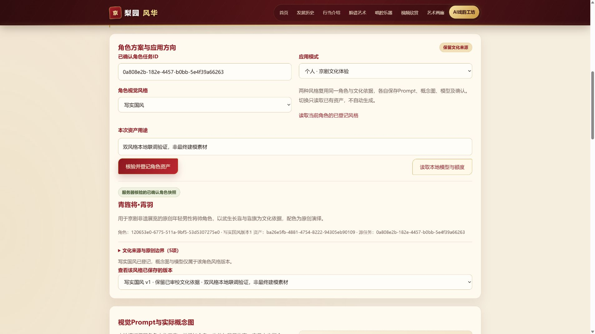
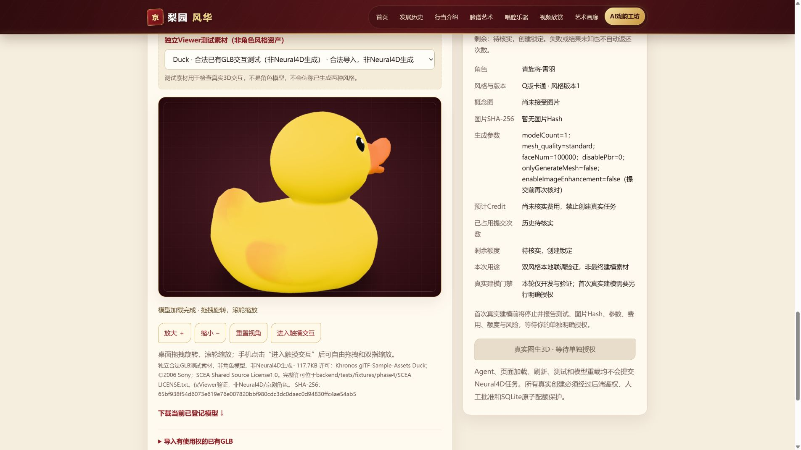
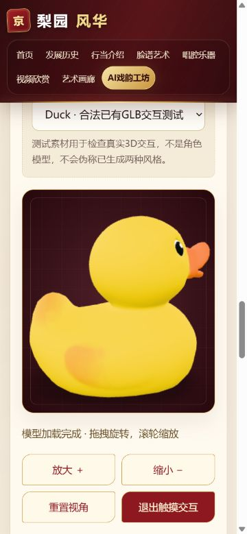

# 戏境 AI · Phase 4阶段报告

## 1. 阶段状态

- 执行日期：2026-10-11～14，Asia/Shanghai；原始证据保留实际UTC时间。
- 当前状态：**PARTIAL**。已完成资产层、双风格、服务封装、离线安全测试与首次真实内部Q版模型恢复，桌面Viewer技术验证及用户人工验收通过；正式角色、写实/企业模型和真手机手势仍未完成。
- 分支：`feature/phase4-neural4d`，基于Phase 3提交 `c89e63e1f5afa575b5e3972dd5cfa26a897d3942`。未合并main，未推送本阶段分支。
- 初版交付时没有真实创建。2026-10-13用户逐次批准后，已执行 **1次真实内部技术建模提交**，供应商返回实际30积分扣费。状态查询与余额请求单独记账；下载门禁失败后已停止，详见第18节。
- 全项目历史：用户明确核查此前为0次，固定账本已一次性登记；当前创建占用1、剩余2、状态未知任务0。原任务已恢复为SUCCEEDED，默认生成仍关闭，无第2次授权。

当前已完成第2次写实主展示候选准备，停在单次授权之前。[Phase 4.2准备总结](phase-04-realistic-preparation.md)及 [第二次授权表](phase-04-second-model-approval.md)记录当前状态。第二次费用、图像权限及正式角色关联未完成；本轮Neural4D请求0，不自动进入Phase 5。

第一次素材仍为蓝白Q版候选版本2；新写实图另存SECOND_REALISTIC_SHOWCASE版本1，没有覆盖旧图。首次创建、下载失败、恢复及用户验收以 [首次内部报告](phase-04-first-internal-modeling.md)为准；后续章节中的初版/待恢复状态保留为当时的历史冻结点，不替代本节当前事实。

## 2. Phase 1～3继承与保护

正式开发前检查已有代码、Git状态、Phase 3角色输出与审查方案，保留未提交文档和历史。原Phase 3基线备份位于 `D:\京剧\.backups\phase3-baseline-c89e63e.zip`；不使用强制重置、历史压缩或伪造时间。

首页与另外6个文化页，共7个HTML：`index/history/roles/facial/music/video/gallery.html`，均与Phase 3基线逐字节一致。原8页均实际打开，62项本地资源正常，6个受保护路径拒绝公开。文化素材、原导航和酒红/金色/米白视觉保留；只增量扩展`about.html`工坊数字IP区域。

原RAG、四Agent、人工确认与角色JSON保留。资产层从服务器权威TaskStore读取角色，要求4步完成、审校通过、`userConfirmed=true`、`publicationAllowed=true`及真实引用。没有从浏览器上传任意JSON冒称已审校结果，也没有为测试重新调用Agent或LLM。

保留 [Phase 2报告](phase-02.md)、[Phase 3报告](phase-03.md)；本阶段没有重新测量历史LLM正确率或将历史费用算作新增消耗。[整站HTTP记录](../evidence/test-results/phase4-http-regression.json)、[只读连续性审计](../evidence/test-results/phase4-local-continuity-audit.json)提供实际文件Hash。

## 3. 实际技术架构

```text
Phase 3已审校、人工确认的角色和引用
  → 服务器权威快照 / 稳定characterId
  → Q版或写实Style Adapter
  → 独立assetId / styleVersion / Prompt Hash
  → 人工视觉确认 / 实际授权概念图导入 / 图像Hash
  → 单次建模批准（当前未启用）
  → SQLite全项目原子预留 / 唯一发送权
  → Neural4D Provider（仅Mock验证）
  → 明确查询 / 受控下载 / GLB验证 / 私有资产存储
  → model-viewer真实文件交互显示
```

继续采用HTML/CSS/原生ES Module + FastAPI，未迁移React/Vue/Next.js。资产元数据使用SQLite，文件存放在`RAG_DATA_DIR/assets`下；固定额度账本位于网站目录之外 `D:\京剧\.runtime\neural4d-usage.sqlite3`。RAG的SQLite/Qdrant/BGE及Agent服务仍由前三阶段提供。

实际环境：Windows、Python3.11.1、Node24.15.0；沿用原后端依赖，新增固定Pillow12.2.0用于真实图像解码和portalocker3.2.0用于项目级发送owner锁。Viewer为本地固定版本model-viewer4.4.0（Apache2.0），只在选择GLB时加载。

详见 [资产与双风格架构](../architecture/phase4-assets-and-styles.md)、[供应商安全边界](../architecture/phase4-neural4d-safety.md)。

## 4. 角色资产与双风格成果

资产Schema版本为1.1，增量字段采用既有camelCase约定：`styleMode`、`styleVersion`、`characterId`、`assetId`、`characterSnapshot`、`reviewSnapshot`、`citationSnapshot`、`visualPrompt`及各自的`images/models`。Phase 3的CharacterDesign协议不变；旧1.0资产兼容读取且不重写历史。

一个文化角色可以保存多个风格和版本：

| 项目 | Q版卡通 | 写实国风 |
|---|---|---|
| 代码 | `chibi` | `realistic` |
| 风格模板 | `opera_chibi_v1` | `opera_realistic_v1` |
| 视觉表达 | 可爱头身比例、清晰轮廓、建模友好结构 | 自然人体比例、服饰层次与材质表达 |
| 文化依据 | 复用同一角色、审校、引用快照 | 完全相同的文化快照 |
| 预留建模面数 | `faceNum=100000` | `faceNum=500000` |
| 当前真实角色模型 | 无 | 无 |

统一视觉模板版本`opera_asset_visual_v2`明确区分证据支持的服饰与原创设计，不自动删除靠旗、雉尾、脸谱或道具。两套模板都要求单人完整全身、构件边界清楚、简洁背景、无文字水印，且保留原角色Prompt供追溯。表中的面数是当前服务端参数设计，**尚非真实供应商成模质量验证**；两种风格均使用单模型图生3D路线，不调用可能产生多候选的专用Q版路线。

风格切换只读取本地已有资产，不生成Prompt新版本、图片、Agent任务或模型。显式登记产生独立资产；没有相应模型时明确显示“当前风格尚未生成3D模型”，不会把Duck夹具当作两种京剧角色成果。

人工编辑Prompt保存为不可覆盖的新asset版本，旧图片/模型保留；新草稿取消视觉和图片接受，带`culturalReviewRequired=true`，不能以客户端声明绕过重新文化审校。既有已发送任务保留原版本，读取不会重新提交。

实际浏览器使用已确认角色“青旌将·霄羽”作本地技术联调，非最终建模素材：

- 统一角色ID：`120653e0-6775-511a-9bf5-53d5307275e0`。
- 源任务ID：`0a808e2b-182e-4457-b0bb-5e4f39a66263`。
- Q版v1：`e9fd199c-65b6-4bb0-a930-9d03d749930a`。
- 写实v1：`ba26e5fb-4881-4754-8222-94305eb90109`。

[真实双风格浏览器记录](../evidence/test-results/phase4-browser-styles.json)和[HTTP快照核对](../evidence/test-results/phase4-style-http-readback.json)确认两者文化与审校快照完全一致、Prompt Hash不同、资产ID不同、切回Q版恢复原版本。两者图片/模型均为空，未替用户确认最终视觉方案。

## 5. 概念图、许可与模型管理

已实现PNG/JPEG/WEBP真实解码与规范化PNG、10MB限制、尺寸约束、原文件Hash/规范化Hash、出处及许可说明、独立图片接受。图像生成供应商与费用尚未选择，平台图像Provider继续未接入；当前采用授权图片导入路径。

用户提供的候选图 `D:\京剧\概念图.jpg`：Q版、600×750、87358字节、SHA-256 `37aaa21e1c03d9bc35bcfc995002e42a200bad987b45766d3b1497b418472c3d`。用户声明来自小红书账号773908132并获得非商业使用与编辑许可；这属于用户提供的许可信息，不是独立认证。用户最后选择“先作为待关联素材”，因此：

- `sourceTaskId=null`，`imageAccepted=false`，文化一致性待审核。
- 未绑定上述蓝金武生，未移除水印，未复制到公开仓库，未用于真实建模。
- 商业使用、供应商上传加工及公开模型再分发范围仍须核实。

见 [候选图元数据](../evidence/test-results/phase4-concept-candidate.json)。它不被列为已完成的角色概念图。

GLB支持真实导入、来源标注、Hash命名文件、文化/风格/图片/Prompt版本关联、已登记ID文件服务与下载。导入与生成文件需通过GLB头/BIN边界、网格、accessor/index、材质和嵌入PNG/JPEG实际解码检查；拒绝外部URI、不支持格式、过大文件及未审校草稿。最大50MB。`fullConformanceChecked=false`，不冒称通过完整Khronos一致性认证。

文件采用同目录flush/fsync后原子不覆盖发布；相同Hash核对后复用，损坏拒绝自动覆盖。同供应商任务的重复结果通过SQLite唯一记录复用模型ID，避免多次刷新登记覆盖。

## 6. Neural4D服务与全局三次保护

当前官方资料索引：[Neural4D文档](https://docs.neural4d.com/llms.txt)，[图生3D接口](https://docs.neural4d.com/en/api-reference/image-to-3d/generate-model-with-image)。正式开发查阅的当前接口为multipart直接提交`image`；它与原历史方案中的matting/fileKey链不同。历史检查点A文档保留，实际差异记在架构文档，不自动回退旧链或增加预处理建模请求。

Provider封装余额查询、单次图生3D创建、已有任务查询及受控GLB下载。由后端读取`NEURAL4D_API_KEY`，配置审计仅记录是否非空，不显示、打印或归档Key值。用户已表示拥有Key，但当前私有配置中该字段未配置，真实余额、鉴权、模型权限和扣费未验证。

所有真实新建提交必须经过`ModelService → UsageManager → Neural4DProvider.create_once`。保护包括：

1. 固定项目账本与硬上限3，`modelCount=1`；不因风格、企业用途、Key、RAG目录或重启创建新额度池。
2. 默认关闭生成和协议核验开关；管理令牌、近期余额、人工核实费用、已确认图片/Prompt/文化快照及已核实历史全部通过才可批准。
3. `BEGIN IMMEDIATE`原子预留并消费一次性批准；幂等键唯一，数据库约束/触发器再次限制第四次。
4. `mark_started`持久化领取唯一HTTP发送权后才发送；单owner锁保护多进程与重启恢复。
5. 单次批准绑定角色、风格、版本、来源Hash、图片Hash、Prompt Hash、用途、服务端参数及费用，15分钟有效。新版本或费用变化使旧未发送批准失效。
6. 创建不自动重试、不重定向；失败、超时、未知或可能已发送均占用。结果不明确时进入`UNKNOWN/PENDING_RECONCILIATION`，禁止自动新建，先人工核查。
7. 查询操作显式触发，至少15秒间隔，每轮20次/20分钟，继续查询要明确确认；不形成无限轮询。
8. 下载限制人工配置的HTTPS精确主机、公开IP、无重定向/无供应商鉴权头转发，并检查实际GLB。未知格式不会自动执行可能付费的转换。

已发送任务的同键请求只读返回旧记录，即使版本或费用后来改变也不重新创建。没有公开重置/返还/扩容接口，前端禁用按钮仅是交互提示，安全由后端执行。Agent代码没有供应商创建入口。

MockTransport与真实transport明确分账；真实Provider检查固定账本位置，不能使用临时测试目录绕过限制。测试模拟的80等Credit值仅为夹具，**不能当作真实当前价格**。

账本是应用层保护，仍须备份和妥善保存；拥有操作系统权限的人可改文件/源码，不能宣称对本机管理员不可绕过。下载DNS检查与HTTP实际解析间存在时间差，本阶段未将其作为公开互联网生产级SSRF防护保证。

## 7. 前端与企业模式

新增数字IP中心：既有Agent流程入口、服务器角色快照、Q版/写实选择、历史版本、Prompt编辑草稿、概念图导入与接受、独立测试模型和真实角色模型选择器、交互Viewer、用途与单次建模确认摘要。

个人与企业模式均可自由选择风格。企业简报实际记录机构类型、受众、场景、设计目标、文化边界、交付范围及授权状态，可显式带入既有Agent输入框；不会自动提交或建模。当前完成企业需求入口与资产结构，**没有商业展示京剧模型、商用许可或游戏绑定/骨骼交付声明**。

新增样式使用`ai-workshop-*`命名空间；模型与用户输出使用安全DOM文本，文件URL只允许已登记ID及配置的后端源，拒绝任意外链/危险协议。平台概念图和真实建模能力继续标为未启用。

## 8. Web 3D Viewer实际验收

采用model-viewer + 实际自包含GLB：相机水平角不夹断，支持鼠标拖拽、滚轮、放大/缩小按钮、重置、Loading/Ready/Error与手动失败重载。移动端默认保留页面上下滚动，用户主动进入触摸交互后允许模型手势，退出恢复页面滚动。

真实浏览器夹具为Khronos Duck，120484字节，Hash `65bf938f54d6073e619e76e007820bbf980cdc3dc0daec0d94830ffc4ae54ab5`，©2006 Sony / SCEA Shared Source License1.0（随fixture保留全文），**不是CC0、京剧角色、Neural4D输出或双风格成果**。

| 实际项目 | 结果 |
|---|---|
| 1920×1080 GLB加载、重启后加载 | Ready，真实模型可见 |
| Loading | 实际观测到loading/75%与中文提示；无独立Loading截图 |
| 连续水平拖拽≥260° | 一次鼠标拖拽记录391.8°，跨360°无夹断 |
| 放大、缩小、滚轮 | 实际相机半径变化，有用户事件记录 |
| 重置 | theta回0，半径回默认值 |
| Error及恢复 | 专用测试文件临时缺失返回404，中文Error；恢复后手动重载Ready |
| 375×812移动布局 | 无水平溢出，实际GLBReady，触摸模式开/关检查通过 |
| 真手机单指旋转、双指缩放 | **未执行，待真机验收** |

391.8°是实际用户`camera-change`的同向连续观察范围；程序缩放/重置或来回小幅拖动不计入260°。较早448.1°记录独立保留，不合并为同一次测量。真实手机触摸未验收，因此不能标注整个Viewer移动手势已通过。

详见 [浏览器报告](../evidence/test-results/phase4-browser-test-report.md)。







## 9. 实际测试结果与失败案例

| 测试层 | 实际结果 | 证据 |
|---|---|---|
| 全量后端离线测试 | **406通过，0失败，1弃用警告**；pytest终端42.73秒，JUnit套件42.048秒（计时范围不同） | [JUnit](../evidence/test-results/phase4-final-unit.xml) |
| 4个Phase 4后端文件专项复测 | 193通过、1警告、22.94秒；包含并发与旧JSON兼容 | [失败与修复记录](../evidence/test-results/phase4-windows-file-race.md) |
| Phase 4前端离线 | 35通过/0失败 | [Node记录](../evidence/test-results/phase4-frontend-offline.json) |
| 原问答/Agent前端离线回归 | 各25通过/0失败 | [问答](../evidence/test-results/phase4-phase2-frontend-regression.json)、[Agent](../evidence/test-results/phase4-phase3-frontend-regression.json) |
| 实际本机资产HTTP/API | 13通过/0失败，含真实本地BGE检索、鉴权、重复拒绝、CORS、体积和modelCount限制 | [API记录](../evidence/test-results/phase4-http-assets.json) |
| 已登记双风格实际HTTP读回 | 6项全部通过，无额外写入 | [风格快照](../evidence/test-results/phase4-style-http-readback.json) |
| 原8页、静态资源、受保护文件 | 真实浏览器与HTTP均通过 | [浏览器8页](../evidence/test-results/phase4-browser-eight-pages.json)、[HTTP](../evidence/test-results/phase4-http-regression.json) |
| 供应商真实鉴权、余额、成模/下载 | **未执行** | 固定账本供应商操作0条 |

后端单元/Provider合约使用明确Mock和临时资产数据；不等同实际供应商测试。全量测试中的Starlette/TestClient httpx弃用提示保留，未为消除警告额外升级原依赖。

真实失败和修复：

- 已有Phase 3输出附加合法`execution/programmaticChecks`，首次网页登记422；修复为受控识别追踪字段，再严格验证文化JSON。旧TaskStore未修改，保存脱敏导出回归夹具。
- 恢复缺失GLB后同URL失败缓存导致不能Ready；仅显式重载加入受控内部缓存参数，保留正常URL与严格校验。实际错误及恢复截图保存。
- Windows并发同Hash `os.replace`遭WinError5，该次**1失败/190通过**真实记录保留；改原子不覆盖发布，4/8线程、已打开读者和篡改文件拒绝均复测通过。
- HTTP脚本误读health字段及把未知历史期望为0，首次11通过/2失败；只修正测试断言，重跑13通过，原报告保留。
- 服务在中断后退出，12日首次访问连接拒绝；恢复并确认startup完成后实际重新验收，没有将未就绪请求算作通过。
- 初期免费vendor下载发生连接重置，实际重试后取得固定版本；不属于Neural调用失败，不占建模额度。

代码审查发现的旧批准版本/费用漂移、任意真实transport账本分类、GLB内嵌纹理和草稿导入门禁亦有离线回归；这些不是虚构的供应商实战失败。

## 10. 代码与文件变更

主要改动：

| 文件 | 作用 |
|---|---|
| `about.html`、`css/ai-workshop.css` | 增量数字IP与双风格/企业/Viewer界面，保留公共视觉 |
| `js/ai-workshop/digital-assets.js`、`model-viewer-adapter.js` | 资产交互、版本切换、真实GLB状态和相机控制 |
| `contracts.js/services.js/main.js/agent-workflow.js` | 增量协议、资产API、已确认角色带入，复用旧工作流 |
| `backend/app/assets/` | Schema、文化快照、Prompt、SQLite目录、真实图片/GLB验证、全局额度与建模门禁 |
| `backend/app/providers/neural4d.py`、`api/assets.py` | 唯一供应商封装与鉴权、受控本地资产接口 |
| `config.py/main.py/services/runtime.py`、`.env.example` | 私有配置、启动锁、能力状态、已有服务整合 |
| `backend/requirements.txt` | 固定图像解码与文件锁依赖 |
| `backend/scripts/`、`backend/tests/` | 合法模型准备、可信人工历史CLI、离线回归、实际旧角色导出夹具 |
| `js/vendor/model-viewer/` | 固定发行文件与原许可 |
| `scripts/phase4*`、`prepare_phase4_viewer_fixture.py`、`export_phase4_prompt.py` | 免费回归、故障复现、只读审计、公开Prompt导出 |
| `README.md`、`docs/architecture/`、`docs/prompts/phase-04/`、`docs/evidence/` | 运行指引、架构、真实失败/截图/Prompt证据与本报告 |

完整实际文件清单以Git相对Phase 3基线的差异为准：`git diff --name-status c89e63e1f5afa575b5e3972dd5cfa26a897d3942 HEAD`。没有删除原文化HTML、资源或前三阶段提交。

## 11. 实际Git记录

以下均为本阶段真实提交，时间未改写，没有空提交：

| Commit Hash | 实际变更 |
|---|---|
| `32a4034bcdcf5916d281737ca3843e4b6b098166` | 批准方案与公开Prompt基线 |
| `2bb1b696895dcebcb02761ede71bc567ea4f4ca6` | 有文化依据的双风格资产存储 |
| `ee90f1417a120126bad54b0d77ea67d4d22229b0` | 全局原子额度、幂等与服务封装 |
| `61177ca6b2523d6e71ceecd34c8064484d9b9fa5` | 前端数字IP工作台与GLB查看器 |
| `3b7a43ac4fbdde890c5e6bf78a917cb6e1a7a810` | GLB内嵌纹理校验、未审校导入门禁 |
| `de6daad66eee5529d924d5e1bcc0c20a71983573` | 实际Viewer恢复Bug、费用变化批准失效 |
| `fb5df133ba5ff38bbd2c0a7fc474bcf970a5f0fe` | 真实旧Agent追踪字段兼容、真实transport分类 |
| `f72fc39a2c451457ffd99f81180813db82eeddb6` | Windows并发不可覆盖原子发布及回归 |

本表是功能代码冻结点，另保留 [实际Git输出](../evidence/test-results/phase4-git-log-code-freeze.txt)；本报告和最终证据由随后真实文档提交收录，其Hash应读取`git log -1 --format=%H -- docs/reports/phase-04.md`。不预填自身尚未产生的Hash，最终回复提供该文档提交实际Hash。完整实际列表见Git历史，不将原Phase 1～3记录删除或合并。

## 12. Prompt与比赛证据

[Phase 4 Prompt目录](../prompts/phase-04/README.md)保存原检查点A、最终三次限制修订、正式开发批准、双风格补充需求及当前公开对话快照。用户来源/许可/待关联回复也在公开记录中，工程摘要不冒充逐字对话。

公开导出仅包含用户、公开助手commentary/final和对应工具证据，剔除隐藏推理/系统/开发者内容、子Agent内部消息、图片Base64与常见凭证。真实源时间、源行号、快照Hash和范围见`04-export-metadata.json`。本轮重新导出到506条的快照不是承诺未来消息已收录，随后导出范围以元数据为准。

提交前另行核对公开源代码/文档/证据中的常见凭证模式和环境模板，未发现疑似Key；原图、私有env、数据库和模型缓存没有被Git跟踪。此扫描不等于对任意秘密格式的绝对保证。[文件与证据核对](../evidence/test-results/phase4-final-evidence-check.json)同时记录406项JUnit计数、Prompt文件Hash、文档链接及真实GLBReady。

真实Prompt/Schema变更、失败测试、GLB缓存恢复、文化门禁、费用/版本批准失效与双风格测试都有对应代码和证据；没有制造额外用户反馈或假调用历史。阶段截图包括首页、工坊、Agent、双风格、企业入口、Viewer桌面/移动/Error/恢复。

评分依据：

| 维度 | 当前实际证据 |
|---|---|
| 过程可复现性25% | 真实细粒度提交、原文Prompt、失败保留、固定版本和免费复测指令 |
| 解题有效性25% | 已确认文化方案可转换为可追溯双风格资产；已有真实GLB可查看，最终京剧成模闭环仍未完成 |
| 方法创新与意图控制20% | 一套文化依据/双风格适配；人工图片及费用批准、Hash绑定、全局三次硬限、不确定状态锁定 |
| 工程质量15% | 模块隔离、SQLite事务/锁/幂等、不可覆盖文件、输入/文件检查和跨阶段回归 |
| 用户体验15% | 保留文化色彩，来源/空态/错误清晰，真实旋转缩放、双风格与企业用途入口 |

没有以Mock成果或Duck替代京剧模型来夸大解题完成度。

## 13. 免费复现与实际条件

完整环境和Phase 2/3启动流程见 [README](../../README.md)。现有依赖与BGE缓存环境下，已验证项目单worker服务、资产准备、免费测试及浏览器GLB；没有空白电脑安装10分钟承诺，也没有重新测量完整依赖下载时间。

在 `D:\京剧\京剧` 执行：

```powershell
# 已有固定Duck fixture、本地依赖与BGE缓存；不访问供应商
.\.venv\Scripts\python.exe -m backend.scripts.prepare_phase4_assets
.\.venv\Scripts\python.exe -m uvicorn backend.app.main:app --host 127.0.0.1 --port 8000 --workers 1
```

另一个终端进行免费验证，重新运行的输出保存在被Git排除的`.runtime`目录，保留本阶段历史证据：

```powershell
New-Item -ItemType Directory -Force .runtime
.\.venv\Scripts\python.exe -m pytest backend/tests -q --junitxml=.runtime/phase4-unit-local.xml
node scripts/phase4_frontend_test.mjs --output .runtime/phase4-frontend-local.json
node scripts/phase2_frontend_test.mjs --output .runtime/phase2-frontend-local.json
node scripts/phase3_frontend_test.mjs --output .runtime/phase3-frontend-local.json
.\.venv\Scripts\python.exe scripts/phase4_http_smoke.py
.\.venv\Scripts\python.exe scripts/phase4_local_audit.py
```

浏览器打开 `http://127.0.0.1:8000/about.html#ai-workshop-model`，选择独立合法Duck验证Viewer。不要用`file://`加载ES Module，也不要用全目录HTTP服务器公开私有配置/数据库。若首次启动拒绝连接，先等日志`Application startup complete`；不盲目提交或重试付费任务。

双风格复测可读取已人工确认的实际任务（每个环境的ID不同），明确登记两种风格并切换，观察未生成模型状态。不要将脱敏单元夹具登记为比赛真实角色，不替用户按“人工确认”。

三个Phase 4免费核对脚本支持`--output`，默认写入`.runtime`下新报告；此行为在收尾复测实际验证。原证据不被普通复现命令覆盖。HTTP探针按当前“未知历史/关闭真实建模”状态检查；未来配置变化会如实改变结果，不能为了测试通过把历史强行设为0。

## 14. 首次真实建模前的就绪报告

目前**尚不具备发送首次真实建模的全部条件**：

| 必要条件 | 当前实际状态 |
|---|---|
| 角色及风格 | 技术联调角色已登记；用户概念图暂不关联角色 |
| 已接受概念图、Hash | 候选图Hash已记录，文化一致性与图片接受未完成 |
| 实际Key、鉴权、余额 | 用户拥有Key；本地Neural字段未配置，未发余额或鉴权请求 |
| 当前官方参数 | 服务已封装multipart `image`、单模型参数；实际发送前再次核对 |
| 预计费用 | 未核实当前Credit；不填写Mock80或过期资料价格 |
| 历史及剩余额度 | 历史未知，剩余null，真实创建锁定 |
| 单次授权 | 尚无任何一次真实建模授权 |

当前预留参数：`modelCount=1`、`mesh_quality=standard`、Q版`faceNum=100000`/写实`500000`、`disablePbr=0`、`onlyGenerateMesh=false`、`enableImageEnhancement=false`。最终发送输入必须由服务端冻结，不能以此表视为已获准请求。

后续仍属于Phase 4：先核查全项目历史提交、在本地私有env配置Key（不要发聊天）、必要时明确执行不创建模型的余额验证；确认图片及角色文化一致性、非商业使用许可对供应商加工/再分发的范围；核实当前费用、下载主机与参数，再准备单次确认摘要。必须停止并取得该次的明确批准后才能保守占用一次额度。

风险包括：单张图背面信息缺失、薄构件/靠旗/头饰可能成模失败、未知响应不能返还次数、生成权属与企业商用许可、GLB大小/性能、模型可能需人工加工。此时不请求笼统授权，也不以费用或历史未知状态擅自调用。

## 15. 检查点B验收结论

| 要求 | 结论 |
|---|---|
| 复用Phase 3 JSON与引用，保护前三阶段 | 已实现，实际旧任务登记、8页/离线回归通过 |
| 双风格模板、版本、文化同源、分别保存 | 已实现，真实本地登记与离线图片/GLB隔离通过；尚无两份真实京剧模型 |
| 神经建模服务与全局三次原子保护 | 已实现，Mock/并发/幂等/重启/未知/费用门禁通过；真实供应商联测未执行 |
| 图片导入及逐次确认 | 已实现；用户素材待关联/接受，真实生成未授权 |
| 真实已有GLB、鼠标≥260°、缩放、重置、Loading/Ready/Error | 实际浏览器通过 |
| 真手机触摸拖拽及双指缩放 | 未验收 |
| 企业用途入口 | 已实现；无商业角色模型/授权交付 |
| 真实模型请求、输出、下载及京剧数字IP | 未执行，不能计入完成 |
| Git、Prompt、README、失败与截图记录 | 已保存；文档提交Hash由最终回复/实际Git读取 |
| Phase 4完整验收 | **PARTIAL，不能标记COMPLETE** |

本轮功能代码停止修改。等待用户审查当前材料、补充真实设备验证和首次建模条件；不会自动发Neural4D请求、合并main或进入Phase 5。

## 16. 2026-10-12三次建模准备补充

用户追加顺序：第1次Q版技术验证 → 人工验收并停止 → 第2次写实主展示 → 人工验收并停止 → 第3次企业案例 → 永久停止新建。完整调用前检查、记录字段、验收、失败处理与用途建议见 [三次执行计划](phase-04-real-modeling-plan.md)。该顺序不是额外新增3次额度；既往项目调用同样计入全局上限。

本轮发现并修复初版UNKNOWN只拦截相同输入的缺口，补齐跨所有角色/风格的新批准、预约及未发送任务的原子全局暂停。修复前6项真实失败及测试环境错误保留；修复提交 `e371019ff65d1e35d470e93deacd9700ba88502b`。新增只读准备/余额工具提交 `20bea4b5054b0e326a067ff4266fa254e9fa990e`。最终全量 [420项通过](../evidence/test-results/phase4-modeling-final-unit.xml)，原406项和中间415项证据保留。

私有env原来没有Neural4D字段，已追加空字段，用户本地填写Key后成功完成一次只读余额鉴权，626.13毫秒，公开记录隐藏具体余额和凭证。没有生成请求或额度预留，也不以鉴权成功冒称建模权限已验证。旧章节的未配置/未联测描述是初版冻结点事实，当前以本节及 [最新准备快照](../evidence/test-results/phase4-modeling-preflight-2026-10-12.json) 为准。

用户选择既有Q版图片作为第1次拟用素材，Hash不变；角色仍未关联、图片/Prompt尚未正式接受冻结、报价未核实，用户回复历史“仍待核查”。全局剩余仍为null，真实创建关闭。阶段仍PARTIAL，停止等待这些准备条件和之后的单次授权，不进入Phase 5。

## 17. 2026-10-12蓝白概念图替换与待审登记

用户将同一路径替换为新蓝白图，本轮实际Hash `9c737011a237de9fb589743e22b385a0c9611d33189c79b5940f8e1386047f0f`，JPEG1049×1398、575200字节。旧绿图元数据原样归档，无法恢复旧文件字节，不把当前原路径作为旧版预览。新图存入独立私有候选表、不可覆盖Hash快照和只读预览；正式2角色/0图片/2合法测试GLB未改变，前三阶段文化页及角色JSON保持。

来源原文为用户本次回复“百度公开数据”，作者、网页及许可待核实，不继承旧图非商业编辑许可。现有20任务中唯一已确认角色“青旌将·霄羽”的大靠/靠旗/青金设计与新图宽袖、珠饰头部和毛笔不匹配。保留`sourceTaskId/characterId=null`、图片未接受、文化未确认；没有调用Agent或LLM替用户确认。

当前背景保留，原JPEG保存字节一致，无损规范化PNG与原图解码RGB逐像素一致。候选版本2的待审Prompt `candidate_bluewhite_review_v1`仅冻结图像审核草稿，`approved=false`；正式角色冻结和ModelApproval尚未创建。细珠/延伸头饰、袖口与手、细毛笔及单图背面仍存在成模风险。

新增功能真实提交 `bcc3a060190cabb7fb210205abda19382d0e1fa9`。首轮专项48通过/1失败，补齐显式禁脚本CSP后全量469通过；真实手机预览发现标题版本名溢出，补换行后专项49通过、实际窄视口无溢出。本地HTTP14通过、工坊前端离线35通过，桌面1920×1080及手机375×812新图预览正常。修复前后证据均保留，不能将图片检查写成3D/真实手机手势验收。

原始需求、来源回复和实际公开过程导出快照721条，详见 [Prompt索引](../prompts/phase-04/README.md)。新图及含图截图保持本机私有，未上传GitHub。费用未核实、历史未知、全局剩余null；本轮供应商请求0、创建0、预留0。3次全局硬限制和UNKNOWN暂停未改，生成仍关闭。完整Hash、审核表、参数和待确认事项见 [本轮报告](phase-04-bluewhite-candidate-review.md)。阶段仍为PARTIAL，停止于首次建模授权前，不进入Phase 5。

## 18. 2026-10-13第1次内部技术建模与停止

用户明确将首次用途调整为内部非公开技术验证，豁免文化角色匹配及最终公开资产适用性；另明确核实全项目历史0次、允许本图上传和3D衍生处理。真实证据单独保存，不把这次豁免套用到正式角色或未来商用。增量实现独立technical信封，仍经同ModelService、固定账本、原子预留、owner锁、幂等及单模型发送；技术角色ID为空，文化与发布标记false，模型隐藏于普通列表，仅本机受控Viewer访问。

真实创建HTTP提交1次，任务ID `bb074c31-1905-45b6-b763-22d065ddc616`，供应商返回实际扣费30积分。三次原任务查询中，前两次PROCESSING，第三次进入完成分支但模型URL被未核实下载域名门禁阻止。已停止，不重查、不下载重试、不创建第2次，原UUID保留为PENDING_RECONCILIATION，已用1/剩余2且全局创建暂停。没有取得GLB，不能声明本次Viewer、≥260°拖拽、缩放/重置、状态或头饰/毛笔/背面通过。

发送前全量535离线通过；查询异常暂停修订后专项131通过，新内部集成52通过，前端35通过。代码真实提交 `374df8c4567c79c06f28f085d9b404f0b7e079b7`。这些Mock/旧GLB结果与真实首次模型联测分别记录。完整输入、授权、费用、失败证据和人工验收待办见 [第1次内部报告](phase-04-first-internal-modeling.md)。本地网页服务恢复、配置生成关闭，阶段PARTIAL，不进入Phase 5。

## 19. 2026-10-13恢复原任务与内部技术验证

在用户只恢复原UUID的明确授权后，定位旧下载白名单`cos.zmkj.com`与实际`cos.neural4d.com`不匹配。经鉴权结果、公开DNS及验证TLS核对，新增共享的精确host、逐跳、DNS固定TCP目标和证书验证下载器；90秒/50MiB/最多2跳，不记录签名URL，不放宽私有地址或任意下载目标。只恢复入口禁止创建，原SQLite管理锁及次数不重置。

原26,600,184字节GLB安全取得，但供应商`image/jpg`声明和两张4K纹理超现有像素门禁。原字节保留，固定Hash本地改为标准JPEG MIME及2K纹理，几何bufferViews/场景/材质关联保持；通过原GLB安全校验后登记8,827,324字节内部衍生模型，Hash `bf9c808c15dbf5464ee67df1cdb3f64f9b2c6b3cd4ee41ecb8a6470a0554654a`。原UUID与技术候选/冻结图Hash/Prompt关联保持，正式角色与双风格协议不改。

真实浏览器加载/材质、鼠标同向连续476.8°、滚轮及按钮缩放、重置、Loading/Ready/Error与同文件恢复后重载通过。375px布局和触摸模式入口通过；实体手机手势未验收。内部Viewer只增加限定WASM编译策略，复测控制台无warn/error，原错误保留。头饰/手袖/毛笔细件有简化与融合，背部较正面简化，仍非公开/商用正式角色。含图截图及GLB只保留私有本机。

最终652后端离线通过、前端Phase 2/3各25及Phase 4共36通过；8页浏览器打开与图片复核、14本机HTTP+62资源GET通过。失败夹具、旧安全断言、真实纹理失败及HEAD405试验保留，详见 [恢复报告第7～12节](phase-04-first-internal-modeling.md)。修复真实提交 `2935155bc766752d5319d3529c3d6ee47f14cc4c`。

本轮新增3原任务查询+2安全资源下载，创建0、付费转换0、增量Credit0。项目仍创建1/3、剩余2，原30积分扣费不变。原账本SUCCEEDED及未知临时暂停解除不等于用户验收/第二次授权；生成配置仍false。**第1次内部桌面技术验证PASS，用户人工验收PENDING；Phase 4整体仍PARTIAL**。等待用户审查第一模型，不能自动进行第二次、合并main或进入Phase 5。

## 20. 第1次用户人工验收（2026-10-13）

用户在恢复完成后回复“批准，第一次非常好”，第1次内部技术模型人工验收通过。[原文](../prompts/phase-04/13-first-model-human-acceptance.txt)、[更新报告第13节](phase-04-first-internal-modeling.md)。此轮仅保存验收及本地额度快照，无API请求、预留或创建。已用1/3、剩2、生成关闭；第2次仍须单独明确授权。实体手机实测、公开/文化/商用审核和完整Phase 4验收未因此自动通过，整体仍PARTIAL。
