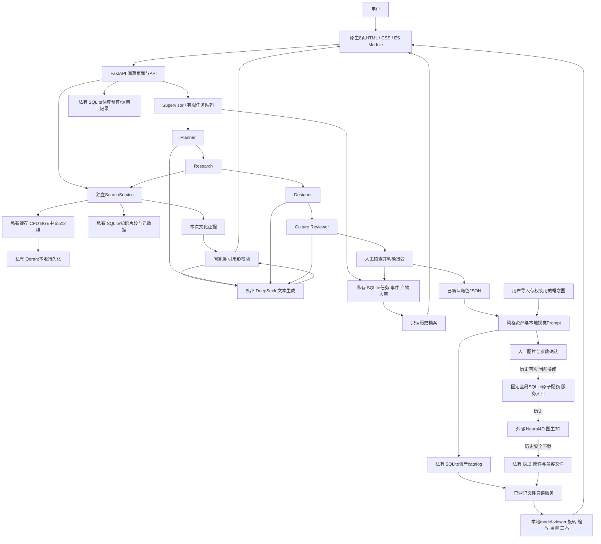

# 戏境 AI · 比赛项目介绍与技术底稿

日期：2026-10-22。统一事实来源：[项目事实表](phase-05-project-facts.md)；逐项原始结果：[证据索引](phase-05-evidence-index.md)。本文件用于后续报名/路演填报，正式比赛名、组别、截止与格式仍[待核实](phase-05-requirements-evidence-map.md)。

## 1. 三种篇幅的介绍

以下是同一项目的详略版本，计数属于文字长度检查，不是效果指标。按汉字分别为104、294、754字，含标点/英数的非空白字符分别为122、353、973；具体表单若按全部字符限字，须按官方规则裁剪。

### 精简介绍（约100字）

戏境AI从京剧文化网站出发，以私有知识库检索和可追溯引用帮助用户理解京剧，通过多Agent协作、文化审校与人工确认形成角色方案，并展示已保存的真实3D资产。平台保留传统视觉，区分历史与实时结果；企业模式目前是需求入口，公开素材许可仍需逐项核实。

### 标准简介（约300字）

戏境AI面向京剧文化体验者和文化角色设计人员，探索从知识理解到数字创作的连贯流程。平台保留原有八页京剧网站，以经来源核对的原创事实摘要建立私有知识库，使用BGE中文向量与Qdrant检索，将命中证据交给DeepSeek生成带引用的回答。角色创作由任务规划、文化研究、角色设计和文化审校四个Agent协作；资料不足时暂停，方案经过人工确认后才能作为已确认角色JSON使用。

平台支持Q版与写实风格资产管理、概念图导入及已有GLB的旋转、缩放和重置。两次真实建模已经完成，模型分别保存，不能把旧模型说成当前新需求的生成结果。比赛导览和只读历史档案支持本地备用展示。企业模式现为需求简报和共用流程入口，没有真实客户交付证明。平台图像生成尚未接入，实体手机、当日外部API与跨机器恢复仍未验证，素材公开范围须先核实。

### 详细介绍（约800字）

京剧文化传播与数字角色创作存在一个实际衔接问题：用户可以看到脸谱、服饰和行当介绍，却难以把创意中的文化元素追溯到具体资料；仅靠聊天生成角色，也容易把原创想象写成传统事实。戏境AI以已有京剧文化网站为起点，尝试把文化理解、资料检索、角色设计、文化审校和数字资产展示组织为一条可查看依据、可由人决定是否接受的流程。

平台保留八个HTML页面和酒红、金色、米白的原有视觉，以原生JavaScript逐步扩展AI戏韵工坊。后端采用FastAPI。知识资料由十二个可核查来源的项目原创事实摘要组成，形成三十五个片段；它们经过助手核对，尚未完成专家复核，不能称为官方原文或权威全集。本地BGE模型产生中文语义向量，Qdrant持久化检索，SQLite保存资料、定位和业务记录。问答将本次命中证据交给DeepSeek，再由程序验证引用ID并映射实际来源；资料不足时明确说明，不用固定答案冒充模型输出。

角色创作由四个Agent分工。Planner整理需求，Research复用同一RAG服务，Designer产出结构化角色JSON，Culture Reviewer辅助检查证据和设计表达。正常完整路径包含三次文本模型调用及一个本地研究阶段，不是四个聊天窗口。澄清、资料不足或审校问题会暂停后续步骤；审校通过也仍需用户明确接受。历史档案保留事件、公开产物、引用和人审记录，读取旧任务不会重新执行AI。

资产层复用已确认角色，分别保存Q版与写实风格版本、视觉Prompt和导入概念图。平台绘图Provider尚未接入；视觉Prompt是审核与资产溯源材料，不能宣称它自动生成了现有图片。项目仅完成两次Neural4D真实建模，累计六十积分，第三次由用户取消。两个GLB支持网页真实旋转、缩放、重置及加载失败恢复；其中Q版为内部技术模型，写实主展示“绛绣·戏韵”关联自己的原任务，两者不是同一角色的两种成品。

比赛导览把知识、Agent历史、人审和已有模型串联起来，外部服务失败时可主动查看真实历史记录，不悄悄替换为假答案。企业模式提供简报入口和共用创作流程，目前没有商业客户或游戏生产认证。已有测试证明了约定范围内的工程行为，但实体手机、当日外部API、完整空白电脑和跨机器恢复仍未验证。公开参赛前，还须补齐官方规则与素材许可证据，不能把本地技术验证视为公开分发或商用授权。

## 2. 实际问题、处理方式和效果

| 目标与问题 | 实际处理流程 | 已有实现/可验证效果 | 局限 |
|---|---|---|---|
| 文化体验者不易追查聊天答案依据 | 问题→本地检索→证据→LLM→引用ID验证→安全文本展示 | 独立SearchService、来源/定位/摘要；历史20题真实RAG及引用映射 | 小规模开发集、非专家gold；引用ID有效不等于结论语义已获证明 |
| 设计人员难以区分传统知识和原创装饰 | 规划→文化研究→JSON设计→辅助审校→人工接受 | 原创/证据区分、暂停、确认ID/序号与后端门禁 | Planner曾误判原创名，Reviewer有历史漏判；没有专家认证 |
| 评委不易看懂生成链与已有成果归属 | 历史档案→真实事件/产物/人审→关联资产 | 同一写实任务可追溯；历史只GET、不能重跑或改内容 | 没有逐帧历史播放引擎，历史不等于刚运行 |
| 文字角色与3D展示容易混淆 | 同角色风格资产独立→导入图片审核→历史模型→Viewer | 两份真实GLB、独立Hash、缺失风格显示未生成；旋转≥260°有实测 | 没有平台自动绘图、任意新角色自动成模、骨骼/游戏量产验证 |
| 比赛外网故障影响展示 | 导览、主动只读备用、明确错误与手动恢复 | WP3/WP4本地页面/档案/资产/故障恢复有证据 | 后端、对应私有库和GLB仍须就位；不存在离线LLM |
| 企业想探索文化数字IP | 企业简报→复用原Agent和资产流程 | 界面与需求带入有实现 | 仅应用方向，无真实客户、订单、收入或企业成模案例 |

## 3. 可主张的工程与产品特色

这里列出四项有实现证据的设计特色，不据此主张行业首创、独立新算法或优于所有同类产品。独创性仍需另做可追溯的相关作品比较。

| 标题 | 具体设计及与简单聊天的区别 | 当前实现/证据 | 限制 |
|---|---|---|---|
| 面向京剧资料的可追溯问答 | BGE/Qdrant加显式关键词/实体路线；本次证据别名映射真实片段，来源由程序装配 | [search.py](../../backend/app/services/search.py)、[chat.py](../../backend/app/services/chat.py)、[Phase 2实测](phase-02.md) | 不是新Embedding算法；摘要覆盖有限，不能把37/37引用映射说成专家正确率 |
| 研究复用与有限多Agent协作 | Research复用问答检索服务，规划/设计/审校产物持久化，资料不足暂停 | [workflow.py](../../backend/app/agents/workflow.py)、[Phase 3报告](phase-03.md) | 不承诺多Agent必然优于单模型，历史失败与Prompt调优保留 |
| 人审和资产归属的双重控制 | 审校pass仍需confirmationId/sequence；资产重验权威角色及结果Hash，风格分别保存 | [Agent存储](../../backend/app/agents/store.py)、[资产服务](../../backend/app/assets/service.py)、[第二模型证据](phase-04-second-model-execution.md) | 人审不是版权/文化专家结论；Q版技术模型有意无正式角色关联 |
| 诚实演示与渐进式工程 | 保留文化多页站；区分历史/实时/说明，坏Agent库隔离；Viewer恢复只读原文件，固定全局额度 | [导览](../../js/ai-workshop/demo-guide.js)、[数据库安全层](../../backend/app/database.py)、[WP4追加实测](phase-05-work-package-04.md) | 不是复杂监控/离线AI；有效错库仍须人核，恢复须重启，模型创建继续关闭 |

## 4. 可编辑的实际技术架构

实线为已实现的数据/控制路径。外部供应商及私有存储以节点前缀标明；虚线Neural4D路径仅记录已完成的两次历史建模，当前创建关闭。本图不含未实现的图像生成服务。

- 当前API/服务对应：[main.py](../../backend/app/main.py)、[配置](../../backend/app/config.py)、[Runtime](../../backend/app/services/runtime.py)、[Agent路由](../../backend/app/api/agents.py)、[模型服务](../../backend/app/assets/neural_service.py)。图中Supervisor、TaskStore、资产服务不是独立微服务。
- 知识入库为离线显式脚本，`active.json`选择generation；本地模型缓存、知识/向量索引、业务库和真实GLB不随Git分发。问答幂等缓存及有界Agent状态查询是现有工程机制，不是对话长期记忆。
- 视觉Prompt用于风格/版本及人工核对。现有Neural4D图生3D实际输入为图片和建模参数，不能把图中的历史流程解释为供应商消费了文本Prompt。
- DeepSeek当前连通/余额未在WP5核实；Qdrant/BGE可本地检索不等于具备离线LLM。概念图生成Provider尚未实现，Neural4D新建入口关闭，第三次用户取消。

## 5. 建议对外表述边界

可说“真实RAG和多Agent历史执行可追溯、两份真实GLB已做约定范围浏览器验证”。不说“全自动即时生成任意角色”“文化零错误”“游戏生产级交付”“企业客户已落地”。技术交互通过不代表模型每根珠饰/背面均忠实还原，也不代表获得商业/公开分发权。

公开稿应先按[许可清单](phase-05-asset-provenance-and-permissions.md)核对可用素材，尤其内部Q版与原站媒体。正式报名、视频、PDF排版与上传应按[提交检查表](phase-05-submission-checklist.md)处理，当前仅提交内容底稿等待人工验收。
