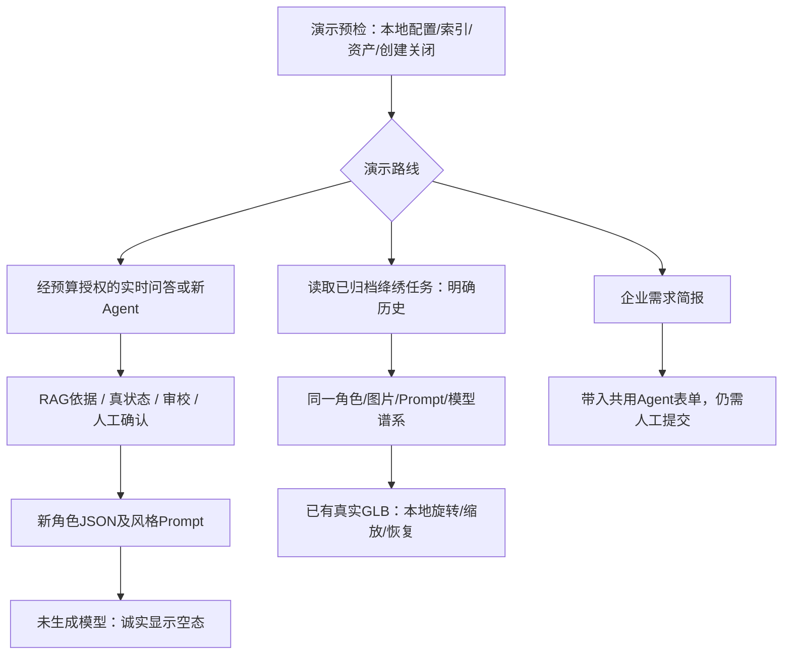

# 戏境 AI · Phase 5实施建议（检查点A）

日期：2026-10-18（Asia/Shanghai）。状态：`PHASE_5_CHECKPOINT_A_WAITING_APPROVAL`。本文件是计划，所有未来测试/交付均未在本轮执行；事实依据见[项目审查](phase-05-project-audit.md)。

## 1. 目标与不变边界

将已有文化网站、真实RAG、四Agent及已有3D成果整理成可解释、可稳定演示和可按条件复现的作品。保留8页、原生前端、酒红/金/米白与前三阶段接口，不迁移框架、不另造Agent引擎、不过度重做网站。

Neural4D全项目仍已用2/3、剩1未使用，第三次取消。**任何Phase 5工作都不得请求供应商新建模型、余额/结果刷新或付费转换来“测试”旧成果**；已有模型本地读取已足够。生成开关关闭、旧批准不可复用，不能重置账本、改上限、按风格分额度或通过换目录建立新额度池。

少量真实DeepSeek端到端测试是可选的独立子任务，须用户批准调用次数/预算后执行；当前方案和未来的免费预检不暗含付费授权。现有Provider仍沿用总预算和phase3增量范围，先只读查余量，不清空历史或擅改预算/价格。

## 2. 推荐工作包与工时

以下是单开发者主动工时估计，不是已执行时长或比赛截止承诺。可并行部分不重复相加；外部下载、用户反馈、设备连接及付费授权等待另计。

| 工作包 | 优先级 | 最小工作内容 | 预计工时 | 依赖/验收 |
|---|---|---|---:|---|
| A：端到端演示链与当前状态 | P0 | 当前状态/两模型取消第三次说明；实时与历史两条路径；修过时文案和README入口 | 1.5～2.5小时 | 审核下方流程；不把新角色套旧模型 |
| B：Agent可观察性与只读历史恢复 | P0 | 复用四卡片/事件/结果，增加合法旧taskId读取入口、创建时间及历史标识，显示输入/产物/审校的公开摘要 | 1.5～2.5小时 | A；恢复只GET且账本调用数不变，无假进度 |
| C：比赛导览与诚实降级 | P1 | 单个轻量导览区，链接问答/创作/已有写实资产/企业简报，明确实时/历史/未实现；无网备用说明 | 1.5～2.5小时 | A/B；不复制整套页面或新路由后台 |
| D：最终回归与可复现检查 | P0 | 离线/本地API/8页/桌面与CDP/两个GLB/错误恢复/启动关闭计时、配置缺失场景；有条件真机 | 3～5小时 | A～C完成；原675项不删减凑通过，真实设备独立标记 |
| E：比赛交付文档与证据索引 | P1 | 运行指南、资产交付清单、演示脚本/备用流程、FAQ、评分证据索引、提交检查单；不重写原证据 | 2～3小时 | 可与A并行；规则不明处待确认 |

核心工程、免费验证和材料文本合计约**9.5～15.5小时（约2～3个工作日）**。如需实现受控私有资产可迁移包及在第二台机器验证，另加2～4小时；当前先明确清单，不能把此项算已完成。真正冷机依赖/模型下载时间没有可靠估计，不承诺10分钟。

若用户确认本阶段同时制作最终视频/PDF：视频录制/剪辑约3～5小时、技术PDF排版/渲染检查约3～5小时，另列执行项；当前只规划内容，不擅自把所有建议当官方强制品。

## 3. 主流程设计

无需每场重新生成角色才能展示真实成模链。默认演示顺序优先同一历史绛绣的证据闭环；联网且另获文本预算时，增加小段真实新问答/Agent，清楚说明它不会消耗Neural4D额度，也不会自动生成新模型。

## 4. A/B/C的最小改动

- 复用`about.html`现有五个面板及锚点，不新增整站路由/前端框架。
- 资产摘要改掉`digital-assets.js:106–109`等“首次建模待授权”旧句，准确显示已有两次、第三取消、只读查看。仅展示真实台账，不把剩1次变成可点击生成。
- 旧任务入口优先使用UUID输入/安全query参数，复用既有`GET /api/v1/agent/status/{id}`和`result/{id}`，不新建任务列表服务。非法/不存在ID明确报错，不能回退为创建任务。恢复显示“已保存结果/产生时间/任务ID”，不播放模拟执行。
- 对已经完成的任务，复用已有plan/research/design/review字段和事件摘要；只呈现公开产物与真实来源，不暴露隐藏推理、私有配置或完整敏感用户输入。不为页面填满而编造Agent交接文本。
- 角色送入资产中心仍由服务器重验四阶段、人审、结果Hash；新任务无GLB就保持未生成，不克隆/重挂旧模型。
- “本地服务就绪”与“最近一次供应商验证”分开解释；若已有响应无时间字段可最小增加非敏感时间元数据。不得用免费GET检查暗中触发模型探测。
- 企业入口补充清楚的目标/输入/输出/价值：文化依据可追溯的概念角色简报与资产管理，不承诺游戏生产规格、商用权利或已交付企业案例。企业简报可免费填入，执行仍是现有明确提交按钮；不强制绑定Q版/写实。
- 不开发新图像供应商、自动图像生成、第三模型、骨骼动画、游戏导出或公网账号系统。

## 5. 运行和资产交付

1. 先把README改成一条“当前验收版本→依赖准备→私有配置→索引→单worker启动→已有资产”的主入口，旧阶段状态移到带日期的历史链接，保留所有旧报告。
2. 当前代码已按仓库父目录计算默认运行目录；优先移除模板/指引的D盘误依赖，而非重构配置。任何新启动辅助工具仅定位实际工程与既有venv，不能偷偷pip install、下载模型、调用check_provider或创建任务。
3. 只读预检检查端口、active.json目标、BGE缓存/版本、资料计数、两模型Hash及关联、两个创建开关false、已用2/剩1/无待消费批准与在途任务。单独列“配置存在”和“本轮真实验证”，不把Key非空等同联网可用。
4. 优先演示已准备本机。若交付第二台机器，先确认素材允许范围，制作私有受控清单：GLB/概念图、相关权威任务与资产元数据、必要公开知识资料/索引准备及Hash。不得无差别复制含私密需求的整库，也不上传env/签名URL/owner锁。
5. 固定全项目额度账本不做新池；保留2次历史及创建关闭。迁移/备份方案必须先审查，不把缺账本时的未知状态自动初始化为0。公开克隆可用合法Duck验证Viewer，但不能冒充两份项目模型可随Git取得。
6. 离线展示只有本地已有记录/GLB和可用的本地检索；没有现成的离线LLM。若BGE/索引不可用但资产服务可用，清楚显示知识能力降级，已有模型仍可展示。启动/关闭要按单worker和owner锁说明，不删除锁文件来强开第二进程。

## 6. 预计文件范围（批准后才可修改）

| 范围 | 预计文件 | 必要性/上限 |
|---|---|---|
| 工坊小幅UI | `about.html`、`css/ai-workshop.css` | 导览、历史ID入口、中文状态；ai-workshop命名空间，不改其他7页内容 |
| Agent只读恢复 | `js/ai-workshop/agent-workflow.js`、必要时`contracts.js/services.js` | 复用GET，任务来源/时间及错误恢复；不改正常付费创建语义 |
| 资产/状态文案 | `digital-assets.js`、必要时`main.js` | 准确两模型、第三取消及历史/实时边界；不改模型归属、文件、Quota |
| 非敏感能力元数据（条件项） | `backend/app/services/runtime.py`、必要时`providers/llm.py` | 仅当现有数据不足以表达“最近验证”；不修改LLM路由/价格/额度逻辑 |
| 当前运行指南 | `README.md`、`.env.example` | 可迁移路径、启动关闭、权限/预算边界；真实密钥始终仓库外 |
| 可选预检工具 | `scripts/phase5_preflight.py` | 若需减少操作，仅只读本地/GET；无自动安装、业务初始化和供应商调用 |
| 真实行为回归 | 必要的`backend/tests/`用例、`scripts/phase5_frontend_test.mjs`、独立浏览器脚本 | 对历史恢复零付费、状态/空态等实际风险验证，避免只复写实现断言 |
| 交付/证据 | `docs/delivery/`、`docs/reports/phase-05.md`、`docs/evidence/phase-05/`、`docs/prompts/phase-05/` | 正式实施后新增，不在检查点A创建功能脚本或伪造结果 |

默认不修改RAG语料/Embedding/Qdrant、Agent业务算法、Neural4D Provider/UsageManager、真实模型与冻结Prompt。审查没有发现必须全面重构这些模块的理由。若发现真正跨层阻断Bug，再先说明影响和最小修复，不扩大阶段。

## 7. 分层测试与完成标准

| 层次 | 正式实施后的测试计划 | 完成标准 |
|---|---|---|
| 离线后端 | 当前完整测试集合、必要新增历史读取/元数据合约/配置缺失，明确Mock/隔离账本 | 无阻断回归；警告与失败如实保留，不删除用例凑通过 |
| 免费本地RAG | 实际BGE/索引、原20题及必要来源复核；不调用LLM | ID/正文/来源可追溯；不足与近似误匹配单列，不冒称人工Gold |
| Agent历史 | GET恢复已确认、待确认、失败/暂停、无效ID、刷新与新会话 | 不自动创建/确认/重试，恢复前后LLM和Neural4D请求数不变，状态与SQLite一致 |
| 页面/API异常 | 后端未启、预算/Key缺失、超时、请求冲突、无资产、错误文件与恢复 | 中文提示、可恢复、无死循环；故障注入使用隔离/Mock，不损坏真实GLB |
| 原8页 | 导航/图片/音视频资源、键盘、滚动、主要旧交互 | 文化内容保持；七文化页字节核对或解释所有必要差异 |
| 两GLB | 实际文件/Hash、1920×1080，鼠标≥260°连续拖拽、缩放/重置、Loading/Ready/Error及原文件重载 | 两模型分别记录，不能把Duck/旧图片算模型，不产生新建HTTP |
| 移动与实体机 | CDP窄视口/单指/双指独立测试；有实体设备再单列 | 模拟不写成真机。内部Q版只允许loopback，不开放公网/LAN绕过；可评估已有USB受控转发条件，无条件则仍未验证 |
| 启动/关闭 | 已缓存条件计时、端口占用、错误配置、重启和锁竞争 | 指明测量起止/条件；不误杀无关进程、不删除锁、不偷调provider |
| 可选真实文本端到端 | 先核实现有预算，再由用户批准少量明确请求，例如1个问答+1个Agent | 记录真实usage/耗时/引用/费用及失败，禁止自动重试；不授权则标“本轮未执行，历史可核” |

全部测试写新证据文件，保留旧失败，新增截图记录视口/浏览器/设备类型。最终只对已执行项下结论；若关键启动/真实文件/引用/交互失败则继续修复或标PARTIAL，不用历史通过掩盖当前问题。

## 8. Git、Prompt与交付计划

本检查点在现有分支新增方案，允许本地真实文档提交；不改历史、不合并/推送。批准正式实施后，先核对干净状态，建议从方案归档HEAD建立`feature/phase5-competition-delivery`，创建前不切用户分支。

可按实际变更提交：当前运行文档/旧文案 → 只读历史与导览 → 测试及真实修复 → 交付材料及最终报告。没有改动就不创建空提交；代码与行为修复应有对应证据，不机械凑次数。

Prompt目录记录本次完整附件、检查点A公开过程、实际批准、每次修改及失败。后续材料选择RAG、Agent、真实导入图→Neural4D资产链，必须说明平台AI绘图未接入，不能伪造第三条AI图像生成Prompt链。演示视频开发片段来自真实记录/操作，并标历史，排除Key、签名URL、受限图片和个人信息。

## 9. 依赖、风险及待确认

- 官方比赛名/赛道/URL/截止/上传限制未知：先按用户既有要求规划，不能虚构官方规定。
- Q版仍内部非公开；第二素材作者/原URL未独立核实：公开材料优先写实且保留声明，许可未扩展的资产不外发。
- 在线问答/Agent依赖网络、权限和现有预算；缓存连通标记不是实时保障。备用用真实历史记录并醒目标注，不伪装在线。
- 单图背面与细件不确定，写实50万面在实体手机的性能未知；有条件实测，不为修Viewer重新建模。
- 现场图像Provider仍未接入；写实/企业价值是可追溯文化概念资产流程，不是现成商业IP或量产角色。
- 规则确认后决定PDF/视频是否本阶段制作；不擅自进入原Phase 6/7或新阶段。

## 10. 停止条件

本次只交审查、方案和演示计划。状态为 **`PHASE_5_CHECKPOINT_A_WAITING_APPROVAL`**。

只有收到用户明确回复 **“Phase 5检查点A批准，开始正式实施”** 才开始上述功能/测试工作；Neural4D新建始终禁止，阶段批准也不解除它。付费文本联测、素材公开或推送如需额外授权，仍在对应动作前按具体范围确认。
