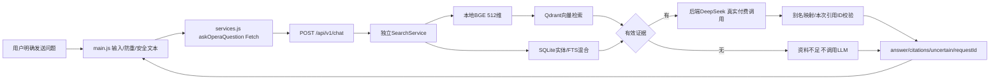
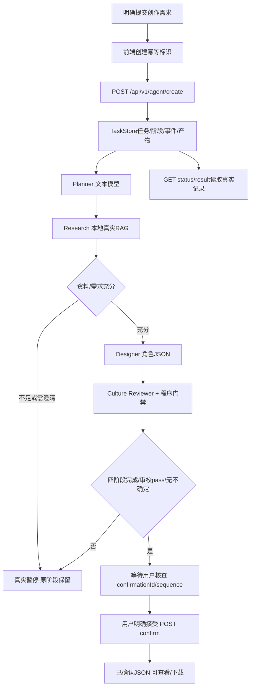
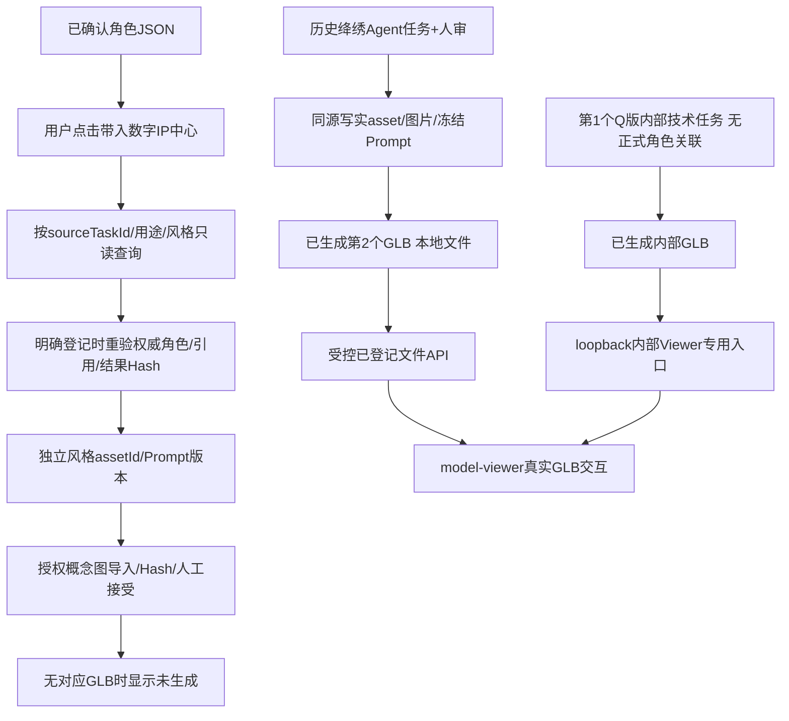

# 戏境 AI · Phase 5 WP1：项目状态校准与端到端流程

日期：2026-10-18，Asia/Shanghai。本工作包仅校准项目/运行文档、根据实际代码梳理流程并免费验证；不实施WP2～WP5。

## 1. 阶段与Git基线

- 用户在[本次完整指令](../prompts/phase-05/03-wp1-approved-user-request.txt)中明确批准Phase 5检查点A，但只授权WP1。
- 起点仓库`D:\京剧\京剧`，分支`feature/phase4-neural4d`，HEAD `8d5de53fd74941fbf827fe2792a6d4f41df38764`，工作区干净，没有未提交用户修改。
- 读取实际[检查点A审查](phase-05-project-audit.md)、[实施方案](phase-05-implementation-proposal.md)、[演示计划](phase-05-demo-plan.md)及[Phase 1](phase-01.md)/[Phase 2](phase-02.md)/[Phase 3](phase-03.md)/[Phase 4最终](phase-04-final-acceptance.md)。原阶段报告的历史“待验收”是当时快照；用户本次确认前四阶段按约定已验收。
- 核对干净状态后，从该提交新建`feature/phase5-competition-delivery`。不重置历史、不改旧报告、不合并main、不推送。
- WP1范围内的工作已完成，当前状态为`PHASE_5_WP1_WAITING_ACCEPTANCE`。本文第7～9节与[本轮测试报告](../evidence/test-results/phase-05-wp1-test-report.md)记录实际结果，不将项目级遗留问题或后续工作包计为本次完成。

## 2. 本次允许与实际修改

正式修改前向用户说明了范围：README、模板路径说明、WP1报告/证据与Prompt。没有修改8个HTML、CSS、前端JS、后端业务、知识语料、冻结Prompt、生成配额或真实模型。

| 文件 | 本次修改/新增及原因 |
|---|---|
| `README.md` | 更新Phase 1～4验收、Phase 5仅WP1、两模型/2次/第三取消；整理已有环境启动、首次准备、私有资源和历史工具边界；去掉主流程中易误执行的付费命令 |
| `.env.example` | 将两行固定D盘RAG/BGE路径改为可选注释，默认采用已有代码的仓库父目录；不改成空Path，不改变私有env |
| 本报告 | 真实流程、状态矩阵、问题及验收清单 |
| `docs/evidence/test-results/phase-05-wp1-test-report.md`及同名证据目录 | 新测试结果/脚本/失败与复测，不覆盖历史证据 |
| `docs/prompts/phase-05/` | 保存本次完整附件、实际公开过程和工程摘要，保留检查点A快照 |

必要的测试隔离辅助仅在独立测试进程操作临时路径，并随证据保存；不是产品功能或生产配额覆盖开关。没有为了过时页面提示扩展到WP2/3：界面中“首次建模”等文案作为后续问题保留，本次通过当前运行指引澄清。

## 3. A：实际端到端流程图

### 3.1 京剧问答

代码：`js/ai-workshop/main.js:297–348`→`services.js:115–141`→`backend/app/main.py:132–159`→`services/search.py:18–57`、`services/chat.py:12–40`、`providers/llm.py:37–109`。界面不是固定回答；证据从真实SQLite片段映射，模型不得自造引用。问题各自独立检索，没有已实现的服务器跨问记忆。资料不足与调用错误不同；后者显示结构化错误、允许明确手动恢复，不自动付费重试。

本WP1只请求本地知识检索，不调用`/chat`或DeepSeek。免费检索实读证据与canonical SQLite逐字段比较，不能把它写成“本轮真实LLM回答成功”。

### 3.2 Agent、人审与文字角色

代码：`api/agents.py:38–65`、`agents/supervisor.py:67–99`、`agents/workflow.py:43–93`、`agents/store.py:161–179,237–253`。正常路径是3次文本模型调用，Research不是第4次聊天。JSON包含定位、服饰/配色/元素、原创/有据区分、文化引用、审校、版本及确认状态。后端人审门禁不是仅禁用按钮；不足/审校问题不能直接接受导出。

查看失败任务时，已经产出的计划/研究、阶段摘要与事件保留；尚无design/review时`result`会409，不伪造完整JSON。已有方案仍按真实`canAccept/publicationAllowed`限制接受/下载。刷新恢复session中的taskId只GET查询；重启将被中断的waiting/running记中断失败，不自动重发。**已有记录读取不是实时执行，更不是静态模拟回放**；目前没有便捷历史ID输入或新回放引擎，本次不开发。

### 3.3 角色资产与两个历史真实模型

本图没有从新角色到新Neural4D创建的箭头：**现有GLB是历史生成资产，新需求不会自动变成旧模型或触发新建**。`agent-workflow.js:334–336`只传已确认taskId；`digital-assets.js:247–259,327–332`按任务/用途/风格读取；`assets/service.py:91–159`及`store.py`维护权威快照和归属。缺少对应风格不取另一个角色模型充数。

| 资产 | 实际入口、标识与文件 |
|---|---|
| 内部Q版 | task `bb074c31-1905-45b6-b763-22d065ddc616`，model `3777a880-fc8c-4766-aade-948d20c6b8f0`；[内部Viewer](http://127.0.0.1:8000/api/v1/assets/internal-models/3777a880-fc8c-4766-aade-948d20c6b8f0/viewer)；无正式character/asset/sourceTask，internalUseOnly=true，不公开/商用 |
| 写实绛绣 | Agent task `ca7007e7-e535-4b1f-a9b6-1932f10e20b4`；character `29c8a710-2760-5079-a2c6-0b6d3f1067b1`；asset `9e2b42e1-bbad-4a2f-ab1b-aeda18015dee`；model `1fa0b519-caf4-4009-aec2-f20b0f9a3523`；[已有写实模型](http://127.0.0.1:8000/about.html?assetId=9e2b42e1-bbad-4a2f-ab1b-aeda18015dee#ai-workshop-model) |

两份兼容GLB在仓库父目录`.runtime/xijing-ai/assets/models/<Hash>.glb`；Q版Hash `bf9c808c15dbf5464ee67df1cdb3f64f9b2c6b3cd4ee41ecb8a6470a0554654a`、8,827,324字节；写实Hash `5a021ac6338009615e6ea232c5b9001eef6f4cc91d9d87c3eeeb5307526bdfd5`、15,158,668字节。纹理均内嵌，无需额外签名URL或外部贴图。原文件位于同assets下`recovery-quarantine`，本轮前后Hash均保持一致，证据见测试报告。

`model-viewer-adapter.js:111–192`加载已登记URL，提供鼠标相机控制、触摸模式、缩放/Reset、Loading/Ready/Error/超时及显式重载原文件。恢复只加载同一文件，不重新建模；本轮未做移动手势或状态故障注入，相关历史证据不改日期冒充新测。

### 3.4 个人与企业模式

文化问答用于知识解释；Agent用于文化角色文字创作；Viewer用于已有3D资产查看。这三个入口有真实实现但不等于每次输入都会完成实时图片/成模。

企业简报在`about.html:276–292`，`digital-assets.js:319–325`仅把机构/受众/场景/目标/文化边界/交付及许可填入共用Agent表单，用户仍需明确提交。企业资产登记会保存`enterpriseBrief`并重验文化角色；没有单独的企业Agent引擎。当前catalog3条正式资产均personal，**没有企业真实客户/订单/收入、企业成模案例、商用资产或企业部署认证**。

## 4. B：功能状态矩阵

`VERIFIED`附具体范围；历史证据与本轮免费实测分开。`IMPLEMENTED_UNVERIFIED`不表示程序已知坏，只表示本轮没有相应真实验证。

| 能力 | 状态 | 依据/范围 |
|---|---|---|
| 现有本地服务启动、8页与健康/资产能力 | VERIFIED | 本轮启动与Chrome/HTTP，见测试报告；健康不是付费连通探测 |
| 本地真实BGE/Qdrant检索与SQLite来源关联 | VERIFIED | 本轮1题真实免费检索及逐片段核对；不是20题新评价或人工Gold |
| DeepSeek真实生成/今日权限余额 | IMPLEMENTED_UNVERIFIED | 代码与历史真实证据存在，本WP1禁止付费，未进行新调用 |
| 无证据/无效引用/异常的业务逻辑 | VERIFIED | 历史证据及本轮隔离Mock验证范围见JUnit；不冒充真实外部错误测试 |
| 四Agent顺序、暂停、确认门禁、JSON | VERIFIED | 代码/历史实测、本轮读取真实已确认角色及离线逻辑；本轮没有新建真实Agent |
| 历史任务查看与角色归属 | VERIFIED | 对既有绛绣status/result只GET，四阶段、人审和JSON字段一致 |
| 两真实GLB加载、桌面拖拽/缩放/Reset | VERIFIED | 本轮Chrome分别实测，模型ID/Hash一致，不用图片/Duck充数 |
| 缺失风格提示与恢复原写实模型 | VERIFIED | 本轮切Q版清空Viewer→切回原写实 |
| Loading/Error/恢复、移动手势实现 | VERIFIED | 10月17日历史实测及本轮离线范围；WP1未重做故障注入/移动模拟 |
| 实体手机/移动GPU性能 | IMPLEMENTED_UNVERIFIED | 代码支持触摸，但没有实体设备验收；不能将CDP说成真机 |
| 角色→风格Prompt/图片导入 | VERIFIED | 既有实现/历史及本轮离线合约；本轮不登记/修改正式资产 |
| 平台图像生成 | PLANNED | Provider仍未接入，仅图片导入 |
| 任意新角色自动得到已有GLB | NOT_APPLICABLE | 不应实现，违背真实角色/资产归属与本轮禁建模约束 |
| Neural4D新建 | BLOCKED | 用户明确禁止；已用2/3剩1、开关false、无未消费审批，不是故障待重试 |
| 第三次企业建模 | NOT_APPLICABLE | 用户决定不执行，未创建、不算失败、不消耗剩余1次 |
| 企业需求入口/共用流程 | VERIFIED | 实际代码、既有离线测试；本轮不真实提交企业Agent或伪造客户案例 |
| 企业商业交付闭环 | PLANNED | 无真实业务/商用交付证据，不计为本包已完成 |
| 便捷历史ID入口/比赛导览 | PLANNED | 属后续WP2/3，本包未开发 |
| 静态演示回放模块 | NOT_APPLICABLE | 当前仅历史记录及截图，不宣称已有播放引擎 |

## 5. C：问题及差距清单

本包不将所有演示差距都叫P0。P0指核心运行阻断或严重安全问题；P1影响核心演示；P2影响易用性/文档；P3可后续完善。

| ID/级别 | 现象与复现 | 原因/影响 | 措施及验证要求 |
|---|---|---|---|
| WP1-01 / P1 | 原README同时出现2/3和“尚未提交/1次/第二待批准” | 历史摘要混在当前状态；误导运行/授权 | 已统一当前摘要，把旧过程明确日期并链接原报告；静态关键词与原报告对照 |
| WP1-02 / P2 | 新机器直接复制.env.example仍指原D盘 | 模板覆盖已有按仓库父目录的默认；可能找不到缓存 | 已将两路径改可选注释；空值不作为Path；显式模板配置检查，不碰私有env |
| WP1-03 / P1 | clone后直接打开成品链接缺记录/文件 | 真实GLB/图片/任务及资产DB不在Git，不是模型生成失败 | 已补资源类别、来源/准备方式、缺失行为及受控交付边界；迁移包留后续，不自动拉资源 |
| WP1-04 / P1 | 直接pytest收集import main先构造默认app | autouse夹具晚于导入；可能初始化生产库，不宜称严格生产隔离 | 用独立测试进程、收集前空env/临时目录/固定canonical一致性及文件/HTTP守卫；不改产品代码；保留辅助隔离失败，完整结果见测试报告 |
| WP1-05 / P2 | 一些“免费检查”实际含旧创建拒绝探针或供应商查询 | 旧脚本固定未知/0次假设，或会执行POST/变更 | README排除旧phase4_http_smoke、evaluate_agent_api、余额/恢复等当前禁用工具；仅核对源码，不执行 |
| WP1-06 / P1 | 新Agent文字结果没有对应GLB | 资产按任务/结果Hash归属，不是通用模型随意替换 | 文档明确两条路径与未生成状态；浏览器证实绛绣缺Q版，不改归属/不重新建模 |
| WP1-07 / P2 | 页面仍写“首次建模需授权”、确认事件仍有旧未接入措辞 | `digital-assets.js:106–109`、`agents/store.py:253`是旧展示消息，不代表后台创建开放 | 本WP1已通过文档澄清；不越界改UI/业务，后续获准再最小修文案，旧事件不可重写 |
| WP1-08 / P1 | 换会话无便捷旧任务入口 | 只恢复sessionStorage的一个taskId；既有GET实际可读 | 记录并建议WP2增加只读恢复；本包不开发，不重新提交来冒充恢复 |
| WP1-09 / P2 | health就绪容易被理解为实时联网成功 | 供应商验证只读成功记录/配置指纹；未检测今日网络/余额 | README明确含义，既有失败反馈保留；后续若改善文案另包，不添加付费轮询 |
| WP1-10 / P1 | Q版内部页在手机LAN/公开视频不可直接使用 | loopback与内部用途是原有约束，不是应绕过的Bug | 主展示用写实；实体设备/公开范围待确认，不解除鉴权或扩大许可 |
| WP1-11 / P3 | 无专家Gold、独立盲测、商业案例/游戏生产认证 | 原数据与模型用途的已知范围 | 保留限制，不编造正确率、客户、收入或骨骼动画能力 |

初次本地服务未运行/未就绪造成连接拒绝，确认startup后恢复；这是运行前提，不归因网页Bug。浏览器切页媒体/内部模型请求取消有真实记录，最终Ready与资源可用性分开说明。

## 6. 运行说明与历史保护

README已区分：已有环境只启动 → 新环境按需安装/下载/入库（本轮未执行）→ 明确收费/有副作用的历史工具（本轮不执行）。当前uvicorn同源8000、127.0.0.1、单worker；启动会初始化库/恢复中断状态，不声称只读。停止用原终端Ctrl+C，不删锁或杀未知进程。

资料从`active.json`所选generation读取，不是RAG根下固定knowledge.sqlite3。引用是助手核查的原创事实摘要，不是官方逐字原文。预算、Key、BGE、Qdrant、GLB及内嵌纹理/资产库边界均已列出；没有生成私有资产包或复制真实Key/模型到Git。

## 7. 测试与真实失败

本轮实际测试环境、命令、时间、数量、成功/失败/跳过及隔离辅助的失败修复，集中记录于[WP1测试报告](../evidence/test-results/phase-05-wp1-test-report.md)。最终run04完整执行后端675项，675通过、0失败、0跳过，pytest及辅助退出码均为0，保留1条既有弃用警告；此前三轮隔离辅助失败原样归档，不计为成功回归。前端三组分别25、25、36项通过；本地HTTP/真实检索8项通过；Chrome必要检查4组通过，含8页和两个真实GLB。

本轮桌面写实模型拖拽323.6°、内部Q版453.7°，缩放/Reset、缺失风格提示及恢复原模型通过。实体手机、移动模拟及Loading/Error故障注入本轮未执行；完整付费端到端问答/新Agent没有重跑。浏览器切页取消记录保留，不把它们改成零错误事件。

本轮不调用付费外部服务：没有POST聊天/Agent创建，没有Neural4D任何请求，没有借测试解开创建锁。本地免费Search POST只运行BGE/Qdrant；前后快照确认LLM累计107次、Neural4D真实HTTP累计18条、建模已用2/3剩1、无未消费审批均不变；两个原始文件、两个兼容GLB与8个HTML的Hash均不变。

## 8. 完成标准核对

以下逐项对应用户本工作包的14条完成标准，验收范围仅WP1：

- [x] README与当前已核实的项目状态一致。
- [x] 关键运行命令与实际模块、脚本、参数核对；未执行的首次安装等步骤明确标注。
- [x] 私有模型、数据库、缓存、图片及配置依赖、缺失行为与许可边界有说明。
- [x] 根据代码梳理RAG真实调用链，区分本轮免费检索与历史付费问答。
- [x] 根据代码梳理Agent顺序、暂停、错误、JSON及后端人工确认门禁。
- [x] 梳理两个真实GLB的资产关联、文件、入口与Viewer展示流程。
- [x] 明确实时执行、持久化历史与未实现静态回放之间的区别。
- [x] 明确企业入口与尚无商业交付/客户案例的边界。
- [x] 建立WP1-01～11问题及后续差距清单，未虚构确定根因。
- [x] 生成实际测试报告，保留失败、复测与未执行事项。
- [x] 修改范围、原始Prompt/公开快照、基线与本地Git变更可追溯。
- [x] 本轮付费API调用为0。
- [x] 本轮Neural4D建模创建及其他供应商请求为0。
- [x] 未实施WP2、WP3、WP4或WP5。

未发现尚未解决的WP1核心运行阻断。项目级限制仍存在：实体手机未验收、今日付费供应商连接未重测、私有资产不能仅靠clone恢复、历史任务入口和少量旧UI措辞待后续工作包；它们没有被标记为本轮已修复或已验证。

Git提交按运行文档校准与测试/证据归档分开。已完成文档提交`f58888bd63050ae6a691c82d76db690e79e11010`（`docs(phase5): align project status and end-to-end guide`），只包含README与.env.example。本文、Prompt及本轮证据在随后独立归档提交中保存；归档Hash和提交后工作区状态由实际`git log --oneline -2`及最终交付回复提供，不自引用尚不存在的提交Hash、不重写历史、不推送远端。

## 9. 停止与下一工作包

当前只处理WP1。WP2只读历史入口需在本包人工验收后另获指令；WP3导览、WP4最终测试包和WP5交付材料均未实施。第三次建模始终取消，余1次不作未来自动调用授权。

当前交付状态为`PHASE_5_WP1_WAITING_ACCEPTANCE`，等待用户人工验收；不自行进入WP2。
